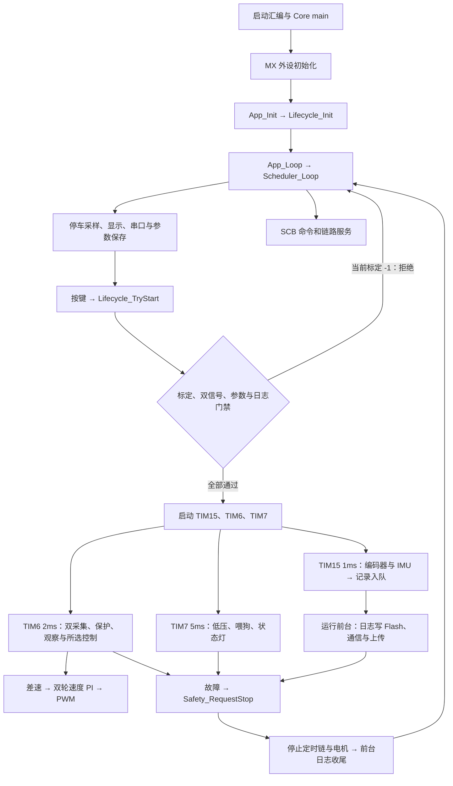
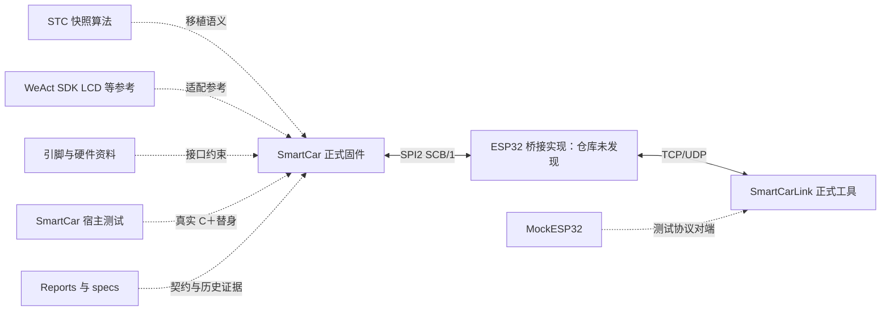

# STM32H7 工作区代码结构与用途分析

审查日期：2026-10-31。仓库：`E:\study\Intelligent Vehicle\STM32H7`。基线提交：`7961f2da3e31acd0cc59457606c8d7c2348af06f`。

## 1. 总体结论与判定口径

工作区有三个主要代码区域：**SmartCar 是当前 STM32 正式固件，Tools 是电脑端正式工具及其测试，Material 是原始算法、厂商示例和辅助资料**。不能把“有 main”“名字带 test”“被测试调用”“放在 build 下”直接等同于正式代码或测试代码。

关键结论：

1. `SmartCar/Core → App → BSP` 已形成启动、停车前台、定时控制、安全停车、参数、记录和通信的真实源码链路。当前 `gray_calibration.h` 的 32 个标定值全部为 `-1`，`Lifecycle_TryStart()` 在开启定时链前拒绝起跑。因此下文的“活动运行链”表示正式入口有调用路径，**不表示当前未标定工作区可以直接跑车**。
2. `SmartCar/tests/*.py` 大量采用“真实 C 模块＋临时生成的测试 main＋假 BSP/HAL”的宿主测试方式。测试中出现的 C 函数、示例标定、虚拟 Flash 和模拟时钟，不是正式硬件实现。
3. 正式目录中也有测试专用接口：`Lifecycle_TestSetRunState()` 受 `SMARTCAR_HOST_TEST` 控制；当前 GCC 正式脚本没有定义该宏。反过来，正式模块被测试导入或编译，不会因此变成测试专用模块。
4. `legacy_*` 混有活动辅助路径和休眠算法。例如 `legacy_pid.c` 的停车预览、`legacy_roundabout.c` 的起跑复位仍有正式调用，不能按整个文件统一判为无用。
5. `Tools/SmartCarLink` 是实际电脑端工具；`tests/mock_esp32.py` 才是模拟设备。工作区没有发现独立的 `ESP32Bridge/` 工程，也没有发现 ESP-IDF 的 `CMakeLists.txt`；`Material/ESP32-S3-DevKitM-1` 只有资料。当前仓库无法提供完整的 STM32—ESP32—电脑实机闭环。
6. `Material/MiniSTM32H7xx-master/SDK/HAL` 有 H743/H750 各 11 个、共 22 个独立示例工程；这些是厂商模块演示，不是 SmartCar 的 22 套运行入口。STC 快照中的 `whole_test()` 被其原始定时控制链调用，不能因名字带 test 判成 AI 测试脚手架。
7. `SmartCar/MDK-GCC/build` 根层有 36 个一次性 Python 脚本，既有审计/构建，也有直接修改 App、工程选项或规约的重构脚本。它们不进入固件，但也不全是“为了测试写的代码”。

### 1.1 用途标签

| 标签 | 判定依据 | 含义与限制 |
|---|---|---|
| 正式活动 | 正式入口、前台、ISR 或业务模块存在可追踪调用 | 仍受启动、模式、外设和输入条件约束 |
| 条件活动 | 编译宏、运行状态或所选模式决定执行 | 当前不执行不等于测试代码 |
| 休眠保留 | 有定义或旧内部调用，但没有当前活动入口调用链 | 不等于已删除，也不等于可直接删除 |
| 测试专用 | 测试驱动、断言、替身、故障注入或固定向量 | 不承担真实设备功能 |
| 工程辅助 | 构建、烧录、资源审计、索引、文档生成 | 不进入业务程序，但有开发用途 |
| 参考/历史 | 厂商示例、原平台快照、临时副本和旧产物 | 对当前程序的关系是参照或证据，须避免重复统计 |

“参与编译”“最终链接保留”“入口可达”“启用条件满足”“实机验收通过”是五种不同结论。本次核对源码和工程清单，**没有重建 ARM 固件，也没有证明现存 ELF/map 与当前源码逐字节对应**；表中的参与构建不能代替链接保留结论。GCC 使用 `-ffunction-sections -fdata-sections` 和 `--gc-sections`，一个参与编译的文件可只有部分函数进入最终镜像。中断向量、HAL 强符号回调及函数指针注册需要作为额外根检查，不能只搜索普通函数调用。

### 1.2 作者来源与 AI 生成的边界

用途可以通过调用和生成关系确认；作者来源需要另外的证据。源码有明确 STM32Cube/ST、WeAct 或逐飞/STC 出处时记录其来源；agent 任务书能证明任务曾按智能体协作方式设计，但不能逐文件证明是谁写的。本次没有读取聊天历史或获得逐文件 AI 生成记录，因此**自维护测试、一次性改写脚本和引脚图脚本的 AI 作者来源统一为“未确认”**。可以确定的是哪些代码由 Python 在测试期间生成，不能把“脚本生成”直接改写成“AI 生成”。

### 1.3 调查范围与已有改动

开始时 `git status --short` 有 267 条状态记录：2 条已跟踪修改，以及 265 条未跟踪记录；默认状态输出会折叠目录，这不是文件总数。已跟踪修改为 `Hardware/STM32H7_Car/STM32H7_Car.kicad_pcb` 与 `.kicad_pro`。未跟踪内容包括该目录 `.hq/`、已有分析报告及大量 GCC 构建/审计遗留。本报告不修改这些内容；调查期间其他任务新增的报告同样保留。

```text
STM32H7/
├─ SmartCar/        当前 STM32 固件、规约、宿主测试与构建证据
│  ├─ Core/         main、外设初始化、异常/中断入口
│  ├─ App/          固定入口＋system/sensing/control/services/hmi
│  ├─ BSP/          自维护板级驱动与 lcd 组件
│  ├─ Drivers/      HAL/CMSIS 依赖
│  ├─ tests/        25 个 Python 文件＋固定向量和结果
│  ├─ MDK-ARM/      Keil 工程与附属选项
│  ├─ MDK-GCC/      构建、链接、启动、烧录及 build 历史目录
│  └─ specs/        项目约束、功能契约、迁移与验证记录
├─ Tools/SmartCarLink/  11 个根层 Python 模块＋11 个 tests 文件
├─ Material/
│  ├─ MiniSTM32H7xx-master/  核心板 SDK、硬件资料和工具
│  ├─ Sirius20260718/       STC 原始算法与库快照
│  ├─ ESP32-S3-DevKitM-1/   PDF/DXF 资料
│  └─ 引脚分配/             接口表、引脚图与两个生成脚本
├─ Hardware/        KiCad 设计、库、器件资料与分析结果
├─ Reports/         研究报告、审查报告、任务书及压缩归档
├─ .vscode/         仓库级构建/烧录/清理入口
└─ .git/、.gitignore、AGENTS.md  版本与协作规则
```

统计按当前实际文件检查：App 45 C＋50 H；BSP 含 lcd 19 C＋21 H；Core 11 C＋10 H。第三方重复库和 build 源码副本不并入这三组当前源码统计。

## 2. SmartCar：正式固件、测试与历史遗留

### 2.1 构建边界

| 路径 | 分类 | 证据与用途 |
|---|---|---|
| `Core/Src/*.c` | 正式构建 | `MDK-GCC/build.sh` 明确扫描；main 调用 App，中断入口交 HAL 分发 |
| `App/*.c` 及五类目录 `*.c` | 正式构建 | GCC 显式列出六组；Keil 中 45 个 App C 各出现一次 |
| `BSP/*.c`、`BSP/lcd/*.c` | 正式构建 | GCC 显式扫描，不通过 Material 示例工程构建 |
| `Drivers/STM32H7xx_HAL_Driver/Src/*.c` | 第三方构建依赖 | GCC 按通配扫描，实际保留由引用和链接回收决定；CMSIS 提供内核/设备头和支持 |
| `MDK-GCC/startup_stm32h743xx.s`、`.ld` | 正式启动/链接 | 汇编启动、向量及内存布局；不是测试入口 |
| `MDK-ARM/SmartCar.uvprojx`、`.uvoptx` | 工程配置 | 主工程清单 99 C＋1 汇编；App 清单与当前源码核对通过；本次未运行 AC5 |
| `SmartCar.ioc` | 外设配置源 | 参与再生成与配置核对，不是 C 运行模块 |
| `tests/`、`specs/`、`MDK-GCC/build/` | 非正式源码扫描范围 | 不在正式 GCC 通配输入中；其中可能存在与正式源同名的副本 |
| `MDK-GCC/SmartCar.elf`、hex/bin、map、对象文件 | 构建产物 | 不能用文件存在证明当前源码已构建或实机可用 |

Keil 和 GCC 均在本仓库使用 `SmartCar` 自己的源文件，不会自动把 `Material` 的 SDK/main 或 Python 测试生成的 `main.c` 合并进来。GCC 与 Keil 的第三方源清单不应假定完全一致；本次确认的全量一致性范围是 App，未把 Keil 配置核对称为 AC5 编译验收。

### 2.2 主要运行链路



源码定位：`Core/Src/main.c` 的 `App_Init/App_Loop`；`Core/Src/stm32h7xx_it.c` 的 TIM6/TIM7 IRQ；`BSP/bsp_runtime.c::HAL_TIM_PeriodElapsedCallback`；`BSP/bsp_sampler.c::TIM15_IRQHandler`；`App/system/scheduler.c` 四个调度入口。

当前默认 `LCD_TARGET_EXTERNAL=0`、`DATALOG_ENABLE=1`、`DATALOG_DIV=1`、`APP_WDG_ENABLE=1`；启动等待是 `control_ticks > 1000`，控制拍 2ms。`tracking.c` 初值选择光电模式，档位零初始化为低档。TIM15 与 TIM6 同优先级、互不抢占；TIM7 是低一级辅助线。

停车前台仍会刷新电感、灰度、电池、显示和串口，并服务 SCB；并非标定失败就整机什么都不做。运行时主循环不刷新 LCD，负责日志写入与通信。两套观察器在控制拍中推进，只有选中模式把方向/速度写入共享执行链；另一套是正式影子观察，不是测试替身。

### 2.3 App 模块逐项分类

以下模块名相对 `SmartCar/App/`；有同名 C/H 时按一组列出，H 是该模块契约，不单独算可执行逻辑。除专门列出的条件接口外，所有 45 个 C 都在正式 GCC 扫描范围中；“休眠”表示当前活动调用链未接入，不能据此断言整个对象不会被链接。

| 区域/模块 | 职责 | 用途与调用证据 | 启用/验证边界 |
|---|---|---|---|
| 根 `app` | 固定总装与 ISR 转发 | 正式；main/BSP 回调 → lifecycle/scheduler/safety | 已核对源码入口 |
| 根 `app_config.h`、`app_types.h` | 开关、时序常量、业务公共类型 | 正式编译契约 | 不是测试参数表 |
| system/lifecycle | 初始化、起跑、模式切换、运行标志 | 正式；scheduler 按键/命令调用 | 受标定、双信号、保存、日志门禁约束 |
| system/scheduler | 停车/运行前台及 1/2/5ms 编排 | 正式；App 转发 | 三线实际启动前不执行运行控制 |
| system/safety | 保护、首因锁存、紧急停车与收尾 | 正式；控制、低压、日志错误调用 | 收尾在前台完成 |
| system/parameter_application | 参数加载/应用、保存协调 | 正式；初始化、菜单、旧串口、起跑调用 | 区别 RAM 生效与 Flash 保存 |
| system/tuning_application | 调参上下文与跨模块生效协调 | 正式；控制拍及命令分发调用 | 实际覆盖受运行/模式/元素状态约束 |
| sensing/track_sensor | 四路电感滤波、偏差、观察量发布 | 正式；停车与控制拍调用 | 电磁保护在两模式都使用 |
| sensing/gray_sensor | 标定检查、归一化、质心与失线 | 正式；停车与控制拍调用 | 当前标定无效，不能起跑 |
| sensing/gray_calibration.h | 16 路黑/白实测表 | 正式配置；gray_sensor 使用 | 当前 32 项均为 -1；测试有效值只在临时夹具 |
| sensing/imu_proc | 零偏、缓存陀螺积分与复位 | 混合；Init/CalibrateGyro/UpdateGyroAngle 有活动调用 | AccelVelocity/CalibrateAccel 包装没有当前活动入口 |
| sensing/legacy_imu | 旧加速度标定/积分实现 | 休眠；仅由上述旧包装调用 | 不是假 IMU；保留原算法语义 |
| sensing/battery | 电池 ADC 与低通 | 正式；停车前台与 TIM7 调用 | 低压停车由 safety 判定 |
| sensing/filter | 低通/高通算子 | 正式依赖；电感、电池、轮速及 IMU 使用 | 各算子使用情况依调用分开判断 |
| control/tracking | 双模式观察、唯一执行、监视字段 | 正式；TIM6 的 Observe/Execute/Complete | 只让选中模式控制电机 |
| control/electromagnetic_fsm | 独立电磁状态与方向历史 | 正式；tracking 调用 Select/Calculate | 活动十字、预环岛、右环岛；Update 整体包装非当前主调用 |
| control/optical_fsm | 光电等待、循迹与保护观察 | 正式；tracking 调用 | 首版普通循迹，没有光电元素算法 |
| control/control_profile | 状态参数剖面、权重与应用 | 正式与旧入口共享 | 电磁活动路径使用；表中存在状态不证明有进入该状态的活动转移 |
| control/direction_controller | 显式参数和历史的方向计算 | 正式；两个 FSM 和旧 PID 调用 | 并非因无 HAL 就是测试算子 |
| control/speed_controller | 双轮位置式 PI 与历史 | 正式；pid → motor 控制链 | 当前速度环使用这套实现 |
| control/pid | 增益、输出协调与控制器接口 | 正式，部分旧角度包装休眠 | ResetAll 仍复位角度与旧方向历史 |
| control/motor | 编码器滤波、差速、轮速 PI、PWM | 正式；初始化/控制/安全路径 | 硬件输出与纯算法层分开 |
| control/tuning | 调参事务和覆盖状态 | 正式；command_dispatch 与控制拍协作 | 测试中的禁用替身不属于此实现 |
| control/tuning_values | 参数组范围与类型校验 | 正式；业务/编码层复用 | 参数校验属于产品行为 |
| control/legacy_pid | 旧共享方向历史、旧增量 PI | 混合；scheduler 停车调用 PID_UpdateTrack，PID_ResetAll 调用复位 | 左右增量 PI 无当前活动调用 |
| control/legacy_roundabout | 原环岛判定/执行与状态复位 | 混合；Lifecycle_ResetRunState 调用 Roundabout_ResetRunState | 旧 Update/Judge 链休眠，当前右环由 electromagnetic_fsm 执行 |
| control/legacy_element | 原元素汇总与单元素判断 | 休眠；旧函数间保留调用边 | 无活动调度入口；左环/跷跷板/路障未因此启用 |
| control/legacy_control | 整体控制与角度执行包装 | 休眠；Control_UpdateLegacy/PID_UpdateAngle 不在当前 scheduler 链 | 宿主回归会调用，仍是保留生产算法代码 |
| control/angle_controller | 角度算法与历史 | 混合；活动 PID_ResetAll → Reset | Update 仅见旧角度包装链，当前活动链不执行角度控制 |
| services/parameter_bank | 双模式双档参数 owner | 正式；参数应用、记录、命令查询使用 | RAM 组织，不是测试 fixture |
| services/parameter_store | 参数镜像编码/迁移及 Flash 保存 | 正式；parameter_application 调用 | 持久化成功需真实 Flash 证明 |
| services/parameter_image.h | 参数持久化布局 | 正式数据契约 | 不是孤立无用头文件 |
| services/run_record | 256B 头、96B 控制快照与采样记录组装 | 正式；控制发布与采样入队使用 | 布局有静态断言 |
| services/logger | 会话、RAM 队列、Flash 刷写 | 正式；Datalog_Start/Push/Service | 1ms 入队，前台刷写；异常可停车 |
| services/log_store | 日志 Flash 后端 | 正式；logger/export 经此访问日志区 | 不同于测试内存 Flash |
| services/log_export | 原始日志、CSV 导出事务 | 正式；旧串口和 SCB 导出使用 | 停车、收尾和互斥门禁 |
| services/datalog.h | 日志聚合公开类型/接口 | 正式契约 | 没有同名 datalog.c 是拆分后的结构，不是实现丢失 |
| services/checksum | CRC32 | 正式；协议/日志相关模块使用 | Python zlib 可作独立测试对照 |
| services/scb_frame | SCB/1 32B 帧头与字节编解码 | 正式；scb_link 使用 | SPI 交换单元与 TCP 有效帧边界不同 |
| services/scb_json | 有界 JSON 扫描与格式化 | 正式；command codec/dispatch 使用 | 非测试 JSON 解析器 |
| services/scb_command_codec | 协议命令/结果转换 | 正式；dispatch 路由 | 区别协议状态与业务调参类型 |
| services/scb_link | 会话、可靠传输、请求缓存及事件队列 | 正式；前台 CommandDispatch_ServiceLink → SCB_Service | 真实通信仍需 ESP 桥接端 |
| services/command_dispatch | 命令路由、结果和事件适配 | 正式；前台服务、ISR 事件描述入队 | 不在高优先级控制 ISR 做完整网络业务 |
| services/telemetry | 与 Flash 独立的上传队列 | 正式；记录支路生产、前台消费 | 上传拥堵可丢上传；不能等同 Flash 日志故障 |
| services/wireless | 旧串口调参、日志命令 | 正式；停车前台 Wireless_Adjust | 与 SCB 网络协议并存 |
| hmi/dashboard | 板载屏单页仪表盘 | 当前条件活动；LCD=0 时前台刷新 | 本工作区默认路径 |
| hmi/menu | 菜单状态、档位与编辑 | 正式共享状态＋外接屏交互 | 默认不从 scheduler 执行完整 Menu_Update，不等于状态无人使用 |
| hmi/menu_keys | ADC 按键识别与显示滤波 | 条件交互/显示依赖 | 依使用方区分，不能把 ADC 键与 PC13 起跑键混为一物 |
| hmi/menu_render | 外接菜单绘制与缓存 | 条件活动；LCD=1 路径 | 当前 LCD=0，不属于测试专用 |

特别注意：`LegacyIMU_UpdateAccelVelocity()` 被另一个旧包装调用，不能只看到“有引用”就声称进入活动 IMU 链；`Roundabout_ResetRunState()` 有起跑调用，也不能倒推出旧环岛 Update 已启用。休眠算法仍有宿主回归价值，其去留不在本次任务范围。

### 2.4 BSP 与 Core 的实际职责

| 模块（相对 BSP） | 分类与正式使用者 | 真实硬件职责/入口 |
|---|---|---|
| bsp_adc | 正式；track/battery/按键/gray | ADC1 十通道 DMA 与读取接口 |
| bsp_gray | 正式；gray_sensor | 四选择线控制和 16 路模拟灰度帧采集 |
| bsp_time | 正式；调度/驱动/并发模块 | DWT 周期、tick、临界区与内存屏障 |
| bsp_runtime | 正式；lifecycle/safety | 定时器启停、状态灯、SPI 时钟及 HAL TIM6/7 回调 |
| bsp_sampler | 正式；1ms IRQ 与 motor/imu | TIM15 编码器读清、累计和 IMU 缓存，再调 App_SampleISR |
| bsp_encoder | 正式；motor/sampler | TIM5/TIM3 编码器与方向接口 |
| bsp_pwm | 正式；motor、安全及初始化 | 左右轮/风扇占空比和实际计数换算 |
| bsp_key | 正式；scheduler/lifecycle | PC13 短按起跑、长按模式切换及释放武装 |
| bsp_uart | 正式；日志/旧串口/调试 | USART1 中断接收、发送与 printf 重定向 |
| bsp_imu660rb | 正式；sampler/imu 初始化校准 | SPI4 IMU 寄存器读写；部分旧接口只供休眠链 |
| bsp_dl1b | 正式；初始化和 TIM6 | I2C2 激光测距 |
| bsp_w25q64 | 正式后端；bsp_flash | SPI1 外部 Flash 指令、擦写读取 |
| bsp_flash | 正式；参数/日志后端 | 外部 Flash 参数区和日志区服务 |
| bsp_wifi | 正式；scb_link | SPI2 DMA、READY/EXTI、完成回调和错误恢复 |
| bsp_wdt | 正式；生命周期、TIM7、停车前台 | IWDG 配置和喂狗；首次成功起跑才开始 |
| bsp_lcd | 正式；dashboard/menu | SPI4 字符绘制与背光，停车态使用 |
| lcd/lcd | 正式 LCD 胶水 | 注册总线、面板方向和显示操作 |
| lcd/st7735、lcd/st7735_reg | 第三方组件依赖 | ST7735 面板组件与寄存器层；不是独立 LCD 测试工程 |
| bsp.h、lcd/font.h 等无 C 头文件 | 正式接口/字模依赖 | 聚合依赖、常量和数据；无独立函数入口正常 |

Core 的 11 个 C 为 `main`、`adc`、`dma`、`gpio`、`i2c`、`spi`、`tim`、`usart`、`stm32h7xx_hal_msp`、`stm32h7xx_it`、`system_stm32h7xx`。前者总装与调用 App，外设文件提供 MX 初始化，MSP 管理底层引脚/时钟/NVIC，it 提供异常和外设 IRQ，system 提供芯片时钟基础设施。它们是生成代码与 USER CODE 扩展的组合，不能因函数形似模板而判为测试替身。

### 2.5 测试体系：到底生成了什么

典型关系如下：

```text
当前 App C/H
  └─ app_fixture.py → 系统临时目录 smartcar_app_*：扁平副本，仅改 include 分类前缀
测试 Python 中的 HARNESS/STUB/固定数据
  └─ 临时 work：test.c/main.c、bsp.h/main.h、假 Flash/HAL、有效标定、基线源码
      └─ 本机 gcc → Windows 宿主 exe → 断言/字节比较/故障注入
正式 ARM 构建仍只读取 Core/BSP/App/Drivers，不读取上述临时 work。
```

`app_fixture.py` 不是另一套正式 App：它按 basename 唯一定位当前模块，去掉 include 的五类目录前缀，把每个 C/H 拷到临时目录；`host_support.py` 编译真实 C 与替身，使用宿主 `gcc -std=c99 -O2 -Wall -Wextra -Werror`，不是 ARM 交叉编译。

| 文件（相对 tests） | 分类/测试对象 | 生成或依赖关系；是否进入正式固件 |
|---|---|---|
| app_fixture.py | 测试源码适配 | 生成临时 App C/H 副本；不进入 |
| host_support.py | 宿主构建公共工具 | 输出临时 exe；不进入 |
| app_inventory.py | 词法/AST 索引 | 依赖 pycparser；包含条件分支，不等于编译后的可达图；不进入 |
| app_layout_check.py | 布局与工程清单检查 | 用临时 fixture 核对五类、Keil/GCC 覆盖；可选历史 G1 回放；不进入 |
| app_architecture_check.py | 架构边界检查 | 检查 include、状态封装、硬件边界、两份 Keil 清单；可选 JSON 输出；不进入 |
| app_migration_check.py | 迁移追溯检查 | 核对历史/最终符号索引及映射；不进入 |
| comment_review_check.py | 暂存区证据检查 | 检查注释证据与依赖摘要；不能替代人工内容审查；不进入 |
| test_comment_review_check.py | 检查器自身回归 | 创建临时 Git 仓库、模拟暂存和证据变化；不进入 |
| control_equivalence.py | 改造前后真实控制算法比较 | 从 Git 提取 Phase11 基线，生成假 BSP 与 C 驱动，比较当前输出；不进入 |
| dual_mode_tracking.py | 双模式、起停门禁/参数等 | 真实模块＋替代 BSP、测试 main、临时标定和基线 FSM；局部注入/适配只在副本；不进入 |
| datalog_v2.py | 灰度/日志/Flash 故障注入 | 临时 test.c、gray_sensor/bsp_flash/telemetry 适配与内存后端；含未标定场景；不进入 |
| runtime_tuning.py | 调参应用、FSM/PID/参数 | 复用 dual 的驱动，假 SCB 结果/事件缓存与独立方程；不进入 |
| scb_protocol.py | 真实 C codec/JSON/CRC | C 驱动＋固定向量＋Python zlib/JSON 对照；不进入 |
| scb_link.py | 真实 C 会话/重发/请求缓存 | 模拟对端与时间驱动；不是 ESP 桥接固件；不进入 |
| spi_wifi_state.py | 真实 bsp_wifi 状态机 | 复制驱动，以假 HAL 注入 READY/DMA/超时；还在临时副本移除补丁作为负对照；不进入 |
| spi_log_export.py | App/日志/命令导出联动 | 真实 C＋替身，与 Python CRC/时间轴对照；不进入 |
| g2_system.py | G2 系统/硬件适配边界 | 生成 main.h/tim.h/bsp.h 与 C 测试程序；不进入 |
| g3_control.py | G3 控制拆分与休眠入口等价 | 临时驱动、Git 基线与当前纯接口；不进入 |
| g4_boundaries.py | G4 状态 owner 与事件语句静态检查 | 源码/历史语句核对；不进入 |
| g4_hmi.py | 菜单、参数应用、旧 UART 拆分回放 | G3 与当前真实 C＋假板级 IO/控制状态；不进入 |
| g4_legacy_boundary.py | 休眠包装发布顺序回归 | 主动调用旧包装验证顺序，不代表生产启用；不进入 |
| g4_transactions.py | 事务 owner 边界 | 真实事务实现＋无协议/BSP 的驱动；不进入 |
| g5_boundaries.py | 日志/协议拆分及字节一致性 | 临时 main、假 Flash/标定、前后对照；不进入 |
| phase16_check.py | 综合宿主、双 LCD 构建与资源证据 | 可修改配置并恢复，写 build 日志和 phase16.json；本次不执行 |
| phase17_resources.py | 独立前后资源比较 | git archive 基线、当前双 LCD 构建、栈帧规划、恢复产物并写结果；本次不执行 |
| scb_vectors.json | 不可变协议向量 | C 协议测试输入；不进入 |
| results/phase16.json、phase17-validation.json、phase17-resources.json | 历史验证记录 | 不是测试程序、不是当前硬件状态 |

测试中 `main()` 可能被内嵌在 Python 字符串里，不会被普通 `.c` 文件搜索完整列出。有效灰度标定、虚拟 Flash、假时钟和假 DMA 回调均为构造边界条件而存在。`SMARTCAR_HOST_TEST` 只控制生命周期测试置值入口；并非全部测试都靠同一宏替换硬件，多数通过临时头文件、源码适配及链接替身完成。

### 2.6 build 遗留：测试代码、改写脚本与历史副本分开

| 路径/家族（相对 MDK-GCC/build） | 实际角色 | 与当前正式程序的关系 |
|---|---|---|
| `g2_refactor.py`、`g3_refactor.py`、`phase17-g4-refactor.py`、`phase17-g5-apply.py` | 一次性实现/重构改写工具 | 会写正式源；不是运行依赖，也不是只读测试 |
| `g2_polish.py`、`g3_headers.py`、`g3_polish.py`、`g3_finalize.py`、`phase17-g4-comments.py/style.py/followup.py/tuning.py/repair.py`、`phase17-g5-polish.py`、`phase17-g6-comments.py` | 整理、修补或注释迁移 | 部分通过 exec 复用其他脚本，因此自身没有 write_text 也不能认定无写入 |
| `g2_test_adapt.py`、`g3_tests_adapt.py`、`phase17-g4-test-adapt.py` | 测试适配改写工具 | 修改测试本身；不能当标准测试入口重新执行 |
| `g2_build.py`、`phase17-g4-build.py`、`phase17-g4-post-approval-build.py`、`phase17-g5-build.py` | 构建编排 | 使用当时源清单/配置，可能临时写配置；非固件源码 |
| `g2_independent.py`、`g2_run_tests.py`、`phase17-g5-host.py` | 宿主检查编排 | 调用测试/收集日志；不进入固件 |
| `phase17-g4-audit.py`、`phase17-g5-audit.py`、`phase17-g4-review-doc.py`、`phase17_bind_evidence.py`、`phase17-g6-migration.py` | 审计、文档/摘要/证据生成 | 可能写规约或证据，不是纯运行检查 |
| `phase17-g6-keil-options.py` | Keil 附属选项同步改写 | 修改工程选项，不是测试用例，也不进入固件 |
| `phase17-g4-stack.py`、`phase17-g4-legacy-stack.py`、`phase17-g5-frames.py` | 资源与栈帧调查 | 历史 GCC 规划证据，不是实测栈峰值 |
| `phase17-g5-prepare.py`、`phase17-g5-test-drafts.py` | 源码/测试草稿生成 | 输出草稿副本；不进入当前固件 |
| `audit-20261022/`、`phase17-*/baseline-source/`、`phase17-baseline-resource-check/source/`、`r08/isolated/` | 历史源码快照、隔离审计树 | 可能自带 AGENTS/ioc/main/工程；不能重复算独立当前固件 |
| `phase17-g5-draft/`、`phase17-helper-current/`、`phase17-helper-preflight/`、`phase17-g5-original-bytes/` | 改写草稿、helper 与原字节备份 | 历史辅助；以当前 App 为事实源 |
| `phase16-artifacts/`、`phase17-resources/`、`phase17-g4-stack/`、`phase17-g5-stack/`、`stack/`、`stack-final/` | 编译/资源/反汇编或栈分析产物 | 保留证据，不是新业务模块 |
| `host-temp/`、`__pycache__/`、`.o/.log/.json`、`*-original-*` | 临时目录、缓存、日志和备份 | 不进入正式源码扫描；文件存在不证明当前检查已执行 |

上表覆盖根层 36 个 Python 脚本；它们的逐文件定位见附录。其共同作者是否为 AI 未确认；用途和写入目标已从脚本本身核对。本次未执行这些一次性改写脚本。

## 3. Tools：实际电脑端工具与模拟设备

### 3.1 正式调用与数据流

```text
smartcar_link.py → scb_cli.main
  monitor → scb_monitor → scb_client → TCP/UDP → 真实 ESP 桥接端（本仓库缺工程）
                       └→ scb_output → raw / events.jsonl / CSV 等输出
  tune/params → scb_tune / scb_client → 请求及最终结果
  --monitor → 本机 127.0.0.1:15000 的已有 monitor
  dump → scb_export → 获取元信息/读块/校验 → 完整日志文件与 CSV
  convert → scb_export + scb_records → 现有本地日志转 CSV（不需设备）

协议公共依赖：scb_protocol（字节帧/CRC/解析）＋scb_session（可靠层/缓存）
数据公共依赖：scb_records（256B 头/96B 记录/57列 CSV）
```

| 根层模块 | 分类与证据 | 启用条件与验证边界 |
|---|---|---|
| smartcar_link.py | 正式 CLI 启动器；导入 scb_cli.main | 命令行入口，无 GUI |
| scb_cli.py | 正式命令解析/分发 | monitor、tune、params、dump、convert |
| scb_client.py | 正式 TCP 连接与 UDP 接收客户端 | 默认设备 192.168.4.1:5000、UDP 5001；需要对端 |
| scb_protocol.py | 正式帧编码、CRC、JSON 与 TCP 拆包解析 | 纯逻辑可离线测试，无 socket 依赖 |
| scb_session.py | 正式可靠传输/重发/去重/请求状态 | 注入时钟便于测试，不是“假会话” |
| scb_records.py | 正式头/记录/遥测/灰度/CSV 数据格式 | 与固件字节契约对应；不证明实机采集正确 |
| scb_monitor.py | 正式常驻会话与本地命令服务 | 持有设备连接，本地接口仅 loopback |
| scb_output.py | 正式接收记录、分段和事件输出 | 需要输出目录可写；不是测试报告生成器 |
| scb_tune.py | 正式参数整组构造、范围校验与业务等待 | 区分 RECEIVED/APPLIED/SAVED；不能只收到帧就称生效 |
| scb_export.py | 正式停车日志导出和离线转换 | dump 需真实设备/停车收尾；convert 可纯离线 |
| scb_vectors.py | 测试专用固定字节向量 | 供 tests/test_vectors.py、test_protocol.py 导入；没有发现正式 CLI 模块导入 |

根层 11 个 Python 文件中，10 个属于正式工具链，`scb_vectors.py` 属于测试数据模块。它虽与正式工具同目录，也不能因位置而算产品运行依赖。该工具不使用第三方包；测试使用标准库 unittest。

### 3.2 tests：11 个文件的分工

| 文件 | 用途 | 能证明什么/不能证明什么 |
|---|---|---|
| `__init__.py` | 测试包标记 | 无运行功能 |
| mock_esp32.py | 本机 Python 模拟对端 | 模拟握手、请求结果、拆包、吞 ACK、会话、日志块及 UDP；不含 ESP-IDF、SPI 从机或真实 Wi-Fi AP |
| test_protocol.py | 帧头、CRC、JSON、增量解析/非法输入 | 协议逻辑与边界 |
| test_records.py | 96B 记录、256B 头、灰度、57列 CSV | 字节布局和转换 |
| test_session.py | 单窗口重发、去重、会话和请求缓存 | 用假时钟验证状态机 |
| test_vectors.py | 固定十六进制向量交叉核对 | 不仅是同一编解码器自我往返 |
| test_client.py | mock 与真实客户端的本机连接测试 | 拆包/重发/结果等待；不覆盖真实 ESP/SPI |
| test_tune.py | 参数构造、拒绝、应用/保存语义 | 部分为纯逻辑，部分依赖模拟连接 |
| test_export.py | 导出块、CRC、partial、CSV 与离线转换 | 内存日志和临时文件；不是真实 W25Q64 吞吐 |
| test_monitor_cli.py | CLI 与 loopback 服务/转发 | 模拟设备和本地接口；不等于实机连通 |
| test_udp.py | 丢包、乱序、重复、队列溢出与 tick 回绕 | 本机模拟数据流；无法替代无线链路测量 |

测试数据和输出位于 tempfile 临时目录；`mock_esp32` 是 tests 的依赖，正式 `smartcar_link.py` 不启动它。`scb_vectors.py` 注释说明原向量生成脚本已删除、字节被固化；当前工作区没有足够证据恢复那份生成脚本或判断其作者。

## 4. Material：参考工程、原始算法与资料脚本

### 4.1 MiniSTM32H7xx：22 个独立模块工程

以下每个工程同时存在于 `SDK/HAL/STM32H743/` 与 `SDK/HAL/STM32H750/`，都有自己的 `MDK-ARM/*.uvprojx`、main、外设配置和依赖库。main 位置分两种，表中明确列出，不能一律假设 `Core/Src/main.c`。

| 工程 | main 相对工程路径 | 示例行为与分类 | 与 SmartCar 的关系 |
|---|---|---|---|
| 01-GPIO | Core/Src/main.c | RNG 随机控制 LED；厂商模块演示 | 不直接参与当前固件 |
| 02-ExtMem_Boot | Core/Src/main.c | QSPI 外存引导，APP 地址 0x90000000 | 当前固件不通过此示例启动 |
| 03-LCD_Test | Src/main.c | 0.96 寸 ST7735 显示测试 | SmartCar README 明确 LCD 移植来源；正式适配已在 BSP/lcd、bsp_lcd |
| 04-SD_Test | Core/Src/main.c | TF 卡读写与 USB U盘模拟 | 当前参数/日志使用外部 W25Q64，不调用此工程 |
| 05-DCMI_UVC | Core/Src/main.c | 摄像头 USB UVC 演示 | 当前不是摄像头循迹方案 |
| 06-SPIFlash_Test | Core/Src/main.c | 两颗 Flash 读写并模拟两个 USB 磁盘 | Flash 参考，不等于正式 bsp_w25q64 运行测试 |
| 07-ADC_Test | Core/Src/main.c | Vrefint、温度、VBAT 读取 | 不等于当前电感＋灰度十通道采样实现 |
| 08-DCMI2LCD | Src/main.c | 摄像头图像显示到 LCD | 参考示例，未接入当前 App |
| 09-PWR_Test | Src/main.c | STANDBY 低功耗演示 | 当前固件没有从此 main 启动 |
| 10-FLASH_EraseProgram | Src/main.c | 片内 Flash 扇区擦写/校验示例 | 与当前外部 Flash 参数/日志方案不同 |
| 11-ExtMem_Boot_USB | Core/Src/main.c | QSPI 外存引导与 USB HID 更新 | 非当前 SmartCar 固件升级入口 |

“不直接参与”由正式构建清单只指向 SmartCar 自有目录支持，不表示未曾参考过其中算法。除 LCD 的明确来源外，本次没有足够证据逐段确认所有驱动的复制关系，不能把接口/芯片相同当作完全移植证明。未对这些示例进行编译或烧录验收。

### 4.2 同一 SDK 内的其他内容

| 路径 | 用途分类 | 运行关系 |
|---|---|---|
| `SDK/openmv/Example/` | 厂商 MicroPython/OpenMV 演示 | Blink、camera、LCD、UART；历史版本含颜色跟踪、圆检测、拍照、OV5640 等示例，需对应 OpenMV 固件 |
| `SDK/openmv/Ports/` | 板级移植与 manifest | 为 OpenMV 构建/板级配置服务，不是当前裸机 App |
| `SDK/openmv/Firmwares/` | 固件分发与历史版本 | 不等于当前项目源码，不能计为 SmartCar 新功能 |
| `SDK/QSPI_Flasher/` | 烧写算法、说明和源码压缩包 | `.FLM/.stldr` 供工具使用，未展开源码压缩包，也未执行 |
| `Soft/` | 下载工具和说明 | 包含 7z 分发包，非当前业务源码 |
| `Hardware/` | 核心板硬件资料 | 参考接线/核心板事实，不进入代码构建 |
| 示例各自的 Drivers、CMSIS、USB 等依赖 | 第三方重复库 | 属于对应示例的构建环境，汇总归类，不重复计算为多个自维护模块 |

这些演示有真实的独立用途；“不属于 SmartCar 当前运行链”不等于“AI 为单元测试临时写的代码”。版本目录需与其上层说明配对使用，不把旧版本脚本直接当当前库接口。

### 4.3 Sirius20260718：原平台有效链路与迁移出处

`Material/Sirius20260718/project/mdk/seekfree.uvproj` 是 STC 原工程，`project/user/main.c`、`user/isr.c`、`project/code/` 和 `libraries/` 组成原平台代码。它不是 STM32 GCC 输入，也不是宿主 fixture。

原平台入口实际可见：`main → clock_init(40MHz) → All_init → tim3_irq_handler=pit_track`；前台扫描启动键和菜单，满足启动条件后 `pit_ms_init(PIT_TR, 2)` 开启控制；`pit_track` 读取 IMU/测距、执行 `whole_test()` 等控制并驱动电机。该函数虽然叫 `whole_test`，在原平台是实际控制入口。源码中个别注释写 5ms，与设置 2ms 的代码不同；本报告以可执行调用参数为事实，未改写该快照。

| 子区域 | 用途分类 | 与 SmartCar 的对应关系 |
|---|---|---|
| project/user/main.c、isr.c | 原平台正式入口/中断分发 | 运行编排和算法追溯来源，当前平台已重写为 Core/App/BSP |
| project/code/config、control、pid、element、roundabout、gyroscope 等 | 原智能车业务算法 | 当前对应 tracking/FSM/profile、PID/控制器、IMU 等；应按实际调用区分原平台活动与旧注释代码 |
| project/code 中菜单、采样、电机等模块 | 原平台业务/适配 | 参考语义来源，不与 STM32 同时链接 |
| libraries | 逐飞/STC 驱动与平台库 | 芯片相关依赖，不可当 STM32 HAL 替代库直接使用 |
| project/mdk/out_file、工程用户选项 | 原平台历史构建/本机状态 | 不代表当前 STM32 产物 |
| .venv | 本地 Python 环境 | 不进入 STC/STM32 固件；本次只借用已存在解释器执行只读检查 |
| .agents、.vscode | 快照内协作/编辑器资料 | 非运行模块，未执行其自动化或改写逻辑 |

当前 App 文件头普遍保留 STC 移植出处，这是算法来源证据；不是逐字节相同的保证。`legacy_*` 的部分算法对应旧平台未启用元素，仍需按当前入口重新分析。

### 4.4 ESP32 资料与引脚图脚本

`Material/ESP32-S3-DevKitM-1/` 当前仅有芯片 PDF、模块 PDF、开发板原理图 PDF 与 DXF，共四份资料，没有业务 C/Python、ESP-IDF 工程或 SPI 从机实现。`Reports/spi-wifi-agent-tasks/02-esp32-agent.md` 要求未来在根目录 `ESP32Bridge` 交付独立工程；任务要求存在不等于交付已经存在。

| 内容 | 分类 | 实际输入/输出与关系 |
|---|---|---|
| `Material/引脚分配/` 的 Markdown、图像等 | 接口参考 | README 中部分旧链接仍写根层 `引脚分配`；本次以实际 Material 路径为准 |
| gen_pinout.py | 文档绘图辅助 | 解析 STM32H743VIT6 引脚分配 Markdown，matplotlib 生成 LQFP100 图 `STM32H743VIT6_引脚分配图.png` |
| gen_board_pinout.py | 文档绘图辅助 | 读取引脚分配 Markdown 并结合脚本内排针映射生成 `STM32H743VIT6_核心板排针图.png`，映射注释指向 SchDoc V12 来源 |
| 两个脚本的输出行为 | 工程辅助 | 使用相对输出文件名，执行位置影响结果落点；不是模块测试，也不进入固件；本次未运行 |
| Material 根的 SDD 学习文档 | 学习资料 | `.gitignore` 明确排除；不能取代 SmartCar/specs 当前约束 |

## 5. 跨区域关系与非代码目录



| 顶层内容 | 角色与本次边界 |
|---|---|
| Hardware | KiCad 主控板、符号/封装库、器件资料、analysis JSON 和硬件评审；这些不是固件源码。本次只清点角色与目录，不做电路/PCB 验证，不读取其设计作为已确认接线结论 |
| Reports | 惯导、光电感知研究、既有 App 必要性及文档一致性报告、SPI/Wi-Fi 三端任务书；研究包附带 HTML/JS/CSS/KaTeX 等展示依赖，也不进入车载固件 |
| Reports 的 zip 包 | 分发/历史归档 | 
| SmartCar/specs 与 CHANGELOG/README | 维护契约和验证记录；对不上当前源码时应标记差异，不能用文档单独证明活动路径 |
| .vscode/tasks.json | build 调用 SmartCar/MDK-GCC/build.sh，flash 调用 flash.sh，clean 删除 GCC build；只查看配置，本次未烧录或清理 |
| .git、.gitignore、AGENTS.md | 版本、忽略规则与协作边界；忽略项仍可能真实存在，未跟踪项也可能包含代码 |

仓库结构已经把旧根层参考目录迁入 Material。mission/techstack/README 中部分旧相对路径仍指向迁移前位置；本次不修文档，报告中的物理定位以实际文件存在性为准。已有必要性报告只用于提示疑点，结论已重新核对当前入口、宏和源清单。

### 5.1 Reports 中也有代码：研究示例与文档生成工具

全仓检索发现 Reports 不只有 Markdown；以下代码不属于三个主要运行工程，但必须单独交代。它们均未进入 SmartCar/SmartCarLink 正式依赖，本次只读检查、未执行改写或下载。

| 区域/文件 | 用途分类与实际作用 |
|---|---|
| 光电感知与惯性导航/code/optical.py | 研究算法示例：标定、数字量/质心/差和比偏差、PID 与光电控制器；五点阵列、SI 单位和示例阈值，不能当作当前 16 路固件算法直接验收 |
| 同目录 inertial.py | 教学惯导示例：四元数、姿态/导航与轮式里程等；模块明确不是完整 Mahony/EKF，也不是当前 IMU 积分实现 |
| 同目录 demo.py | 离线演示入口：合成 SI 输入 → 两类示例算法 → code/output 的 CSV、metadata/summary JSON；不是实测记录 |
| 同目录 test_algorithms.py | 研究算法单元测试：外部算例、物理不变量、异常恢复；不证明实车性能 |
| 光电感知与惯性导航/validate.py | 示例执行与导出字段检查，保存 validation.txt；是研究包验收入口 |
| 同包 make_diagrams.py、render_diagrams.mjs | 文档图示生成/渲染；非控制逻辑 |
| 同包 integrate_report.py、finalize_artifacts.py | 整合 Markdown、章节/显示修正及交付检查；会改报告 |
| 同包 prepare_math_update.py、merge_math_parts.py、check_math_update.py | 数学排版拆分、合并和 QA；prepare 还会下载排版资源 |
| 同包 build_report.mjs | Markdown＋四个 Python 源码附录＋KaTeX → report_full.md/HTML；依赖 MARKED_PATH 和包内 KaTeX |
| 同包 package_delivery.py | 明确交付路径打包、生成 manifest 和归档核对 |
| 惯导系统研究/tools/numerical_examples.py | 确定性说明算例和 SVG/JSON；源码声明不是论文复现或实车测试 |
| 同包 tools/diagrams.py | 原生 SVG 工程图生成 |
| 同包 tools/fetch_sources.py、fetch_supplement.py | 文献/代码下载、临时阅读缓存与版本清单；fetch_sources 还依赖 pypdf，不属于飞行/车辆运行代码 |
| 同包 tools/fetch_math_renderer.py | 下载固定 KaTeX 分发与生成资源 manifest |
| 同包 tools/convert_inline_math.py、finalize_markdown.py | 报告专用公式迁移、源码/覆盖索引整理；会写 Markdown |
| 同包 tools/check_math_migration.py、audit_report.py | 排版迁移、文档完整性 QA，输出 JSON；不验证车辆性能 |
| 两包 HTML、KaTeX JS/CSS/字体、图像和 code/output/qa/data | 展示依赖或历史生成产物；包含程序文本/JavaScript 不表示在智能车上运行 |

这组代码最能说明“算法示例”“算法测试”“文档构建”是三种用途：optical/inertial 是可离线调用的研究实现，test_algorithms 是验证它们的测试，build_report 等是制作研究交付物的工具。它们的 AI 作者来源同样未确认。

## 6. 本次验证、证据限度与待确认事项

### 6.1 本次实际执行结果

| 项目 | 结果 | 对结论的作用 |
|---|---|---|
| Git 状态、顶层目录、源文件与工程入口清点 | 完成 | 记录基线和在途工作；未把历史副本计入当前 App |
| `app_layout_check.py` | 通过：95 C/H、45 个 Keil App C 各一次、五类 GCC 扫描 | 证明当前 App 布局和工程覆盖；不证明语义或实机 |
| `app_architecture_check.py` | 未完成：所用现有 Python 环境缺少 pycparser | 未安装依赖、未把历史通过记成本次通过 |
| Tools/test_protocol.py | 37 项通过 | 当前帧、CRC、解析纯逻辑 |
| Tools/test_records.py | 31 项通过 | 当前记录/头/CSV/灰度转换纯逻辑 |
| Tools/test_session.py | 16 项通过 | 当前可靠层和请求状态纯逻辑 |
| Tools/test_vectors.py | 13 项通过 | 固定跨端向量对照；以上合计 97 项通过 |
| Tools 全量 unittest discover | 146 项执行，重定向临时目录后的结果为 12 failures＋26 errors | TCP loopback 连接报 WinError10013，UDP 场景超时；本次全量不通过，不能据此认定产品缺陷已定位 |
| 全量测试首次尝试 | 146 项，5 failures＋35 errors | 默认临时目录写文件被拒绝，并叠加网络限制；调整 TEMP/TMP 到已有可写目录后复测一次 |
| datalog_v2.py、spi_wifi_state.py | 未完成：启动本机 gcc 报 WinError623（系统 DLL 重定位） | 未进入成功的 C 编译/回放阶段；不把它们记为 C 行为失败或通过 |
| ARM GCC / AC5 / 烧录 / 实车 / SDK 示例 | 未执行 | 本任务是结构调查；没有修改配置或替换现有产物 |

执行解释器为工作区已有 `.venv/Scripts/python.exe`（Python 3.14.0），使用 `-B` 避免写字节码。另查看了现有 Python 3.13.13 的依赖可用性，也无 pycparser。全量网络测试只尝试本机模拟对端，未连接智能车设备。TEMP/TMP 的调整仅作用于子进程环境，临时文件位于工作区外已授权的可写目录，未新增测试结果 JSON。

### 6.2 历史验证怎样使用

`SmartCar/tests/results/phase17-validation.json` 记录执行日 2026-10-24，基线 `4745aa2339209d5df9a739449685fc7f1cb66429`，G5 源提交 `fe274b399080c22bd32923543726d362154d94ae`；其 `source_manifest` 有 101 个路径。本次逐项对照：**16 个原始字节 SHA256 一致，85 个在 CRLF→LF 归一化后与记录摘要一致，未发现归一化后仍不一致项**。这是源码内容关联证据，不是说历史测试在本机重新执行了。

记录中的 `software_executable_acceptance_complete=true`，但 `overall_hardware_and_original_sample_acceptance_complete=false`。待验内容包括原始 LQ_Track 样本、AC5、实测栈峰值、灰度 700μs/控制 900μs、SPI 波形、持续吞吐和实车回归。`phase16.json` 与 `phase17-resources.json` 是各自时点证据；不能用文件名或 ELF 存在代替当前构建与实测。

### 6.3 待确认或不应过度推断的事项

- **AI 来源**：缺少逐文件生成记录，自维护代码、测试和一次性脚本的作者来源未确认；报告只确定用途及脚本生成关系。
- **ESP 桥接交付**：仓库没有找到工程；无法判断用户是否在其他目录或设备上已有实现。本报告只描述本工作区。
- **灰度标定与实机条件**：当前配置明确未标定；不能替用户填数据，也不能用测试值解除门禁。
- **链接保留清单**：没有本次匹配构建，故未对每个函数给出“当前 ELF 必然保留/裁剪”的结论。源码休眠、编译参与和链接保留分开记录。
- **休眠算法去留**：已有活动复位/预览和宿主回归依赖；删减或接入需要后续专门设计，本报告不执行处置。
- **归档内部与库深度**：zip/7z 未解压运行，厂商重复库按组件汇总；对压缩包内代码不作当前活动判定。
- **测试环境限制**：缺依赖、gcc 启动错误和本机网络访问受限已分别记录；这些现象不能用来声称所有正式功能失败，也不能忽略后标记全量通过。

本次交付仅新增本文。下方附录提供关键结论的文件/行号、模块覆盖和历史脚本清单，便于后续定位，不改变任何现有固件行为。

## 附录 A：关键源码证据定位

行号按本次工作区读取，后续改动可能移动；链接指向实际文件。

| 文件 | 行号与定位内容 |
|---|---|
| [SmartCar/Core/Src/main.c](../SmartCar/Core/Src/main.c) | 71：`int main(void)`；139：`App_Init();`；146：`App_Loop();` |
| [SmartCar/Core/Src/stm32h7xx_it.c](../SmartCar/Core/Src/stm32h7xx_it.c) | 254：`void TIM6_DAC_IRQHandler`；268：`void TIM7_IRQHandler` |
| [SmartCar/BSP/bsp_runtime.c](../SmartCar/BSP/bsp_runtime.c) | 71：`void HAL_TIM_PeriodElapsedCallback` |
| [SmartCar/BSP/bsp_sampler.c](../SmartCar/BSP/bsp_sampler.c) | 162：`void TIM15_IRQHandler` |
| [SmartCar/App/app_config.h](../SmartCar/App/app_config.h) | 44：`#define DATALOG_ENABLE`；49：`#define LCD_TARGET_EXTERNAL` |
| [SmartCar/App/system/lifecycle.c](../SmartCar/App/system/lifecycle.c) | 55：`void Lifecycle_Init`；114：`uint8_t Lifecycle_TryStart`；197：`static void Lifecycle_ResetRunState(void)`；317：`#if defined(SMARTCAR_HOST_TEST)`；326：`void Lifecycle_TestSetRunState` |
| [SmartCar/App/system/scheduler.c](../SmartCar/App/system/scheduler.c) | 41：`void Scheduler_Loop`；123：`void Scheduler_ControlISR`；218：`void Scheduler_TaskISR`；241：`void Scheduler_SampleISR` |
| [SmartCar/App/system/safety.c](../SmartCar/App/system/safety.c) | 38：`void Safety_RequestStop`；111：`void Safety_FinalizeStop` |
| [SmartCar/App/sensing/gray_calibration.h](../SmartCar/App/sensing/gray_calibration.h) | 12：`static const int16_t s_gray_black`；31：`static const int16_t s_gray_white` |
| [SmartCar/App/control/tracking.c](../SmartCar/App/control/tracking.c) | 116：`void Tracking_Observe`；191：`void Tracking_Execute` |
| [SmartCar/App/control/electromagnetic_fsm.c](../SmartCar/App/control/electromagnetic_fsm.c) | 119：`void ElectromagneticFSM_Select` |
| [SmartCar/App/control/legacy_pid.c](../SmartCar/App/control/legacy_pid.c) | 20：`int16_t PID_UpdateTrack`；37：`int16_t PID_UpdateIncrementalLeft` |
| [SmartCar/App/control/legacy_roundabout.c](../SmartCar/App/control/legacy_roundabout.c) | 54：`void Roundabout_Update`；306：`void Roundabout_ResetRunState` |
| [SmartCar/App/services/logger.c](../SmartCar/App/services/logger.c) | 230：`void Datalog_Push`；274：`void Datalog_Service` |
| [SmartCar/App/services/command_dispatch.c](../SmartCar/App/services/command_dispatch.c) | 595：`void CommandDispatch_ServiceLink` |
| [SmartCar/tests/app_fixture.py](../SmartCar/tests/app_fixture.py) | 29：`_fixture = tempfile.TemporaryDirectory` |
| [SmartCar/tests/dual_mode_tracking.py](../SmartCar/tests/dual_mode_tracking.py) | 682：`(work/'gray_calibration.h').write_text` |
| [SmartCar/tests/spi_wifi_state.py](../SmartCar/tests/spi_wifi_state.py) | 132：`# Negative control` |
| [SmartCar/MDK-GCC/build.sh](../SmartCar/MDK-GCC/build.sh) | 44：`for f in`；58：`--gc-sections` |
| [Tools/SmartCarLink/smartcar_link.py](../Tools/SmartCarLink/smartcar_link.py) | 19：`from scb_cli import main` |
| [Tools/SmartCarLink/scb_cli.py](../Tools/SmartCarLink/scb_cli.py) | 27：`def build_parser`；128：`def main` |
| [Tools/SmartCarLink/tests/mock_esp32.py](../Tools/SmartCarLink/tests/mock_esp32.py) | 39：`class MockESP32` |
| [Tools/SmartCarLink/scb_vectors.py](../Tools/SmartCarLink/scb_vectors.py) | 1：`共同测试向量` |
| [Material/Sirius20260718/project/user/main.c](../Material/Sirius20260718/project/user/main.c) | 12：`void main`；18：`tim3_irq_handler = pit_track`；133：`whole_test();` |
| [Material/引脚分配/gen_pinout.py](../Material/引脚分配/gen_pinout.py) | 152：`plt.savefig` |
| [Material/引脚分配/gen_board_pinout.py](../Material/引脚分配/gen_board_pinout.py) | 172：`plt.savefig` |
| [Reports/spi-wifi-agent-tasks/02-esp32-agent.md](../Reports/spi-wifi-agent-tasks/02-esp32-agent.md) | 8：`在ESP32Bridge新建独立工程` |
| [Reports/光电感知与惯性导航_2026-10-07/code/demo.py](../Reports/光电感知与惯性导航_2026-10-07/code/demo.py) | 20：`synthetic_interface_demo` |

## 附录 B：当前固件 C/H 覆盖清单

按模块列出当前物理文件；用途分类见正文 2.3/2.4。此清单不把测试副本计为正式源。

| 区域 | 模块及实际文件 |
|---|---|
| SmartCar/App | [app.c](../SmartCar/App/app.c), [app.h](../SmartCar/App/app.h)（`app`） |
| SmartCar/App | [app_config.h](../SmartCar/App/app_config.h)（`app_config`） |
| SmartCar/App | [app_types.h](../SmartCar/App/app_types.h)（`app_types`） |
| SmartCar/App | [angle_controller.c](../SmartCar/App/control/angle_controller.c), [angle_controller.h](../SmartCar/App/control/angle_controller.h)（`control/angle_controller`） |
| SmartCar/App | [control_profile.c](../SmartCar/App/control/control_profile.c), [control_profile.h](../SmartCar/App/control/control_profile.h)（`control/control_profile`） |
| SmartCar/App | [direction_controller.c](../SmartCar/App/control/direction_controller.c), [direction_controller.h](../SmartCar/App/control/direction_controller.h)（`control/direction_controller`） |
| SmartCar/App | [electromagnetic_fsm.c](../SmartCar/App/control/electromagnetic_fsm.c), [electromagnetic_fsm.h](../SmartCar/App/control/electromagnetic_fsm.h)（`control/electromagnetic_fsm`） |
| SmartCar/App | [legacy_control.c](../SmartCar/App/control/legacy_control.c), [legacy_control.h](../SmartCar/App/control/legacy_control.h)（`control/legacy_control`） |
| SmartCar/App | [legacy_element.c](../SmartCar/App/control/legacy_element.c), [legacy_element.h](../SmartCar/App/control/legacy_element.h)（`control/legacy_element`） |
| SmartCar/App | [legacy_pid.c](../SmartCar/App/control/legacy_pid.c), [legacy_pid.h](../SmartCar/App/control/legacy_pid.h)（`control/legacy_pid`） |
| SmartCar/App | [legacy_roundabout.c](../SmartCar/App/control/legacy_roundabout.c), [legacy_roundabout.h](../SmartCar/App/control/legacy_roundabout.h)（`control/legacy_roundabout`） |
| SmartCar/App | [motor.c](../SmartCar/App/control/motor.c), [motor.h](../SmartCar/App/control/motor.h)（`control/motor`） |
| SmartCar/App | [optical_fsm.c](../SmartCar/App/control/optical_fsm.c), [optical_fsm.h](../SmartCar/App/control/optical_fsm.h)（`control/optical_fsm`） |
| SmartCar/App | [pid.c](../SmartCar/App/control/pid.c), [pid.h](../SmartCar/App/control/pid.h)（`control/pid`） |
| SmartCar/App | [speed_controller.c](../SmartCar/App/control/speed_controller.c), [speed_controller.h](../SmartCar/App/control/speed_controller.h)（`control/speed_controller`） |
| SmartCar/App | [tracking.c](../SmartCar/App/control/tracking.c), [tracking.h](../SmartCar/App/control/tracking.h)（`control/tracking`） |
| SmartCar/App | [tuning.c](../SmartCar/App/control/tuning.c), [tuning.h](../SmartCar/App/control/tuning.h)（`control/tuning`） |
| SmartCar/App | [tuning_values.c](../SmartCar/App/control/tuning_values.c), [tuning_values.h](../SmartCar/App/control/tuning_values.h)（`control/tuning_values`） |
| SmartCar/App | [dashboard.c](../SmartCar/App/hmi/dashboard.c), [dashboard.h](../SmartCar/App/hmi/dashboard.h)（`hmi/dashboard`） |
| SmartCar/App | [menu.c](../SmartCar/App/hmi/menu.c), [menu.h](../SmartCar/App/hmi/menu.h)（`hmi/menu`） |
| SmartCar/App | [menu_keys.c](../SmartCar/App/hmi/menu_keys.c), [menu_keys.h](../SmartCar/App/hmi/menu_keys.h)（`hmi/menu_keys`） |
| SmartCar/App | [menu_render.c](../SmartCar/App/hmi/menu_render.c), [menu_render.h](../SmartCar/App/hmi/menu_render.h)（`hmi/menu_render`） |
| SmartCar/App | [battery.c](../SmartCar/App/sensing/battery.c), [battery.h](../SmartCar/App/sensing/battery.h)（`sensing/battery`） |
| SmartCar/App | [filter.c](../SmartCar/App/sensing/filter.c), [filter.h](../SmartCar/App/sensing/filter.h)（`sensing/filter`） |
| SmartCar/App | [gray_calibration.h](../SmartCar/App/sensing/gray_calibration.h)（`sensing/gray_calibration`） |
| SmartCar/App | [gray_sensor.c](../SmartCar/App/sensing/gray_sensor.c), [gray_sensor.h](../SmartCar/App/sensing/gray_sensor.h)（`sensing/gray_sensor`） |
| SmartCar/App | [imu_proc.c](../SmartCar/App/sensing/imu_proc.c), [imu_proc.h](../SmartCar/App/sensing/imu_proc.h)（`sensing/imu_proc`） |
| SmartCar/App | [legacy_imu.c](../SmartCar/App/sensing/legacy_imu.c), [legacy_imu.h](../SmartCar/App/sensing/legacy_imu.h)（`sensing/legacy_imu`） |
| SmartCar/App | [track_sensor.c](../SmartCar/App/sensing/track_sensor.c), [track_sensor.h](../SmartCar/App/sensing/track_sensor.h)（`sensing/track_sensor`） |
| SmartCar/App | [checksum.c](../SmartCar/App/services/checksum.c), [checksum.h](../SmartCar/App/services/checksum.h)（`services/checksum`） |
| SmartCar/App | [command_dispatch.c](../SmartCar/App/services/command_dispatch.c), [command_dispatch.h](../SmartCar/App/services/command_dispatch.h)（`services/command_dispatch`） |
| SmartCar/App | [datalog.h](../SmartCar/App/services/datalog.h)（`services/datalog`） |
| SmartCar/App | [log_export.c](../SmartCar/App/services/log_export.c), [log_export.h](../SmartCar/App/services/log_export.h)（`services/log_export`） |
| SmartCar/App | [log_store.c](../SmartCar/App/services/log_store.c), [log_store.h](../SmartCar/App/services/log_store.h)（`services/log_store`） |
| SmartCar/App | [logger.c](../SmartCar/App/services/logger.c), [logger.h](../SmartCar/App/services/logger.h)（`services/logger`） |
| SmartCar/App | [parameter_bank.c](../SmartCar/App/services/parameter_bank.c), [parameter_bank.h](../SmartCar/App/services/parameter_bank.h)（`services/parameter_bank`） |
| SmartCar/App | [parameter_image.h](../SmartCar/App/services/parameter_image.h)（`services/parameter_image`） |
| SmartCar/App | [parameter_store.c](../SmartCar/App/services/parameter_store.c), [parameter_store.h](../SmartCar/App/services/parameter_store.h)（`services/parameter_store`） |
| SmartCar/App | [run_record.c](../SmartCar/App/services/run_record.c), [run_record.h](../SmartCar/App/services/run_record.h)（`services/run_record`） |
| SmartCar/App | [scb_command_codec.c](../SmartCar/App/services/scb_command_codec.c), [scb_command_codec.h](../SmartCar/App/services/scb_command_codec.h)（`services/scb_command_codec`） |
| SmartCar/App | [scb_frame.c](../SmartCar/App/services/scb_frame.c), [scb_frame.h](../SmartCar/App/services/scb_frame.h)（`services/scb_frame`） |
| SmartCar/App | [scb_json.c](../SmartCar/App/services/scb_json.c), [scb_json.h](../SmartCar/App/services/scb_json.h)（`services/scb_json`） |
| SmartCar/App | [scb_link.c](../SmartCar/App/services/scb_link.c), [scb_link.h](../SmartCar/App/services/scb_link.h)（`services/scb_link`） |
| SmartCar/App | [telemetry.c](../SmartCar/App/services/telemetry.c), [telemetry.h](../SmartCar/App/services/telemetry.h)（`services/telemetry`） |
| SmartCar/App | [wireless.c](../SmartCar/App/services/wireless.c), [wireless.h](../SmartCar/App/services/wireless.h)（`services/wireless`） |
| SmartCar/App | [lifecycle.c](../SmartCar/App/system/lifecycle.c), [lifecycle.h](../SmartCar/App/system/lifecycle.h)（`system/lifecycle`） |
| SmartCar/App | [parameter_application.c](../SmartCar/App/system/parameter_application.c), [parameter_application.h](../SmartCar/App/system/parameter_application.h)（`system/parameter_application`） |
| SmartCar/App | [safety.c](../SmartCar/App/system/safety.c), [safety.h](../SmartCar/App/system/safety.h)（`system/safety`） |
| SmartCar/App | [scheduler.c](../SmartCar/App/system/scheduler.c), [scheduler.h](../SmartCar/App/system/scheduler.h)（`system/scheduler`） |
| SmartCar/App | [tuning_application.c](../SmartCar/App/system/tuning_application.c), [tuning_application.h](../SmartCar/App/system/tuning_application.h)（`system/tuning_application`） |
| SmartCar/BSP | [bsp.h](../SmartCar/BSP/bsp.h)（`bsp`） |
| SmartCar/BSP | [bsp_adc.c](../SmartCar/BSP/bsp_adc.c), [bsp_adc.h](../SmartCar/BSP/bsp_adc.h)（`bsp_adc`） |
| SmartCar/BSP | [bsp_dl1b.c](../SmartCar/BSP/bsp_dl1b.c), [bsp_dl1b.h](../SmartCar/BSP/bsp_dl1b.h)（`bsp_dl1b`） |
| SmartCar/BSP | [bsp_encoder.c](../SmartCar/BSP/bsp_encoder.c), [bsp_encoder.h](../SmartCar/BSP/bsp_encoder.h)（`bsp_encoder`） |
| SmartCar/BSP | [bsp_flash.c](../SmartCar/BSP/bsp_flash.c), [bsp_flash.h](../SmartCar/BSP/bsp_flash.h)（`bsp_flash`） |
| SmartCar/BSP | [bsp_gray.c](../SmartCar/BSP/bsp_gray.c), [bsp_gray.h](../SmartCar/BSP/bsp_gray.h)（`bsp_gray`） |
| SmartCar/BSP | [bsp_imu660rb.c](../SmartCar/BSP/bsp_imu660rb.c), [bsp_imu660rb.h](../SmartCar/BSP/bsp_imu660rb.h)（`bsp_imu660rb`） |
| SmartCar/BSP | [bsp_key.c](../SmartCar/BSP/bsp_key.c), [bsp_key.h](../SmartCar/BSP/bsp_key.h)（`bsp_key`） |
| SmartCar/BSP | [bsp_lcd.c](../SmartCar/BSP/bsp_lcd.c), [bsp_lcd.h](../SmartCar/BSP/bsp_lcd.h)（`bsp_lcd`） |
| SmartCar/BSP | [bsp_pwm.c](../SmartCar/BSP/bsp_pwm.c), [bsp_pwm.h](../SmartCar/BSP/bsp_pwm.h)（`bsp_pwm`） |
| SmartCar/BSP | [bsp_runtime.c](../SmartCar/BSP/bsp_runtime.c), [bsp_runtime.h](../SmartCar/BSP/bsp_runtime.h)（`bsp_runtime`） |
| SmartCar/BSP | [bsp_sampler.c](../SmartCar/BSP/bsp_sampler.c), [bsp_sampler.h](../SmartCar/BSP/bsp_sampler.h)（`bsp_sampler`） |
| SmartCar/BSP | [bsp_time.c](../SmartCar/BSP/bsp_time.c), [bsp_time.h](../SmartCar/BSP/bsp_time.h)（`bsp_time`） |
| SmartCar/BSP | [bsp_uart.c](../SmartCar/BSP/bsp_uart.c), [bsp_uart.h](../SmartCar/BSP/bsp_uart.h)（`bsp_uart`） |
| SmartCar/BSP | [bsp_w25q64.c](../SmartCar/BSP/bsp_w25q64.c), [bsp_w25q64.h](../SmartCar/BSP/bsp_w25q64.h)（`bsp_w25q64`） |
| SmartCar/BSP | [bsp_wdt.c](../SmartCar/BSP/bsp_wdt.c), [bsp_wdt.h](../SmartCar/BSP/bsp_wdt.h)（`bsp_wdt`） |
| SmartCar/BSP | [bsp_wifi.c](../SmartCar/BSP/bsp_wifi.c), [bsp_wifi.h](../SmartCar/BSP/bsp_wifi.h)（`bsp_wifi`） |
| SmartCar/BSP | [font.h](../SmartCar/BSP/lcd/font.h)（`lcd/font`） |
| SmartCar/BSP | [lcd.c](../SmartCar/BSP/lcd/lcd.c), [lcd.h](../SmartCar/BSP/lcd/lcd.h)（`lcd/lcd`） |
| SmartCar/BSP | [st7735.c](../SmartCar/BSP/lcd/st7735.c), [st7735.h](../SmartCar/BSP/lcd/st7735.h)（`lcd/st7735`） |
| SmartCar/BSP | [st7735_reg.c](../SmartCar/BSP/lcd/st7735_reg.c), [st7735_reg.h](../SmartCar/BSP/lcd/st7735_reg.h)（`lcd/st7735_reg`） |
| SmartCar/Core | [adc.h](../SmartCar/Core/Inc/adc.h)（`Inc/adc`） |
| SmartCar/Core | [dma.h](../SmartCar/Core/Inc/dma.h)（`Inc/dma`） |
| SmartCar/Core | [gpio.h](../SmartCar/Core/Inc/gpio.h)（`Inc/gpio`） |
| SmartCar/Core | [i2c.h](../SmartCar/Core/Inc/i2c.h)（`Inc/i2c`） |
| SmartCar/Core | [main.h](../SmartCar/Core/Inc/main.h)（`Inc/main`） |
| SmartCar/Core | [spi.h](../SmartCar/Core/Inc/spi.h)（`Inc/spi`） |
| SmartCar/Core | [stm32h7xx_hal_conf.h](../SmartCar/Core/Inc/stm32h7xx_hal_conf.h)（`Inc/stm32h7xx_hal_conf`） |
| SmartCar/Core | [stm32h7xx_it.h](../SmartCar/Core/Inc/stm32h7xx_it.h)（`Inc/stm32h7xx_it`） |
| SmartCar/Core | [tim.h](../SmartCar/Core/Inc/tim.h)（`Inc/tim`） |
| SmartCar/Core | [usart.h](../SmartCar/Core/Inc/usart.h)（`Inc/usart`） |
| SmartCar/Core | [adc.c](../SmartCar/Core/Src/adc.c)（`Src/adc`） |
| SmartCar/Core | [dma.c](../SmartCar/Core/Src/dma.c)（`Src/dma`） |
| SmartCar/Core | [gpio.c](../SmartCar/Core/Src/gpio.c)（`Src/gpio`） |
| SmartCar/Core | [i2c.c](../SmartCar/Core/Src/i2c.c)（`Src/i2c`） |
| SmartCar/Core | [main.c](../SmartCar/Core/Src/main.c)（`Src/main`） |
| SmartCar/Core | [spi.c](../SmartCar/Core/Src/spi.c)（`Src/spi`） |
| SmartCar/Core | [stm32h7xx_hal_msp.c](../SmartCar/Core/Src/stm32h7xx_hal_msp.c)（`Src/stm32h7xx_hal_msp`） |
| SmartCar/Core | [stm32h7xx_it.c](../SmartCar/Core/Src/stm32h7xx_it.c)（`Src/stm32h7xx_it`） |
| SmartCar/Core | [system_stm32h7xx.c](../SmartCar/Core/Src/system_stm32h7xx.c)（`Src/system_stm32h7xx`） |
| SmartCar/Core | [tim.c](../SmartCar/Core/Src/tim.c)（`Src/tim`） |
| SmartCar/Core | [usart.c](../SmartCar/Core/Src/usart.c)（`Src/usart`） |

## 附录 C：一次性 build 脚本完整清单

以下均在 `SmartCar/MDK-GCC/build/`，用途家族见正文 2.6；未执行。

- [g2_build.py](../SmartCar/MDK-GCC/build/g2_build.py)
- [g2_independent.py](../SmartCar/MDK-GCC/build/g2_independent.py)
- [g2_polish.py](../SmartCar/MDK-GCC/build/g2_polish.py)
- [g2_refactor.py](../SmartCar/MDK-GCC/build/g2_refactor.py)
- [g2_run_tests.py](../SmartCar/MDK-GCC/build/g2_run_tests.py)
- [g2_test_adapt.py](../SmartCar/MDK-GCC/build/g2_test_adapt.py)
- [g3_finalize.py](../SmartCar/MDK-GCC/build/g3_finalize.py)
- [g3_headers.py](../SmartCar/MDK-GCC/build/g3_headers.py)
- [g3_polish.py](../SmartCar/MDK-GCC/build/g3_polish.py)
- [g3_refactor.py](../SmartCar/MDK-GCC/build/g3_refactor.py)
- [g3_tests_adapt.py](../SmartCar/MDK-GCC/build/g3_tests_adapt.py)
- [phase17-g4-audit.py](../SmartCar/MDK-GCC/build/phase17-g4-audit.py)
- [phase17-g4-build.py](../SmartCar/MDK-GCC/build/phase17-g4-build.py)
- [phase17-g4-comments.py](../SmartCar/MDK-GCC/build/phase17-g4-comments.py)
- [phase17-g4-followup.py](../SmartCar/MDK-GCC/build/phase17-g4-followup.py)
- [phase17-g4-legacy-stack.py](../SmartCar/MDK-GCC/build/phase17-g4-legacy-stack.py)
- [phase17-g4-post-approval-build.py](../SmartCar/MDK-GCC/build/phase17-g4-post-approval-build.py)
- [phase17-g4-refactor.py](../SmartCar/MDK-GCC/build/phase17-g4-refactor.py)
- [phase17-g4-repair.py](../SmartCar/MDK-GCC/build/phase17-g4-repair.py)
- [phase17-g4-review-doc.py](../SmartCar/MDK-GCC/build/phase17-g4-review-doc.py)
- [phase17-g4-stack.py](../SmartCar/MDK-GCC/build/phase17-g4-stack.py)
- [phase17-g4-style.py](../SmartCar/MDK-GCC/build/phase17-g4-style.py)
- [phase17-g4-test-adapt.py](../SmartCar/MDK-GCC/build/phase17-g4-test-adapt.py)
- [phase17-g4-tuning.py](../SmartCar/MDK-GCC/build/phase17-g4-tuning.py)
- [phase17-g5-apply.py](../SmartCar/MDK-GCC/build/phase17-g5-apply.py)
- [phase17-g5-audit.py](../SmartCar/MDK-GCC/build/phase17-g5-audit.py)
- [phase17-g5-build.py](../SmartCar/MDK-GCC/build/phase17-g5-build.py)
- [phase17-g5-frames.py](../SmartCar/MDK-GCC/build/phase17-g5-frames.py)
- [phase17-g5-host.py](../SmartCar/MDK-GCC/build/phase17-g5-host.py)
- [phase17-g5-polish.py](../SmartCar/MDK-GCC/build/phase17-g5-polish.py)
- [phase17-g5-prepare.py](../SmartCar/MDK-GCC/build/phase17-g5-prepare.py)
- [phase17-g5-test-drafts.py](../SmartCar/MDK-GCC/build/phase17-g5-test-drafts.py)
- [phase17-g6-comments.py](../SmartCar/MDK-GCC/build/phase17-g6-comments.py)
- [phase17-g6-keil-options.py](../SmartCar/MDK-GCC/build/phase17-g6-keil-options.py)
- [phase17-g6-migration.py](../SmartCar/MDK-GCC/build/phase17-g6-migration.py)
- [phase17_bind_evidence.py](../SmartCar/MDK-GCC/build/phase17_bind_evidence.py)

## 附录 D：STC 快照业务文件导航

仅作为原平台算法出处索引；本表的函数名不是活动入口判定，不能据此认定旧平台每个算法都启用。

| 文件 | 定义示例 |
|---|---|
| [adc.c](../Material/Sirius20260718/project/code/adc.c) | `get_track_error`、`symmetry_adc`、`read_adc`、`front_adc_init` |
| [config.c](../Material/Sirius20260718/project/code/config.c) | `All_init`、`key_start`、`uart_adjust`、`float_abs` |
| [control.c](../Material/Sirius20260718/project/code/control.c) | `whole_test`、`roundabout_test`、`track_test`、`speed_test2`、`speed_test`、`gyro_test`、`adc_test` |
| [eeprom.c](../Material/Sirius20260718/project/code/eeprom.c) | `write_menu`、`write_pid_v`、`write_speed_low`、`write_speed_high`、`read_all`、`read_menu`、`read_pid_v` 等 |
| [element.c](../Material/Sirius20260718/project/code/element.c) | `element_judge`、`straight_judge`、`crossroads_judge`、`crossroads_out_judge`、`teeterboard_judge`、`teeterboard_out_judge`、`cask_judge` 等 |
| [filter.c](../Material/Sirius20260718/project/code/filter.c) | `lowpass_init`、`lowpass_update`、`gyro_hpf_init`、`gyro_hpf_update` |
| [gyroscope.c](../Material/Sirius20260718/project/code/gyroscope.c) | `read_accel_velocity`、`read_gyro_angle`、`accel_calibrate`、`gyro_calibrate` |
| [menu.c](../Material/Sirius20260718/project/code/menu.c) | `key_scan`、`key_init`、`key_action`、`menu_draw_content`、`menu_draw_cursor`、`menu` |
| [motor.c](../Material/Sirius20260718/project/code/motor.c) | `speed_control`、`motor_control`、`read_encoder`、`motor_init`、`encoder_init` |
| [pid.c](../Material/Sirius20260718/project/code/pid.c) | `PID_track`、`PID_angle`、`PID_L`、`PID_R`、`PID_L_pos`、`PID_R_pos` |
| [roundabout.c](../Material/Sirius20260718/project/code/roundabout.c) | `roundabout`、`L_reroundabout_judge`、`R_reroundabout_judge`、`reroundabout_out_judge`、`L_roundabout_judge`、`R_roundabout_judge`、`ahead_judge` 等 |
