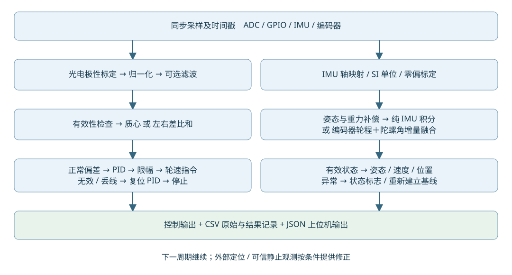
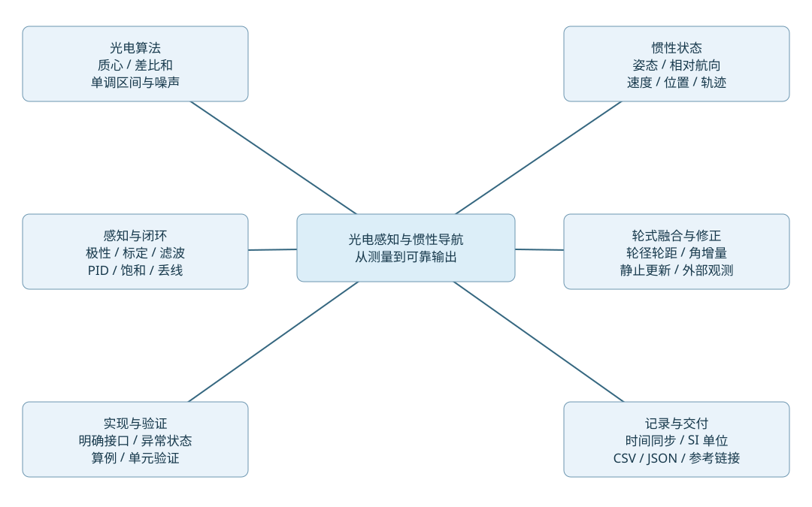

# 光电感知与惯性导航：算法原理、数据处理及代码实现

中文技术报告 · 2026 年 10 月 7 日 · 数学排版修订 2026 年 10 月 9 日

## 阅读结论与实现范围

光电阵列可以用标定后的目标线强度计算横向偏差，再驱动转向控制。权重法利用各探头的位置，差比和法利用左右组的相对强度；两者的输出尺度与有效区间必须通过实际阵列扫线测量确认。IMU 擅长短时角运动与姿态估计，低成本 IMU 的速度和位置双重积分容易漂移；平面轮式车辆加入编码器后，可以用轮程提供平移约束、用陀螺提供角运动信息，仍需要外部位置或航向观测才能长期约束全局漂移。

本报告以独立 Python 3 标准库代码说明算法，硬件驱动抽象为时间戳、ADC/GPIO 读数、三轴比力与角速度、左右轮累计计数。代码可离线运行，未直接接入 STM32、具体光电模块或实际车辆。名义周期为 $10\,\mathrm{ms}$（$100\,\mathrm{Hz}$），不是经实车验证的最佳周期。报告以平面差速车演示控制与轮式里程计；若车辆采用舵机和阿克曼转向，光电偏差算法仍可用，转向映射与轮式运动学需替换。

### 证据标记

正文中的“来源”指链接资料明确支持的事实；“推导”指本报告由已声明模型推出的结果；“建议”是需用实测确认的工程选择；“示例”指人为设定的参数和输入。离线单元验证证明数值和异常逻辑，不证明真实车辆速度、赛道通过率或传感器精度。

## 1 统一符号与接口基础

| 符号或字段 | 含义与单位 | 约定 |
|---|---|---|
| $b$ 坐标系 | 车体右手坐标系 | $x$ 向前、$y$ 向左、$z$ 向上 |
| $n$ 坐标系 | 起始局部水平坐标系 | 初始前向为 $x$，左向为 $y$，向上为 $z$；不是地理北向 |
| $\psi$ / `yaw` | 航向 $\mathrm{rad}$ | 从 $n$ 的 $+x$ 朝 $+y$ 逆时针为正，输出包裹至 $[-\pi,\pi)$ |
| $\phi$、$\theta$ | 横滚、俯仰 $\mathrm{rad}$ | $R_{nb}=R_z(\psi)R_y(\theta)R_x(\phi)$；右手旋转 |
| $R_{nb}$ | $b$ 向量到 $n$ 的旋转矩阵 | 姿态定义不得与逆变换混用 |
| $\mathbf f_b$ | 加速度计比力 $\mathrm{m}/\mathrm{s}^{2}$ | 水平静止为 $(0,0,+g)$；不是已经去重力的线加速度 |
| $\boldsymbol\omega_b$ | 三轴角速度 $\mathrm{rad}/\mathrm{s}$ | 驱动层把 $\mathrm{deg}/\mathrm{s}$ 转换后传入 |
| $\mathbf g_n$ | 重力加速度 $\mathrm{m}/\mathrm{s}^{2}$ | $(0,0,-9.80665)$ |
| $t$、$\Delta t$ | 单调采集时刻与相邻间隔 $\mathrm{s}$ | 同一时间基准；不要用串口接收时刻代替采集时刻 |
| $y_i$ | 光电探头横向位置 $\mathrm{m}$ | 从右到左 $[-0.02,-0.01,0,0.01,0.02]$ |
| $q_i$ | 目标线归一化强度 | $[0,1]$，越大越接近目标线；不是反射率绝对值 |
| $e_y$、$e$ | 横向偏差 $\mathrm{m}$、归一化偏差 | 目标线在左为正；PID 正输出使车左转 |
| $N_L$、$N_R$ | 左右轮累计编码器计数 `count` | 前行均为正，计数含实际倍频与减速比 |

水平静止比力正向是重力补偿最容易出错的环节：

$$
\mathbf a_n=R_{nb}\mathbf f_b+\mathbf g_n.
$$

传感器轴映射、极性与单位必须在驱动适配层完成。车辆初始航向定义为零，只表示相对起点方向。

本报告的 PID 使用 $e$ 作为误差，定义为测得目标线位置减去阵列中心。因为正输出定义为向目标线左转，这个符号约定正确；如果直接调用采用 `setpoint−measurement` 的现成 PID 库，应反转误差或执行器符号，并通过低速左偏测试核验。

## 2 光电权重法与差比和法

### 2.1 两种名称不等于唯一公式

【来源支持】Pololu 官方 QTR 文档给出以通道索引乘 1000 为位置权重的归一化加权平均，并说明传感器间距相对线宽合适时，其估计设计为单调，可用于闭环控制。[Pololu QTR 官方说明](https://www.pololu.com/docs/0j19/all)。本文改用实测横向位置 $y_i$，随后归一化到 $e\in[-1,1]$；这只是单位和原点变换。

“权重法”至少可能指：① $\sum_i w_iq_i$ 的未归一化加权和；② $\frac{\sum_i y_iq_i}{\sum_i q_i}$ 的位置质心；③先二值化再按状态表赋偏差。①将线位置与响应总强度混合；②允许强度整体变化时保持位置；③会丢失连续幅值，且状态表不能自动外推。本文固定采用②，不将三种定义混用。

“差比和”一般表达左右差除以左右和，但左右量可能是单通道、组内求和或组内均值，正负号也常随接线或编号相反。左右通道数相等时，组和与组均值所得比值相同；不等时直接比较组和会引入偏置。本文固定采用左右组均值，中心通道不进入公式：

$$
\begin{aligned}
L&=\frac{1}{M_L}\sum_{i:\,y_i>0}q_i,\qquad
R=\frac{1}{M_R}\sum_{i:\,y_i<0}q_i,\\
e_{\mathrm{dos}}&=\frac{L-R}{L+R}.
\end{aligned}
$$

这里的 $M_L$、$M_R$ 分别表示左、右光电组的通道数。

$L$、$R$、$e_{\mathrm{dos}}$ 均无量纲，左侧响应较强时输出为正。另一种把中心响应 $C$ 加入分母的版本 $\frac{L-R}{L+R+\lambda C}$ 能降低中心附近增益，但已是不同算法；不能拿它的参数和本文版本直接互换。

### 2.2 权重法：公式、算例与适用性

$$
\begin{aligned}
S&=\sum_i q_i,\\
e_y&=\frac{\sum_i y_iq_i}{S},\\
e_{\mathrm{centroid}}&=\frac{e_y}{y_{\max}},\qquad y_{\max}=0.02\,\mathrm{m}.
\end{aligned}
$$

输入是各通道响应及实际安装位置；输出 $e_y$ 是感知阵列平面中的目标响应质心（$\mathrm{m}$），$e_{\mathrm{centroid}}$ 是控制用归一化偏差。它不是天然等于车轴中心到赛道中心的几何距离；若阵列位于车轴前方、航向有夹角、线形状不对称或视场被截断，二者不同。

【报告算例】令 $\mathbf q=[0.05,0.10,0.20,0.80,0.90]$。总响应 $S=2.05$；位置加权和为

$$
\begin{aligned}
\sum_i y_iq_i
&=(-0.02\times0.05-0.01\times0.10+0\times0.20\\
&\qquad +0.01\times0.80+0.02\times0.90)\,\mathrm{m}\\
&=0.024\,\mathrm{m}.
\end{aligned}
$$

因此

$$
\begin{aligned}
e_y&=\frac{0.024}{2.05}\,\mathrm{m}
=0.011707317\,\mathrm{m},\\
e_{\mathrm{centroid}}&=0.585365854.
\end{aligned}
$$

即左偏约 $11.707\,\mathrm{mm}$。注意分子不是 $0.0245$；以上逐项加法应作为实现验证基准。

【数学推导】设连续目标响应 $q(y)=Ah(y-y_0)$，$h$ 关于零对称，目标响应全部落在观测范围内，则

$$
\begin{aligned}
\frac{\int yq(y)\,\mathrm{d}y}{\int q(y)\,\mathrm{d}y}
&=y_0+\frac{\int uh(u)\,\mathrm{d}u}{\int h(u)\,\mathrm{d}u}\\
&=y_0.
\end{aligned}
$$


这给出质心法在对称单线、覆盖完整时的理论依据；离散传感器相当于对积分求和，有限间距、非均匀响应、背景残留和阵列边缘截断会产生偏差。不能由连续模型推断任何间距都可行。应把阵列横扫实际赛道，记录“真实横移—输出”曲线，核验单调区间、斜率和残差。

因为 $q_i\geq0$，$e_y$ 是 $y_i$ 的凸组合，必在最小与最大传感器位置之间；这保证输出有界，却不能保证线路唯一。两条对称支线或全黑区域也能得到 $e=0$，必须保留原始空间模式以识别交叉口、宽线或歧义。

### 2.3 差比和法：公式、算例与适用性

同一组数据中，左右组均值及偏差为

$$
\begin{aligned}
L&=\frac{0.80+0.90}{2}=0.85,\\
R&=\frac{0.05+0.10}{2}=0.075,\\
e_{\mathrm{dos}}&=\frac{0.85-0.075}{0.85+0.075}\\
&=\frac{0.775}{0.925}=0.837837838.
\end{aligned}
$$


输出也指向左，但它与质心的 $0.585365854$ 并不等尺度。差比和丢弃了组内“靠近中心还是靠近外侧”的信息。例如 $\mathbf q=[0,0,0,1,0]$ 与 $[0,0,0,0,1]$ 的差比和都为 $1$；质心则分别为 $0.5$ 与 $1$。PID 参数必须随算法变化重新评估。

【数学推导】非负且 $D=L+R>0$ 时 $\lvert L-R\rvert\leq L+R$，故 $e_{\mathrm{dos}}\in[-1,1]$。共同乘性系数 $c>0$ 满足

$$
\frac{cL-cR}{cL+cR}=e_{\mathrm{dos}},
$$

因此未饱和的共同增益变化可消除；共同加性背景 $b$ 却产生 $\frac{L-R}{L+R+2b}$，使灵敏度下降。左右增益不一致还会造成零点偏置。所谓“抗光照变化”只能在变化可近似为共同乘法、且标定正确的条件下成立。

把左右组响应写成横移 $y_0$ 的函数，

$$
\frac{\mathrm{d}e_{\mathrm{dos}}}{\mathrm{d}y_0}
=\frac{2(RL'-LR')}{(L+R)^2}.
$$


在所关心区间内若 $L'\geq0$、$R'\leq0$，并且至少一侧有有效变化，该输出局部单调。在对称中心附近，若

$$
\begin{aligned}
L&=L_0+\kappa y_0,\\
R&=L_0-\kappa y_0,\qquad L_0>0,
\end{aligned}
$$

则 $e_{\mathrm{dos}}\approx\frac{\kappa}{L_0}y_0$。$\kappa/L_0$ 的单位是 $\mathrm{m}^{-1}$，可由实际横扫标定拟合；线宽、光斑宽度、组布局及安装高度都会改变该斜率。远离中心可能两侧都弱、都饱和或单侧占优，此时公式虽可有界，位置分辨能力却消失。

【来源支持】Hamamatsu 的 PSD 技术说明给出连续电阻型位置探测器公式

$$
X=\frac{I_2-I_1}{I_1+I_2}\,\frac{L_x}{2},
$$

并说明归一化可消除理想模型中的光强影响。[Hamamatsu PSD 技术说明，公式 1-3、2-2](https://www.hamamatsu.com/content/dam/hamamatsu-photonics/sites/documents/99_SALES_LIBRARY/ssd/psd_kpsd9001e.pdf)。PSD 的电流分流机制与分立循迹阵列不同；该资料支持差除和在特定光学模型中的数学用途，不能证明本阵列输出与真实横向距离严格线性，更不能证明小车车速。

### 2.4 参数、灵敏度、噪声与响应

【数学推导】质心对通道扰动的灵敏度是

$$
\frac{\partial e_y}{\partial q_i}=\frac{y_i-e_y}{S}.
$$


若扰动较小、相互独立，通道方差为 $\sigma_i^2$，一阶近似为

$$
\operatorname{Var}(e_y)
\approx\frac{\sum_i(y_i-e_y)^2\sigma_i^2}{S^2}.
$$


小总响应放大噪声；距当前质心较远的通道误差贡献较大。若通道相关，须用雅可比 $J\Sigma J^{\mathsf T}$ 而不能简单相加。不能断言“加更多通道必然更稳”：新通道若主要看到背景噪声，反而会引入扰动。

差比和对左右量的偏导数为

$$
\begin{aligned}
D&=L+R,\\
\frac{\partial e_{\mathrm{dos}}}{\partial L}&=\frac{2R}{D^2},\qquad
\frac{\partial e_{\mathrm{dos}}}{\partial R}=-\frac{2L}{D^2}.
\end{aligned}
$$

左右独立时

$$
\operatorname{Var}(e_{\mathrm{dos}})
\approx\frac{4(R^2\sigma_L^2+L^2\sigma_R^2)}{D^4}.
$$

例如 $L=R=0.5$、$\sigma_L=\sigma_R=0.01$，$\sigma_e\approx0.01414$；若共同缩小为 $L=R=0.05$、绝对噪声仍为 $0.01$，则 $\sigma_e\approx0.1414$。这说明归一化并不能恢复低信噪比；必须有有效分母门限。

| 参数或选择 | 作用及代价 | 选择依据 |
|---|---|---|
| 物理位置权重 $y_i$ | 决定质心单位和空间意义；夸大外侧权重会改变响应形状 | 测量安装位置；非均匀阵列按真实坐标。额外非线性权重应作为另一种映射验证 |
| $y_{\max}$ 归一化 | 调整无量纲误差尺度和 PID 增益；不增加信息 | 固定几何范围，调参时记录算法及尺度 |
| 逐通道增益/零点标定 | 去除器件差异；过小黑白跨度使归一化噪声变大 | 实际地面、实际高度、多次样本；跨度须显著超过噪声 |
| 去噪门限 $q_i<\tau$ 置零 | 减少背景噪声，但产生偏差和阈值附近跳变 | 由背景响应分布及可接受误检率确定，配合横扫连续性验证 |
| $q_i^{\gamma}$ 或软阈值 | $\gamma>1$ 更强调强响应；可能压掉弱有效通道、放大峰值竞争 | 本文默认 $\gamma=1$；确有宽线/背景问题再比较误差、单调性和抖动 |
| 有效分母门限 $S_{\min}$、$D_{\min}$ | 防止弱信号除法爆噪；门限太高会拒绝有效边缘 | 依据上述噪声传播式、目标输出噪声上限和失线分布选取 |
| 左右分组 | 均值避免数量偏置；组内位置丢失 | 先标定 $e_{\mathrm{dos}}(y)$；需宽量程位置时优先质心 |
| 时间低通或平均 | 降低高频噪声，增加延迟与相位滞后 | 同时测噪声和延迟；长度 $M$ 的因果等权平均群延迟为 $\frac{(M-1)T}{2}$ |

【来源支持】现行 QTR `readLinePrivate()` 源码有独立的噪声参与门限、在线判定门限，以及丢线后按上次方向给出边界位置的处理。[Pololu 官方实现](https://pololu.github.io/qtr-sensors-arduino/_q_t_r_sensors_8cpp_source.html)。这些是特定库的工程选择，本文不把其数值搬作通用参数。

【工程建议】逐通道门限可先以背景均值与标准差构造

$$
\tau_i=\mu_{\mathrm{bg},i}+k\sigma_{\mathrm{bg},i}.
$$

$k$ 根据允许误检率选取；只有背景近似高斯且稳定时才可将其解释为尾概率。更可靠的做法是使用实测背景分位数，再验证弱线能被保留。静止采样得到的门限还应复测振动、地面变化、环境光变化。

### 2.5 可行性、可信度与“快”的边界

【数学推导】上面的质心恒等式和差比和局部单调性，分别说明这两种观测量可在明确的单线、有效信号及几何条件下用于反馈。进一步给出一个有限的闭环可行性例子：直线轨迹、常速 $v>0$、小横偏 $Y$ 和小航向 $\psi$、传感器位于车轴前 $\ell>0$（$\mathrm{m}$），且理想执行器可直接实现航向角速度。阵列测得线相对位置约为 $e_y\approx-Y-\ell\psi$。取正转向增益 $\frac{\mathrm{d}\psi}{\mathrm{d}t}=Ke_y$，$K>0$ 的单位是 $\mathrm{rad}/(\mathrm{m}\cdot\mathrm{s})$，则

$$
\begin{aligned}
\frac{\mathrm{d}Y}{\mathrm{d}t}&=v\psi,\\
\frac{\mathrm{d}\psi}{\mathrm{d}t}&=-K(Y+\ell\psi).
\end{aligned}
$$

特征方程为

$$
\lambda^2+K\ell\lambda+Kv=0.
$$


两系数为正，连续时间线性化系统渐近稳定。若差比和在中心有正斜率 $h=\frac{\mathrm{d}e}{\mathrm{d}y_0}>0$，使用 $\frac{\mathrm{d}\psi}{\mathrm{d}t}=ke$，等效 $K=kh$，同一结论成立。这是本报告自推导的可行性例证，未使用车辆实验数据；它不包含轮胎打滑、转向带宽、执行器延迟、采样、限幅或大曲率，不能替代 PID 稳定性验证。$\ell=0$ 时该纯比例模型无阻尼，提示布局及动态补偿的重要性。

该模型的自然频率和阻尼比为

$$
\omega_n=\sqrt{Kv},\qquad
\zeta=\frac{K\ell}{2\sqrt{Kv}}.
$$

这表明，提高车速并不只要求“算得更快”，还改变闭环阻尼；真正能否高速循迹取决于感知提前量、采样与执行延迟、转向能力、附着力、线形状及赛道条件。

| “快”的含义 | 本报告可以论证什么 | 尚须验证什么 |
|---|---|---|
| 计算执行速度 | 两法均需一次遍历，复杂度 $O(N)$，少量乘加和一次有效除法 | 目标主控驱动、浮点/定点实现、任务调度下的最坏耗时；Python 时耗不等于 STM32 时耗 |
| 控制响应速度 | 局部斜率、噪声传播及理想模型解释增益和响应关系 | 含采样、滤波、转向执行器和限幅的实测响应/稳定裕度 |
| 实际运动速度 | 公开实现与条件推导说明可用于循迹反馈 | 没有核验到本公式、同类阵列和条件齐全的量化高速实验；不宣称某 $\mathrm{m}/\mathrm{s}$ 已被证明 |

### 2.6 方法选择表与必须保留的异常状态

| 比较项 | 归一化位置质心 | 左右组差比和 |
|---|---|---|
| 最合适条件 | 有多通道有效幅值，需覆盖阵列范围的横向位置估计 | 左右响应在目标区间互补且局部单调，主要需中心附近转向误差 |
| 优点 | 保留各位置作用，可输出 $\mathrm{m}$，连续单线模型有清楚的几何意义 | 计算和分组简单，有界，理想共同乘性增益变化被消除 |
| 限制 | 背景残留、边缘截断、多线导致偏差；弱总响应放噪声 | 组内位置不可辨，可能提前饱和；依赖布局和线宽，通常不能直接输出 $\mathrm{m}$ |
| 中心仅一通道有线 | $\mathbf q=[0,0,1,0,0]$ 给出有效 $e_y=0$ | $L+R=0$，本定义无效；不能把 $\frac{0}{0}$ 当成已确定居中 |
| 对称多峰或全覆盖 | 可能输出 $0$，需形态判定 | 也可能输出 $0$，需形态判定 |
| 选择依据 | 横扫单调性、位置误差和噪声；适合更完整的位置需求 | 横扫有效区间、中心斜率、饱和范围及噪声；适合布局明确的局部反馈 |

【工程建议】算法应同时输出 `valid`、`reason`、`strength` 与偏差，而不是只给一个数字。分母过小应判无效；加一个任意 $\varepsilon$ 虽能避免除零，却会把“没有证据”伪装成接近零的偏差。质心有效、差比和无效且中心响应较强时，可由明确写出的状态机使用质心回退，或进入 `center_only` 保守策略；这属于混合算法，必须在记录中标明使用的方法。丢线搜索可参考最后可信方向，但旧偏差不是新测量，搜索速度和持续时间需限幅；多峰/全覆盖应由线路任务逻辑处理。

## 3 数据类型与从感知到 PID 的闭环流程

### 3.1 读数究竟代表什么

**来源事实。** 反射式光电循迹模块通常用发射器照射地面，再通过接收器观察反射光；输出还受地面材料、安装高度、环境光和电路影响，并非直接给出“线中心坐标”。Pololu QTR-A 的光电晶体管与上拉电阻产生模拟电压，反射强时电压趋低、反射弱时趋高。厂家用黑胶带和白纸的旋转圆盘展示波形：高度增大使黑白输出差缩小，电机噪声可见，因此安装与滤波影响判别能力。[Pololu QTR 模拟输出与波形](https://www.pololu.com/docs/0J13/3)。这些结论针对该电路，不证明所有模块极性相同，也不证明“黑色”在任意红外波长下反射一定最弱。

数字量必须再区分两个概念。一位 DO 是比较后的高低电平，每通道每次只保留阈值哪一侧的信息。例如 DFRobot SEN0017 官方注明黑色 `LOW`、白色 `HIGH`；本报告黑线目标时应映射 `LOW` 为 $q=1$、`HIGH` 为 $q=0$。[DFRobot SEN0017 官方说明](https://wiki.dfrobot.com/sen0017/)。模块内部比较器的正负输入、反相器或固件会改变极性，接入其他产品时必须实际测量黑白两种状态。

**GPIO 数字接口不必然只有一位光学信息。** Pololu QTR-RC 先将电容充电，再释放 GPIO，并测量下降到逻辑低电平的时间。反射强时放电较快，时间较短；计时结果是多级反射测量，不等于只读一次 LOW/HIGH。厂家显示安装高度增大可将黑面脉宽从毫秒级拉长，影响更新率，并建议对电机毛刺做持续低电平确认。[Pololu QTR-RC 输出原理和示波器测量](https://www.pololu.com/docs/0J13/2)。RC 计时可沿用连续读数的标定流程，但要保留单位、计时分辨率、超时饱和标志，不能当作 ADC counts。

| 数据类型 | 每次信息与分辨能力 | 阈值/噪声特点 | 用于偏差算法的限制 |
|---|---|---|---|
| 一位比较器 DO | 只有目标/背景分类；空间分辨主要由通道位置、光斑与目标宽度决定 | 阈值附近可能反复跳变；阈值可能固定或可调；只能看到结果，无法恢复原始幅度 | $q_i\in\{0,1\}$ 可做质心或左右计数差比和，但误差呈台阶；多线/全命中时不能唯一解释 |
| AO+ADC | 多级幅度；理想 $B$ 位 ADC 有 $2^B$ 个码，不等于 $2^B$ 个有效光学等级 | 需考虑参考电压、饱和、噪声、通道差异；可做软件阈值、软权重 | 连续 $q$ 可平滑估计，但需标定，位置精度仍取决于光斑与空间响应 |
| RC+GPIO 计时 | 脉宽多级；计时器分辨率及超时决定可用等级 | 逻辑门限、毛刺、安装高度影响时间；超时截断 | 可作为连续原始量；较长读出时间可能增加延迟，不能误称固定一位输入 |

表中关于量化与信息损失的内容是数学/信号处理结论。ADC 的电压换算若需要可写为

$$
V=\frac{\mathrm{raw}\,V_{\mathrm{ref}}}{2^B-1}.
$$

但 ADC 到电压的换算并不自动得到物理反射率，目标线检测仅需稳定的相对强度标定。

### 3.2 标定、归一化、阈值与滤波

**来源事实。** Pololu 的官方库建议在初始化阶段让每个通道实际接触最亮与最暗区域；也提供发射器开/关两次读取来减少非均匀环境光影响。该文档明确针对 QTRSensors **3.1.0**，不能把其接口照搬为当前任意版本。[QTRSensors 3.1.0 校准与读出模式](https://www.pololu.com/docs/0j19/all)。本文借鉴原理，不依赖该库。

**报告定义与数学推导。** 令 $r_i$ 为 ADC counts 或 RC 秒数，$b_i$ 为背景读数，$\ell_i$ 为目标线读数，不要求 $\ell_i>b_i$。统一目标强度为


$$
q_i=\operatorname{clip}_{[0,1]}\!\left(\frac{r_i-b_i}{\ell_i-b_i}\right).
$$


这样背景映射 $0$，目标映射 $1$，即使原始极性相反也成立。分母 $\lvert\ell_i-b_i\rvert$ 过小意味着缺乏对比，必须将标定判为无效，而不是加极小数继续运行。可用重复采样估计目标/背景均值、标准差和分位数：背景与目标分布间隔应明显大于噪声及环境变化；阈值选在两类分布之间。$0.5$ 只在归一化且两类误判代价相近时是示例起点，不能替代分布检验。归一化后的噪声近似 $\sigma_q=\frac{\sigma_r}{\lvert\ell-b\rvert}$，解释了低对比归一化为何放大噪声。截断是算法边界约束；原始超量程与截断仍应记录，不能用 `clip` 隐藏断线/饱和。

**算例假设。** 五通道均设 $b=100\ \mathrm{counts}$、$\ell=900\ \mathrm{counts}$，读取 $\boldsymbol r=[140,180,260,740,820]\ \mathrm{counts}$，则 $\boldsymbol q=[0.05,0.10,0.20,0.80,0.90]$。若实际电路极性相反，$b=900\ \mathrm{counts}$、$\ell=100\ \mathrm{counts}$，读数 $\boldsymbol r=[860,820,740,260,180]\ \mathrm{counts}$ 得到同一个 $\boldsymbol q$。若 $\sigma_r=8\ \mathrm{counts}$，对比为 $800\ \mathrm{counts}$ 时 $\sigma_q\approx0.01$；对比只有 $80\ \mathrm{counts}$ 时约 $0.1$，这不是 PID 调参能够恢复的信息。

**工程建议。** 标定在最终安装高度、赛道材料和供电条件下进行，逐通道存储参数；边缘线宽及光斑分布用横向扫描标定。环境光影响明显且模块允许控制发射器时，可做开/关采样，但具体补偿公式须匹配电路；非线性 AO/RC 不能无条件用 $r_{\mathrm{on}}-r_{\mathrm{off}}$ 当反射率。两次采样还增加耗时，并受车辆运动造成的空间错位影响。

连续 $q$ 如确有噪声，可以一阶低通


$$
\begin{aligned}
\bar q_{i,k}&=\bar q_{i,k-1}+\alpha_k\bigl(q_{i,k}-\bar q_{i,k-1}\bigr),\\
\alpha_k&=\frac{\Delta t_k}{\tau_q+\Delta t_k}.
\end{aligned}
$$


这是连续一阶滤波的后向欧拉离散化，$\tau_q$ 单位 $\mathrm{s}$；$\tau_q=0$ 时直接通过。初始化用首个有效 $q$，而不是把滤波器初始化为全零后制造假的丢线。中值滤波适于孤立尖峰，均值滤波适于独立随机噪声；不是每种滤波都要叠加。$M$ 点滑动平均低频附近群延迟约 $\frac{(M-1)T}{2}$，一阶低通低频附近延迟约 $\tau_q$，因此滤波越重通常越迟钝。硬件低通可在 ADC 前降低带外噪声；软件滤波无法消除已经发生的混叠。

一位 DO 可用迟滞或时间一致性抑制抖动，但迟滞只在可读 AO 或可配置比较器时能实现完整上下阈值：$q\ge\theta_{\mathrm{on}}$ 判目标，$q\le\theta_{\mathrm{off}}$ 判背景，中间保留前次，且 $\theta_{\mathrm{on}}>\theta_{\mathrm{off}}$。只有 DO 时可连续 $K$ 次一致才切换，代价是约 $(K-1)T$ 的附加延迟且可能抹掉窄线；其参数应由噪声持续时间与最短真实事件持续时间共同决定。

### 3.3 从采样到控制输出

下表为完整闭环。偏差公式遵守共同约定；这里只讨论接口语义与处理依赖。

| 步骤 | 输入 → 输出 | 目的与必须/可选处理 |
|---|---|---|
| 定时采样 | 电压/DO/RC → 原始通道数组、采集时间戳、硬件状态 | 明确极性、量程、通道顺序；检查 ADC 饱和、RC 超时、通信校验、采样新鲜度；记录实际 $\Delta t$ |
| 标定与统一强度 | 原始数组、$b_i$、$\ell_i$ → $q_i\in[0,1]$、标定有效标志 | 模拟/计时需归一化并验证对比；DO 做极性映射；必要时补偿环境光 |
| 选择性滤波/门限 | $q_i$、历史 → 处理后强度、检测状态 | 只在噪声需求下采用；计入延迟；原始异常不能因滤波而继续显示正常 |
| 偏差计算 | 有效强度、$y_i$/左右组 → $e$、`signal`、`valid`、`reason` | 质心总强度和差比和分母要分别判断；空间形状与总信号可用于低置信度/多线判断 |
| 控制 | 有效 $e$、$\Delta t$、PID 状态 → 限幅转向 $u$ | 首帧/恢复帧抑制导数跳变；可选小积分；导数低通；考虑饱和与实际执行器限制 |
| 执行 | $u$、基础速度、硬件映射 → PWM/转角/轮速命令 | 再检查输出范围/变化率；硬件符号必须试验；执行器是闭环一部分，不是公式输出即实际转角 |

阵列前置距离的作用见第 2.5 节的小角模型；单排阵列读数混合了横向和航向几何关系，不能独立重建完整车辆位姿。

**报告 PID 定义。** 目标线在左时 $e>0$，$u>0$ 表示左转。本报告让 PID 输入就是这个转向误差信号，相当于在所选执行器约定下使用 $\mathrm{measurement}-\mathrm{reference}$，而不是直接套用常见 $\mathrm{setpoint}-\mathrm{measurement}$ 后忘记反号。对于归一化 $u$，$e$、$u$ 均无量纲，$K_p$ 无量纲，$K_i$ 单位 $\mathrm{s}^{-1}$，$K_d$ 单位 $\mathrm{s}$：


$$
\begin{aligned}
d_k^{\mathrm{raw}}&=\frac{e_k-e_{k-1}}{\Delta t_k},\\
d_k&=d_{k-1}+\frac{\Delta t_k}{\tau_d+\Delta t_k}\bigl(d_k^{\mathrm{raw}}-d_{k-1}\bigr).
\end{aligned}
$$


$$
\begin{aligned}
I_k^{\mathrm{try}}&=I_{k-1}+K_i e_k\Delta t_k,\\
u_k^*&=K_p e_k+I_k^{\mathrm{try}}+K_d d_k,\\
u_k&=\operatorname{clip}_{[-u_{\max},u_{\max}]}(u_k^*).
\end{aligned}
$$


$I$ 是已经乘过 $K_i$ 的积分输出，因此其单位与 $u$ 相同。若 $u_k^*>u_{\max}$ 且 $K_i e_k>0$，或 $u_k^*<-u_{\max}$ 且 $K_i e_k<0$，则拒绝本次向饱和方向增长的积分，并用旧 $I$ 重算输出；反方向积分允许退饱和。若下游轮速/舵机又限幅，应按真实可执行输出做跟踪抗饱和；仅限制 PID 前级不保证执行器不饱和。MathWorks 官方文档说明带一阶导数滤波的离散 PID、显式采样时间及实际 $\Delta t$ 接口；其抗饱和示例说明条件积分/回算与执行器饱和的关系。[PID 结构与离散采样](https://www.mathworks.com/help/simulink/slref/pidcontroller.html)、[抗积分饱和官方示例](https://www.mathworks.com/help/simulink/slref/anti-windup-control-using-a-pid-controller.html)。上述具体递推式是本文选择的通用实现，不声称照抄某软件。

**算例假设。** $\Delta t=0.01\ \mathrm{s}$，$e_{k-1}=0.20$，$e_k=0.30$，$d_{k-1}=0$，$\tau_d=0.02\ \mathrm{s}$，$K_p=0.8$、$K_i=0.1\ \mathrm{s}^{-1}$、$K_d=0.02\ \mathrm{s}$、$I_{k-1}=0$。得 $d_k^{\mathrm{raw}}=10\ \mathrm{s}^{-1}$、$d_k=3.3333\ \mathrm{s}^{-1}$、$I_k^{\mathrm{try}}=0.0003$、$u_k^*=0.306967$；$u_{\max}=0.5$ 时不饱和。若 $u_{\max}=0.25$，正误差把积分推向上饱和，拒绝 $I_k^{\mathrm{try}}$，再算 $u_k^*=0.306667$，输出 $0.25$。首帧 $d=0$，不能凭不存在的上一帧做差分。

差速车一个示例映射为

$$
\begin{aligned}
v_L&=v_0-k_u u,\\
v_R&=v_0+k_u u,\\
\omega&=\frac{v_R-v_L}{B}.
\end{aligned}
$$

其中速度和 $k_u$ 的单位为 $\mathrm{m/s}$，$u>0$ 时右轮较快，向左转；$B$ 为轮距。若左/右轮速限制为 $[0,v_{\max}]$，要满足 $\lvert k_u u\rvert\le\min(v_0,v_{\max}-v_0)$，或统一缩放轮速并让 PID 知道实际饱和。PWM 相等不保证轮速相等，可增设编码器轮速内环。舵机车则输出左转为正的转角映射，必须标定中位、机械限位、死区与响应；不能直接套用差速映射。

### 3.4 异常与丢线：不可把缺失数据当零误差

**工程策略。** `valid`/`reason` 必须伴随数值；没有足够线信息时 $e=0$ 只能是存储占位，不能向 PID 宣称车辆居中。

- 全阵列信号不足（$\sum_i q_i$ 小、峰值低且与背景统计一致）：标为 `LOW_SIGNAL`/`LOST`。短时丢线可冻结积分、关闭导数、降速，使用最后可靠方向执行有界恢复；持续超时停车。恢复时用新 $e$ 重新初始化导数，避免大脉冲。所需停车超时取决于制动距离、场地和最短丢线事件；未指定车辆时不能给保证通用安全的秒数。
- 差比和 $L+R$ 小：先看全阵列。若中间通道强而左右弱，是 `CENTER_ONLY`，不能等同 `LOST`；应切换质心并使用该算法专属增益、或明确实现条件成立的居中保持策略。缺乏这样的前提时使差比和输出无效。加 $\varepsilon$ 到分母只能避免浮点除零，不能恢复信息。
- 超量程、`NaN`、长度不符、无效标定、过期帧、$\Delta t\le0$：标为输入/时序故障，不继续更新 PID 状态；上层降速或停车。容忍单坏通道并剔除后重新归一化是一种额外策略，但会改变空间响应，应有独立校验；通用示例可以直接拒绝整帧。
- 全部强/对称两侧强：可能是宽线、路口、标记或环境干扰。两算法即使算出 $e=0$，也不能证明单条线居中；必须利用已知赛道规则、连通分组/形状判据或附加传感器。保留 `AMBIGUOUS` 状态。
- ADC 满量程或 RC 超时：可能是真黑面，也可能高度异常/断线。仅凭一个读数不能判断；必须结合标定范围、其他通道、持续性和硬件诊断。

### 3.5 采样与参数的依据

**数学推导。** 假设采样、滤波、计算、通信、执行器合计延迟 $\tau$，在速度 $v$ 下车体前进 $v\tau$；纯延迟在角频率 $\omega$ 处附加相位 $-\omega\tau$。因此更长滤波、RC 超时或阻塞串口打印都会消耗相位裕量；更快 CPU 不会自动降低光学读出、执行器和机械延迟。名义 $T=0.01\ \mathrm{s}$ 只是本报告示例。实际周期应依据传感器读出上限、目标带宽、执行器动态、最高速度下的事件宽度和 CPU 负载确定；有效事件尺度 $l$ 对应时间 $\frac{l}{v}$，需要多个样本才能可靠识别，不能只满足抽象 Nyquist 后忽略传感器光斑和运动。

**工程建议。** 先用静止和横向扫线日志测噪声/对比/线宽/算法 $e$ 的单调区，再确定滤波强度与低信号阈值。确认“目标在左→命令左转”的符号后，从低速 P 或 PD 开始：$K_p$ 提高使同偏差下转向更强，但过大会振荡或频繁饱和；$K_d$ 提高阻尼及趋势响应，却放大差分噪声；只有持续静差且不是机械/标定/左右速度问题时才增小量 $K_i$。通过相同赛道与速度下的横向 RMS、峰值、丢线次数、饱和占比和执行器抖动评价，之后逐级增速重新辨识。两算法 $e$ 尺度虽同为 $[-1,1]$，局部斜率不同，不能无条件共享 PID 增益。

**公开工程的支持边界。** Pololu 3pi 官方给出从 line position 到 PID 再到限幅差速的源码，并建议逐步升速调参；这是可核验工程依据，支持“连续偏差+闭环转向可实际实施”。其码值 255 是电机命令，不是 m/s，示例增益与离散求和/差分的采样方式绑定，不能转移为本报告 SI 时间公式中的增益，也不能据此宣称任意车辆高速。[Pololu 3pi PID 循迹公开实现](https://www.pololu.com/docs/0J21/7.c)。未获得本车的光电型号、车体动力学、安装几何与赛道实验，不能给绝对最高速度或保证不丢线。

## 4 惯性导航的实现 记录 输出与修正

### 4.1 输出的区别与方案边界

姿态是车体相对导航系的三维旋转，可用四元数 $\mathbf q_{nb}$ 或 roll/pitch/yaw 表示；航向通常指 yaw，需要说明参照方向。本例航向相对启动方向，不是真北或磁北。速度是位置对时间的变化，位置是相对启动点的坐标，轨迹是带时间的连续位置序列，不能把一张 yaw 曲线称为位置轨迹。

| 信息 | 纯 6 轴 IMU | IMU＋左右轮编码器 |
|---|---|---|
| roll/pitch | 静止或线加速度较小时可用重力方向修正陀螺积分 | 同左；编码器本身不测倾斜 |
| yaw | 已知初始 yaw 后积分；重力不提供 yaw 观测，长期漂移 | 陀螺与轮差提供相对转角；仍无绝对航向 |
| 速度 | 去重力后的比力积分，需初速，误差增长 | 由轮程/时间直接估计前向速度，需轮径、传动比、计数分辨率与无滑动假设 |
| 位置、轨迹 | 再积分，需初始位置；低成本 IMU 通常不宜独立长期定位 | 轮程与融合航向递推局部平面轨迹；打滑与航向误差仍累积 |
| 主要前提 | 标定、初始姿态/速度、准确时间与安装变换 | 另需差速运动学、有效轮距、左右轮径与同步计数 |

上述姿态观测边界由 [VectorNav AHRS 官方说明](https://www.vectornav.com/resources/inertial-navigation-primer/theory-of-operation/theory-ahrs)支持：加速度计可提供重力倾角，但动态加速度破坏其假设；yaw 通常需磁或其他航向参考。本文不把厂商带磁力计的 AHRS 表现直接套用到 6 轴 IMU。

### 4.2 纯 IMU 如何实现

#### 4.2.1 原始测量、标定与初始化

加速度计测的是比力 $\mathbf f_b$，不是已经去掉重力的线加速度。静止水平时，$\mathbf f_b\approx(0,0,+g)^{\mathsf T}$。先把寄存器数值按量程换成 $\mathrm{m\,s^{-2}}$、$\mathrm{rad\,s^{-1}}$，再做轴映射、偏置、比例因子和非正交修正：

$$
\begin{aligned}
\mathbf f_b &= \mathbf C_a(\mathbf f_m-\mathbf b_a),\\
\boldsymbol\omega_b &= \mathbf C_g(\boldsymbol\omega_m-\mathbf b_g).
\end{aligned}
$$

$\mathbf C_a$ 与 $\mathbf C_g$ 合并比例与轴间误差；$\mathbf b_a$ 单位 $\mathrm{m\,s^{-2}}$，$\mathbf b_g$ 单位 $\mathrm{rad\,s^{-1}}$。静止均值可估计陀螺零偏；加速度计在一个静止姿态只观察到重力与偏差之和，不能一般地一次确定三轴零偏、比例和安装误差。六面静态标定可利用每轴 $\pm g$；陀螺比例因子需要已知转速或可靠角度基准。温度变化时可建立 $\mathbf b(T)$ 的表或拟合。此标定模型、六面重力测试、转台与温度标定依据见 [VectorNav IMU Calibration & Characterization](https://www.vectornav.com/resources/inertial-navigation-primer/specifications--and--error-budgets/specs-imucal)。校准减少可重复结构误差，不能消除随机噪声。

对于已校正、已确认静止的初始比力，采用欧拉角旋转次序，roll、pitch、yaw 分别记为 $\phi$、$\theta$、$\psi$：

$$
\begin{aligned}
\mathbf R_{nb} &= \mathbf R_z(\psi)\,\mathbf R_y(\theta)\,\mathbf R_x(\phi),\\
\phi &= \operatorname{atan2}(f_y,f_z),\\
\theta &= \operatorname{atan2}\!\left(-f_x,\sqrt{f_y^2+f_z^2}\right),\\
\psi &= 0.
\end{aligned}
$$

$\psi=0$ 表示人为设定初始前向。加速度计不能验证这个 yaw 是否等于真北。初始位置默认 $\mathbf 0$，初速默认 $\mathbf 0$，只有确实静止时该初速成立。

#### 4.2.2 姿态更新与重力补偿

通用姿态积分用四元数而非逐轴直接积分欧拉角。$\mathbf q_{nb}$ 采用标量在前 $[w,x,y,z]^{\mathsf T}$，Hamilton 乘法：

$$
\begin{aligned}
\dot{\mathbf q}_{nb} &= \frac{1}{2}\mathbf q_{nb}\otimes
\begin{bmatrix}0\\\boldsymbol\omega_c\end{bmatrix},\\
\mathbf q_{nb} &\leftarrow \frac{\mathbf q_{nb}}{\lVert\mathbf q_{nb}\rVert}.
\end{aligned}
$$

每步积分后进行上述归一化。

可加入一个易解释的重力方向比例反馈（工程示例，属于互补滤波思想，并非宣称完整复现某论文）：

$$
\begin{aligned}
\mathbf u_b &= \mathbf R_{nb}^{\mathsf T}\begin{bmatrix}0\\0\\1\end{bmatrix},\\
\widehat{\mathbf f}_b &= \frac{\mathbf f_b}{\lVert\mathbf f_b\rVert},\\
\mathbf e_g &= \widehat{\mathbf f}_b\times\mathbf u_b,\\
\boldsymbol\omega_c &= \boldsymbol\omega_b+k_a\mathbf e_g.
\end{aligned}
$$

$k_a$ 单位 $\mathrm{s^{-1}}$。在方向可靠时，反馈拉回 roll/pitch；不观测 yaw。$k_a$ 越大，倾角校正更快，也越容易把运动加速度当重力。比力幅值偏离 $g$、饱和、非有限数或姿态创新过大时暂停反馈；仅检查 $\lVert\mathbf f_b\rVert\approx g$ 并不能证明没有动态加速度，持续转弯仍可能误导倾角。因此纯 IMU 双积分演示可设置 $k_a=0$ 及已知初态，用于验证代数；实车选择 $k_a$ 应基于振动与加减速记录。[x-io Fusion 官方工程](https://github.com/xioTechnologies/Fusion)公开了陀螺积分与反馈、增益折衷、加速度拒绝与四元数/去重力加速度输出；此引用支持设计思想与可核验实现，本文示例不是其二进制或算法性能复现。

导航系线加速度与积分如下；$\Delta t$ 表示实际采样时间差：

$$
\begin{aligned}
\mathbf a_n &= \mathbf R_{nb}\mathbf f_b+\mathbf g_n,\\
\mathbf v_k &= \mathbf v_{k-1}+\mathbf a_{n,k}\Delta t,\\
\mathbf p_k &= \mathbf p_{k-1}+\mathbf v_{k-1}\Delta t
+\frac{1}{2}\mathbf a_{n,k}(\Delta t)^2.
\end{aligned}
$$

后一式是采样区间内加速度恒定近似；快速变化时使用更高采样率或梯形/中点积分。本文短程局部例不建模地球自转、科里奥利与曲率，不能作为长距离精密 INS。IMU 不在车体参考点时还需处理角加速度/向心加速度的杆臂项；示例假定安装在近似参考点。

**数值算例（报告推导，不是实测）**：姿态单位四元数、$\mathbf f_b=(1,0,9.80665)^{\mathsf T}\,\mathrm{m\,s^{-2}}$，$\mathbf a_n=(1,0,0)^{\mathsf T}\,\mathrm{m\,s^{-2}}$，初速初位为零、$\Delta t=0.01\,\mathrm s$，则第一步：

$$
\begin{aligned}
\mathbf v_1 &= (0.01,0,0)^{\mathsf T}\,\mathrm{m\,s^{-1}},\\
\mathbf p_1 &= (0.00005,0,0)^{\mathsf T}\,\mathrm m.
\end{aligned}
$$

相同恒定加速度运行 100 步、保持已知姿态而不启用重力反馈，应得 $v_x=1\,\mathrm{m\,s^{-1}}$、$p_x=0.5\,\mathrm m$。启用基于加速度的倾角反馈会违反本算例恒定前向加速度下的重力假设，不能期待相同结果。

### 4.3 IMU＋编码器如何实现

左右轮单个计数对应距离为：

$$
\begin{aligned}
c_L &= \frac{2\pi r_L}{N_{\mathrm{rev},L}},\\
c_R &= \frac{2\pi r_R}{N_{\mathrm{rev},R}}.
\end{aligned}
$$

$N_{\mathrm{rev}}$ 是每轮转一圈最终解码计数，需包含减速比和四倍频，不能把编码器铭牌 PPR 直接当 $N_{\mathrm{rev}}$。

$$
\begin{aligned}
\Delta s_L &= c_L\Delta n_L, & \Delta s_R &= c_R\Delta n_R,\\
\Delta s &= \frac{\Delta s_L+\Delta s_R}{2},\\
\Delta\psi_{\mathrm{enc}} &= \frac{\Delta s_R-\Delta s_L}{B},\\
v_{\mathrm{enc}} &= \frac{\Delta s}{\Delta t}.
\end{aligned}
$$

$B$ 为有效轮距。右轮走得更多则车向左转，符合 yaw 正号。无侧滑时 $\mathbf v_b=(v_{\mathrm{enc}},0,0)^{\mathsf T}$。这是差速车运动学，阿克曼转向车需用转角、轴距与速度替换 yaw 模型，不能照搬轮差公式。运动学与无滑动假设由 [Dellaert、Hutchinson 开放教材 5.2](https://www.roboticsbook.org/S52_diffdrive_actions.html)支持。

平面示例可用角增量加权融合：

$$
\begin{aligned}
\Delta\psi_g &= \omega_{b,z}\Delta t,\\
\Delta\psi &= \lambda\Delta\psi_g+(1-\lambda)\Delta\psi_{\mathrm{enc}},
\qquad 0\le\lambda\le 1.
\end{aligned}
$$

这里 $\omega_{b,z}$ 已完成校正，不能再次扣零偏。示例 $\mathbf C_g=\mathbf I$、只做偏置修正，因此 $\Delta\psi_g=(\omega_{m,z}-b_{g,z})\Delta t$；代码输入 gyro_rad_s 是 SI 单位的测量值 $\boldsymbol\omega_m$，Navigator 内部减去所配置零偏一次。

$$
\begin{aligned}
\psi_k &= \operatorname{wrap}(\psi_{k-1}+\Delta\psi),\\
x_k &= x_{k-1}+\Delta s\cos\!\left(\psi_{k-1}+\frac{\Delta\psi}{2}\right),\\
y_k &= y_{k-1}+\Delta s\sin\!\left(\psi_{k-1}+\frac{\Delta\psi}{2}\right).
\end{aligned}
$$

gyro 的 $z$ 分量等于 yaw 角速度仅在水平平面假设下成立；非平面情形应使用姿态运动学。中点位置递推近似小角圆弧；大角区间可用精确圆弧：把上述 $\Delta s$ 乘 $\dfrac{\sin(\Delta\psi/2)}{\Delta\psi/2}$。

在两种角增量误差独立、零均值、方差已知时，最小方差线性权重为（数学推导）：

$$
\lambda=\frac{\sigma_{\mathrm{enc}}^2}{\sigma_g^2+\sigma_{\mathrm{enc}}^2}.
$$

常数 $\lambda$ 是教学简化，系统性轮径误差、打滑与温漂不满足这些统计条件。编码器可信时增加其权重；出现滑移疑似、角速度创新 $\left\lvert\dfrac{\Delta\psi_g}{\Delta t}-\dfrac{\Delta\psi_{\mathrm{enc}}}{\Delta t}\right\rvert$ 过大时可临时令 $\lambda=1$ 并标记降级，但 gyro 只能改善转向，无法恢复未知打滑造成的轮程误差。两个来源不一致也可能是时间错位、轴映射或标定错误，不能直接判定某个传感器坏了。

**数值算例（报告假设）**：$c_L=c_R=0.001\,\mathrm{m\,count^{-1}}$，$B=0.20\,\mathrm m$，$\Delta t=0.01\,\mathrm s$，$\Delta n_L=8$、$\Delta n_R=12$，则：

$$
\begin{aligned}
\Delta s &= 0.010\,\mathrm m,\\
v_{\mathrm{enc}} &= 1\,\mathrm{m\,s^{-1}},\\
\Delta\psi_{\mathrm{enc}} &= 0.020\,\mathrm{rad}.
\end{aligned}
$$

扣零偏后的 $\omega_{b,z}=1.8\,\mathrm{rad\,s^{-1}}$ 得 $\Delta\psi_g=0.018\,\mathrm{rad}$。取 $\lambda=0.7$ 得 $\Delta\psi=0.0186\,\mathrm{rad}$。从 $(0,0,0)$ 起步，中点公式给出：

$$
\begin{aligned}
x &\approx 0.0099995676\,\mathrm m,\\
y &\approx 0.00009299866\,\mathrm m,\\
\psi &\approx 1.0657353^{\circ}.
\end{aligned}
$$

$\lambda=0.7$ 仅为检验接口的示例，不能作为未测量传感器的最优参数。

更完整 EKF 可采用状态 $[x,y,\psi,v,b_{g,z}]^{\mathsf T}$，以 gyro 和运动模型预测，以编码器速度、轮差角速度及可信静止约束更新；协方差应来自静态噪声和实际轮地试验。相同编码器已算出的 pose、速度与 yaw 不应当作相互独立的新信息重复融合，见 [robot_localization 官方传感器配置教程](https://raw.githubusercontent.com/cra-ros-pkg/robot_localization/rolling-devel/doc/configuring_robot_localization.rst)。该教程证明工程接口和相关性注意事项，不证明本文简化融合达到某精度。

### 4.4 数据如何记录与同步

记录必须保留能够重新运行算法的输入与配置，而不只保存最终轨迹。以下是一份建议字段表；单位和坐标系必须写入文件头/旁车元数据，不靠读者猜测。

| 字段 | 单位/坐标 | 用途 |
|---|---|---|
| seq, t_sample_ns, t_receive_ns | 整数；同一单调时钟时间域 | 查丢帧、时间间隔与通信延迟 |
| accel_m_x/y/z, gyro_m_x/y/z | $\mathrm{m\,s^{-2}}$、$\mathrm{rad\,s^{-1}}$；车体 $b$；尚未减本次偏置 | 离线重做标定；另可存原始寄存器整数与量程 |
| temperature | $^{\circ}\mathrm C$，若传感器支持 | 检验温漂 |
| count_L/R, t_encoder_ns | 累计解码 count、采样时刻 | 重建轮程，避免只保留微分后的量化速度 |
| dt_s, b_a_xyz, b_g_xyz | $\mathrm s$、$\mathrm{m\,s^{-2}}$、$\mathrm{rad\,s^{-1}}$；$b$ | 审计状态估计与在线偏置 |
| q_nb_w/x/y/z | 无量纲，标量在前、$b\to n$ | 姿态可复算 |
| a_n_xyz, v_n_xyz, p_n_xyz | $\mathrm{m\,s^{-2}}$、$\mathrm{m\,s^{-1}}$、$\mathrm m$；$n$ | 纯 IMU 结果，必须标注 drift_demo |
| yaw_rad, speed_m_s, x_m, y_m | $\mathrm{rad}$、$\mathrm{m\,s^{-1}}$、$\mathrm m$；planar 局部 $n$ | IMU＋编码器估计 |
| stationary, valid, quality, fault_flags | 布尔/枚举/位图 | 区分异常、拒绝观测与降级 |

元数据另存传感器型号/量程/ODR、安装旋转、轮径轮距、$N_{\mathrm{rev}}$、标定 ID、算法版本与参数。若记录解算 covariance，必须写清顺序、坐标与单位平方，不能用未经估计的数值冒充置信度。

同步原则是对齐采集时刻而非串口到达时刻：MCU 用同一硬件计时器在 IMU DRDY 时记录时间、快照编码器；编码器异步时，对同时间区间内累计计数差计算轮程。不同设备时钟需估计偏移与漂移；记录接收时间只能帮助诊断，不可替代采样时间。示例接口假定 IMU 与编码器已对齐至同一时间戳。延迟 $\delta t$ 引入约 $\omega\delta t$ 的角度错位及 $v\delta t$ 的位置关联偏差，是量纲明确的一阶推导。

采样频率依所需车体动态带宽、传感器低通、振动混叠、编码器最小计数与控制延迟选择。理论上采样率应高于有效最高频率的两倍，并留工程余量；先在采样前/传感器端抗混叠，不能期待采样后滤波恢复混叠信号。$100\,\mathrm{Hz}$、$10\,\mathrm{ms}$ 是教学值。姿态/控制输出可同步 $100\,\mathrm{Hz}$，上位机绘图可降至 $10\text{–}20\,\mathrm{Hz}$；原始数据宜保持估计所用频率。CSV 可人工检查，JSONL 可带状态字段；二进制适合高率存储，但需版本、字节序、长度、CRC 和格式说明。日志应通过缓冲/后台写出，不能把文件 I/O 延迟反馈进采样周期。

示例输入记录（$\mathbf f_m$ 为已换 SI 单位但未减本次零偏的原始测量；时间从启动计）：

```csv
seq,t_sample_ns,accel_m_x,accel_m_y,accel_m_z,gyro_m_x,gyro_m_y,gyro_m_z,count_L,count_R,stationary
0,0,0,0,9.80665,0,0,0,0,0,1
1,10000000,0,0,9.80665,0,0,1.8,8,12,0
```

这两行用于运动学/接口算例；不是声称完整重现转弯中实际加速度（真实转弯包含向心加速度）。

### 4.5 结果如何输出

控制程序应读带时间戳、有效性、更新周期和单位的结构，不读面向显示的字符串。角速度闭环用 gyro $\mathrm{rad\,s^{-1}}$，速度闭环用 speed $\mathrm{m\,s^{-1}}$，航向控制用相对 yaw $\mathrm{rad}$；横向路径控制还需 $x/y$ 与已知路径。上位机可显示姿态度数、yaw 时间曲线、速度时间曲线和 $x/y$ 轨迹，并标注参照起点；绘图取样不能改变估计 $\Delta t$。

```json
{"t_s":0.01,"mode":"imu_encoder_planar","frame":"startup_local_x_forward_y_left_z_up","yaw_rad":0.0186,"speed_m_s":1.0,"x_m":0.0099995676,"y_m":0.00009299866,"valid":true,"quality":"relative_dead_reckoning"}
```

valid=true 仅代表本次输入与更新通过程序检查，不代表位置等于真值。纯 IMU 输出需同时带 $\mathbf q_{nb}$、$\mathbf a_n$、$\mathbf v_n$、$\mathbf p_n$，并明确纯惯性位置为短程演示；不可用平面融合的 yaw 默默覆盖独立 AHRS 四元数中的 yaw 而不说明。

### 4.6 如何修正以及修正的边界

| 误差/修正 | 修正什么 | 必需条件 | 不能解决什么 |
|---|---|---|---|
| 静态 gyro 均值、温度表 | 启动零偏及可重复温漂 | 真实静止、热状态明确；持续若干样本检验离散度 | 运动中不可见漂移；比例误差 |
| 六面加速度标定、安装标定 | 零偏、比例、坐标失准 | 已知重力和多方向数据/机械基准 | 随机噪声、重力方向与动态加速度混淆 |
| 低通、互补滤波 | 高频噪声、短期倾角漂移 | 带宽和延迟预算；倾角观测有效 | 恒定偏置和长期位置漂移；滤波增加延迟 |
| ZUPT（零速更新） | 确认静止时的速度漂移；滤波器中部分偏置 | 可信静止信息，不仅是低 gyro | 已累计位置误差、绝对 yaw；误判会抹掉匀速运动 |
| 编码器辅助 | 用轮程代替加速度双积分；改善部分转角估计 | 无/可识别滑动、有效轮参数与同步 | 相同方向双轮打滑、侧滑、绝对位置航向 |
| 轮参数标定/双向方形路程 | 轮径比例、左右不等、有效轮距 | 有真值或可测终点，平稳地面，多次往返 | 随机地面扰动与每次打滑 |
| 非完整约束 $v_{b,y}=0$ | 限制侧向速度误差 | 平面、无侧滑、参考点正确 | 漂移中的绝对位置；滑移时会引入错误 |
| GNSS、视觉、测距/已知标记 | 提供独立位置或航向参考、限制相应漂移 | 外部观测可用、外参时间标定及噪声模型 | 遮挡/磁扰/错误匹配等观测故障 |

低角速度、$\lVert\mathbf f_b\rVert\approx g$ 也可能是匀速行驶，不能自动当成静止。因此示例只允许经外部可信 stationary 标记并通过 IMU 条件检查后更新零偏/清零速度。电机不转、编码器无变化也不是所有情况下的车体静止证明（例如被搬动）。ZUPT 不回滚过去轨迹。

**误差增长算例（数学推导）**：恒定未补偿加速度偏置 $\delta a=0.02\,\mathrm{m\,s^{-2}}$，忽略其他误差，$t=10\,\mathrm s$ 后：

$$
\begin{aligned}
\delta v &= \delta a\,t=0.2\,\mathrm{m\,s^{-1}},\\
\delta p &= \frac{\delta a\,t^2}{2}=1\,\mathrm m.
\end{aligned}
$$

初始水平倾角误差 $1^{\circ}$ 会把重力投影为约 $g\sin 1^{\circ}=0.17115\,\mathrm{m\,s^{-2}}$，若未校正，$10\,\mathrm s$ 位置误差约 $8.56\,\mathrm m$；若 yaw 初始误差 $1^{\circ}$，直行 $10\,\mathrm m$ 的侧向位置差约 $10\sin 1^{\circ}\,\mathrm m=0.1745\,\mathrm m$。gyro 恒定 yaw 偏置导致 yaw 随 $t$ 增长；倾角 gyro 偏置还会使错误重力补偿积累，短时小角近似为：

$$
\delta p\approx\frac{g\,b_g\,t^3}{6}.
$$

误差积分机制与姿态对速度位置的影响见 [VectorNav INS 官方原理](https://www.vectornav.com/resources/detail/what-is-an-ins)与 [GNSS/INS 原理](https://www.vectornav.com/resources/inertial-navigation-primer/theory-of-operation/theory-gpsins)。本文数值由给定假设计算，没有移用厂商典型器件表作实测结论。

轮式里程计系统性误差和非系统性打滑的区分可核验于 [Borenstein、Feng，Gyrodometry: A New Method for Combining Data from Gyros and Odometry in Mobile Robots（ICRA 1996）](https://www.cs.cmu.edu/~motionplanning/papers/sbp_papers/integrated2/borenstien_gyro.pdf)。该文支持轮误差分类、航向误差会扩散为位置误差、gyro/里程计互补的工程思路；其旧平台实验数值不是本文代码或现代 IMU 精度指标。

IMU＋编码器增加运动学、同步与轮参数标定，但避免了把加速度零偏双积分当成前向位置的主要来源，通常更适合地面车的短程局部运动估计。它仍属于航位推算，只有加入适当独立观测才能约束相应长期误差；滤波器复杂度本身不会凭空创造可观测信息。

## 5 与公式一致的代码接口与运行方法

下载包的 `code/optical.py` 实现 `normalize`、`digital`、`centroid`、`difference_over_sum`、`PID` 和 `OpticalController`；`code/inertial.py` 实现 `IMUSample`、`Navigator`、四元数运算、可信静止零偏标定和可选初始倾角初始化。完整代码见报告附录，单独文件可直接导入。

```text
原始模拟数值 + 背景/目标标定 -> normalize() -> q_i
一位电平 + target_level -> digital() -> q_i
q_i -> centroid()/difference_over_sum() -> OpticalResult
时间戳 + 原始光电数组 -> OpticalController.step() -> 有效偏差与轮速命令
IMUSample(t_s, f_b, ω_b, count_left, count_right, stationary)
    -> Navigator.update() -> 纯IMU状态 + 独立平面odom状态
```

### 5.1 初始化与可调参数

光电示例标定 `background` 为五个 $100\ \mathrm{counts}$、`target` 为五个 $900\ \mathrm{counts}$、ADC 范围为 $[0,1023]\ \mathrm{counts}$；读数 $[140,180,260,740,820]\ \mathrm{counts}$ 对应第 2 节 $\boldsymbol q$ 算例。反向极性用 `background` 为 $900\ \mathrm{counts}$、`target` 为 $100\ \mathrm{counts}$ 即可。归一化需 $\lvert\ell_i-b_i\rvert\ge20\ \mathrm{counts}$，这只是示例对比门限，应按实测噪声设置。RC 接入时需改用计时原始单位、范围和对比门限，完成 GPIO 放电驱动及超时诊断；不能套用默认 ADC counts 参数。

光电低通 $\tau_q$ 默认 $0$（直通）。默认 PID $K_p=0.8$、$K_i=0.1\ \mathrm{s}^{-1}$、$K_d=0.02\ \mathrm{s}$、$\tau_d=0.02\ \mathrm{s}$、$u_{\max}=0.5$。参数 `v_base`、`k_u`、`v_max` 分别对应 $v_0=0.3\ \mathrm{m/s}$、$k_u=0.3\ \mathrm{m/s}$、$v_{\max}=0.6\ \mathrm{m/s}$；构造约束为

$$
k_u u_{\max}\le\min(v_0,v_{\max}-v_0),
$$

避免下游额外饱和。数字量可令 `mode='digital'` 并给定 `target_level`；示例默认低电平表示目标线。

质心 $S_{\min}=0.15$，差比和 $D_{\min}=0.05$；控制器当前 $\boldsymbol q$ 满足 $\sum_i q_i<0.15$ 或 $\max_i q_i<0.10$ 时判 `LOST`。所有 $q_i\ge0.8$ 或 $q_i\ge0.5$ 的响应形成两块以上不连通区域时判 `AMBIGUOUS`。后者只是明确的形状启发式，不能识别所有交叉口/宽线；若实际线会产生多峰，需按扫线数据改判据。丢线和异常时停止、`reset` PID 与滤波；报告讨论的有界搜索策略并未作为未知车辆的默认动作。

选择 `method='dos'` 时，左右分母过小而质心仍有效，可输出 `method='centroid_fallback'`、`reason='FALLBACK_CENTER_ONLY'` 或其他原始原因；方法切换复位 PID。示例为了展示接口共用一组增益，实车应根据两法局部斜率设置专属参数。低通前检查当前帧丢线/歧义，避免历史滤波值掩盖故障。

IMU 默认初态 $\boldsymbol q=[1,0,0,0]$，假定起始水平且航向角 $\psi=0$、初速零。非水平起始先用可信静止样本 `initialize_tilt`；该函数不提供真北。$k_a=1\ \mathrm{s}^{-1}$ 是重力反馈示例增益，幅值与重力相差不超过 $15\%$、方向创新不超过 $\frac{\pi}{4}$ 才采用反馈。二者均不能保证没有动态加速度。`gyro_weight` 为 $0.7$，$c_L=c_R=0.001\ \mathrm{m/count}$、$B=0.20\ \mathrm{m}$，默认角速度差门限 $2\ \mathrm{rad/s}$。差异过大时使用 gyro 转角并标记 `angular_disagreement`，轮程仍可能有平移滑移误差。

采样间隔可接受 $\Delta t\in[0.001,0.05]\ \mathrm{s}$；$10\ \mathrm{ms}$ 是名义值，不能将所有间隔硬写为 $0.01\ \mathrm{s}$。IMU 比力范数上限 $16g$、gyro 范数上限 $35\ \mathrm{rad/s}$、每轮绝对线速度上限 $5\ \mathrm{m/s}$ 为示例异常门限，实际应按型号量程/车辆极限设置。范围内读数仍可能错误，故硬件层还需饱和/通信/新鲜度标志。

### 5.2 记录 输出与恢复语义

`demo.py` 生成 101 帧人工数据，以同一时间戳驱动两个模块，输出 `output/samples.csv`、`metadata.json`、`frames.jsonl` 和 `summary.json`。CSV 保留原始 ADC、SI IMU、累计计数、`stationary`、时间间隔及偏差、控制、四元数、加速度、速度、位置与 `odom`；数组列用 JSON 编码。元数据记录坐标、单位、参数和人工数据身份。示例接收时间等于采集时间，仅表示零传输延迟假设；实际驱动应记录真正接收时刻与可用温度。此同步离线写文件方式用于复现，实时控制必须把日志写盘移到后台队列。

第一帧惯导仅建立时间/计数基线，不积分。非单调时间拒绝且不倒退基线；正向大缺口、量程/输入故障和计数跳变拒绝并重新建立可用基线，以免下一帧把未知间隔补积分。若时间戳为 `NaN`/`Infinity`，故障时刻未知，下一有限有效帧只重建基线。丢帧之后以 `incomplete_dead_reckoning` 标记轨迹不完整，正常下一帧不意味着丢失位移被恢复。编码器缺失时不伪造轮程，恢复首帧重建轮计数基线。`valid` 表示更新通过程序检查；`quality` 描述条件或降级，二者都不是统计置信度。

纯 IMU 与平面 `odom` 的航向角 $\psi$ 分别输出。JSON 用有限数值和状态字段，拒绝把 `NaN`/`Infinity` 发送为有效测量；无效时间可用 `null`。标定工具只在明确 `stationary` 并经幅值/离散度检查的样本上求 gyro 均值。运行中可信静止标记须同时通过 IMU 与可用轮计数一致性检查，才缓慢更新 gyro 零偏/清零速度；错误静止标记返回 `STATIONARY_REJECTED`，不抹掉运动。

### 5.3 运行与算例验证

在 `code` 目录运行：

```powershell
python -m unittest -v test_algorithms.py
python demo.py
```

无需第三方包。若系统 python 不在 PATH，使用本机 Python 3.10 及以上解释器绝对路径。代码库没有硬件读写副作用；输出目录可删除后重跑。

本次在 Python 3.12.14 环境实际运行 **30 项单元验证，全部通过**，并成功导出 101 帧 CSV/JSONL 示例。验证日志包含命令、解释器版本与逐项结果。核心数值如下：

| 验证对象 | 预期值 | 实际核验 |
|---|---|---|
| 光电 $\boldsymbol q=[0.05,0.10,0.20,0.80,0.90]$ 质心 | $e_y=0.011707317073\ \mathrm{m}$，$e=0.585365853659$ | 通过，双精度误差内一致 |
| 同一 $\boldsymbol q$ 的差比和 | $e=0.837837837838$，$D=0.925$ | 通过 |
| PID 第 3.3 节算例 | $u=0.306966666667$；限幅 $0.25$ 时不增长积分 | 通过 |
| 水平静止 $\boldsymbol f=(0,0,g)$ | $\boldsymbol a\approx\boldsymbol 0$、$\boldsymbol v\approx\boldsymbol 0$、$\boldsymbol p\approx\boldsymbol 0$，四元数单位范数 | 通过 100 个更新步骤 |
| 已知姿态、$a_x=1\ \mathrm{m/s^2}$、$k_a=0$ | 首步 $v_x=0.01\ \mathrm{m/s}$，$p_x=0.00005\ \mathrm{m}$；$1\ \mathrm{s}$ 后 $1\ \mathrm{m/s}$、$0.5\ \mathrm{m}$ | 通过 |
| 左/右轮计数 $8/12$、$\omega_z=1.8\ \mathrm{rad/s}$ | $\psi=0.0186\ \mathrm{rad}$、$v=1\ \mathrm{m/s}$、$x=0.009999567553\ \mathrm{m}$、$y=0.000092998659\ \mathrm{m}$ | 通过 |
| 中心仅命中、全无信号、多块/全强 | 显式质心回退、`LOST` 停止、`AMBIGUOUS` 停止 | 通过 |
| `NaN`、超量程、错误长度、非法 $\Delta t$ | 拒绝输入/更新，有限 JSON，按规则恢复 | 通过 |
| 时间缺口、非单调时间、编码器跳变/缺失 | 不跨故障补积分，基线恢复，标记不完整 | 通过 |
| 不可信 `stationary`、倾角初始化与反馈、静态零偏 | 不误清运动速度，反馈符号正确，条件标定 | 通过 |

独立复核发现的无效时间戳恢复问题已修正：`t_s` 为非有限值时，不再跨未知区间积分；下一有限有效帧只建立基线，返回 `REBASELINED_AFTER_INVALID_TIME`，并持续标记 `incomplete_dead_reckoning`。该行为有专门回归测试。实际运动速度、硬件最坏执行时间、控制稳定裕度和轨迹精度不属于本次离线验证结论。

### 5.4 流程图



### 5.5 思维导图




## 6 实际硬件接入与验证边界

光电端需补充 ADC 分辨率和参考电压、GPIO 有效电平、采样顺序、发射灯控制、安装高度、阵列间距、黑白标定与饱和诊断。IMU 端需补充量程与比例因子、轴映射、数据就绪/FIFO 时间戳、温漂标定、总线超时和传感器饱和标志；读取寄存器成功并不意味着数值物理有效。编码器端需补充计数溢出差分、正反方向、每轮每转计数、轮径、轮距、减速比和重置检测。执行器端需补充 PWM 或舵机标定、速度反馈、死区、限流与停止策略。

先架空或低速核验“左偏→正偏差→左转”和水平静止时的关系

$$
f_z\approx+g\quad\Longrightarrow\quad\boldsymbol a_n\approx\boldsymbol 0.
$$

然后用已知距离直行、左右等角转弯、不同光照扫线和丢线实验检查误差。用地面标记、摄像或外部定位建立轨迹真值，报告横向误差、位置误差、掉帧率、恢复时间、饱和比例以及速度分布。只有这些实测能支持具体车辆的运动速度和精度结论。

## 7 参考资料与具体支持范围

链接资料于 2026-10-07 核验。公开文档和源码可能更新；报告代码为独立教学实现。以下列表说明采用的依据，实际结论附近也已放置链接。

| 资料 | 支持的结论 | 不应外推的结论 |
|---|---|---|
| [Pololu QTR 官方文档](https://www.pololu.com/docs/0j19/all)及[当前源码](https://pololu.github.io/qtr-sensors-arduino/_q_t_r_sensors_8cpp_source.html) | 标定后加权平均、条件单调、门限和丢线记忆的公开实现；旧文档示例 API 与当前源码区分 | 具体车速；任意间距均有效 |
| [Hamamatsu PSD 技术说明](https://www.hamamatsu.com/content/dam/hamamatsu-photonics/sites/documents/99_SALES_LIBRARY/ssd/psd_kpsd9001e.pdf) | 连续 PSD 模型的差除和与光强归一化 | 分立阵列严格线性位置；循迹车速度 |
| [Pololu QTR AO](https://www.pololu.com/docs/0J13/3)、[RC](https://www.pololu.com/docs/0J13/2) | 两类读出原理、厂家测量波形、安装高度与噪声影响 | 所有光电模块极性相同 |
| [DFRobot SEN0017](https://wiki.dfrobot.com/sen0017/) | 特定模块黑 LOW 白 HIGH 的一位输出例 | 所有数字模块都相同 |
| [MathWorks PID](https://www.mathworks.com/help/simulink/slref/pidcontroller.html)与[抗饱和示例](https://www.mathworks.com/help/simulink/slref/anti-windup-control-using-a-pid-controller.html) | 离散采样、导数滤波、条件积分/回算思路 | 本例参数的实车稳定性 |
| [Pololu 3pi PID 实现](https://www.pololu.com/docs/0J21/7.c) | 从偏差到 PID 和差速输出的公开工程流程 | PWM 255 等于某个 m/s |
| [VectorNav AHRS](https://www.vectornav.com/resources/inertial-navigation-primer/theory-of-operation/theory-ahrs) | 重力倾角、动态加速度的限制和航向参考需求 | 六轴 IMU 自动获取绝对航向 |
| [VectorNav IMU 标定](https://www.vectornav.com/resources/inertial-navigation-primer/specifications--and--error-budgets/specs-imucal) | 偏置、比例、轴误差、六面/温度标定 | 一次单姿态求全加速度标定 |
| [x-io Fusion 官方工程](https://github.com/xioTechnologies/Fusion) | 四元数姿态融合、反馈增益、观测拒绝和去重力输出的可核验工程 | 本报告简化滤波达到同样性能 |
| [Dellaert 与 Hutchinson 开放教材 5.2](https://www.roboticsbook.org/S52_diffdrive_actions.html) | 差速车运动学及无滑动模型 | 阿克曼车直接用轮差转角 |
| [robot_localization 配置教程](https://raw.githubusercontent.com/cra-ros-pkg/robot_localization/rolling-devel/doc/configuring_robot_localization.rst) | 相同轮式来源的位姿速度相关性，避免重复信息 | 增加 EKF 即可消除不可观测漂移 |
| [Borenstein 与 Feng Gyrodometry ICRA 1996](https://www.cs.cmu.edu/~motionplanning/papers/sbp_papers/integrated2/borenstien_gyro.pdf) | 轮式误差与 gyro/里程计互补的原始工程研究 | 旧平台精度就是本代码精度 |
| [VectorNav INS 原理](https://www.vectornav.com/resources/detail/what-is-an-ins)、[GNSS/INS 原理](https://www.vectornav.com/resources/inertial-navigation-primer/theory-of-operation/theory-gpsins) | 积分漂移、外部观测约束的机制 | 无外部信息仍可永久准确定位 |
| [Woodman 剑桥技术报告 UCAM-CL-TR-696](https://www.cl.cam.ac.uk/techreports/UCAM-CL-TR-696.pdf) | MEMS 捷联惯导的误差传播与漂移分析，作主 agent 交叉核验 | 把报告中某 IMU 的实验数值移作本例实测 |

## 8 协作与复核说明

主 agent 先统一约定；A 负责两种光电公式与依据，B 负责数据类型与闭环流程，C 负责惯导与记录修正。第一轮完成后冻结接口，B 与 C 分别实现独立模块，主 agent 编写集成、日志与验证并统一正文。最后由未参与代码编写的 A 独立复核公式、引用、单位、代码与覆盖范围，主 agent 处理其发现后交付。独立复核的两项修订均已关闭；修复后的 30 项验证由主 agent 与复核 agent 分别运行并通过。具体检查结论见验证节。


## 附录 完整可运行代码

以下文件与下载目录中的代码一致，Python 3.10 及以上，仅依赖标准库。

### optical.py

```python
"""光电标定、两种偏差与 PID；Python 3.10+，仅依赖标准库。

阵列顺序为右到左，y 左为正，单位 m；q 越大越像目标线。
时间单位 s。100 Hz 只是示例，控制器使用实际采集时间戳。
LOST/形状阈值是本报告假设，需要依据实际光斑和赛道标定。
"""

from dataclasses import dataclass
import math

POSITIONS_M = (-0.02, -0.01, 0.0, 0.01, 0.02)
MIN_DT_S = 0.001
MAX_DT_S = 0.05
NOMINAL_DT_S = 0.01
LOST_TOTAL = 0.15
LOST_PEAK = 0.10
STRONG_THRESHOLD = 0.50
ALL_STRONG_THRESHOLD = 0.80


@dataclass
class OpticalResult:
    """e 无量纲；e_y_m 仅质心有物理位置，strength 是方法自身信号量。"""

    e: float
    e_y_m: float | None
    valid: bool
    reason: str
    method: str
    strength: float


def _finite(value, name):
    try:
        number = float(value)
    except (TypeError, ValueError, OverflowError) as exc:
        raise ValueError(f"{name} must be finite") from exc
    if not math.isfinite(number):
        raise ValueError(f"{name} must be finite")
    return number


def _vector(values, name):
    if isinstance(values, (str, bytes)):
        raise ValueError(f"{name} must be a numeric sequence")
    try:
        result = [_finite(value, name) for value in values]
    except TypeError as exc:
        raise ValueError(f"{name} must be a sequence") from exc
    if not result:
        raise ValueError(f"{name} must not be empty")
    return result


def _clip(value, low, high):
    return max(low, min(high, value))


def _dt_in_range(dt):
    # 相减时间戳可能在边界产生约 1e-16 s 舍入误差。
    return MIN_DT_S - 1e-12 <= dt <= MAX_DT_S + 1e-12


def _geometry(positions_m):
    positions = _vector(positions_m, "positions_m")
    if len(positions) < 2 or any(a >= b for a, b in zip(positions, positions[1:])):
        raise ValueError("positions_m must be strictly increasing, right to left")
    if max(abs(value) for value in positions) == 0:
        raise ValueError("positions_m must have nonzero span")
    return positions


def _input_q(q, positions_m):
    values = _vector(q, "q")
    positions = _geometry(positions_m)
    if len(values) != len(positions):
        raise ValueError("q and positions_m lengths differ")
    if any(value < 0 or value > 1 for value in values):
        raise ValueError("q must be in [0, 1]")
    return values, positions


def normalize(raw, background, target, raw_min=0.0, raw_max=1023.0, min_span=20.0):
    """逐通道 q=clip((raw-background)/(target-background),0,1)。

    默认 raw 为 ADC counts；正/负标定极性均支持。原始超量程、低对比
    或配置错误抛 ValueError。RC 计时可指定一致的单位与范围后复用此函数。
    """
    low = _finite(raw_min, "raw_min")
    high = _finite(raw_max, "raw_max")
    span = _finite(min_span, "min_span")
    if high <= low or span <= 0:
        raise ValueError("invalid raw range or min_span")
    values = _vector(raw, "raw")
    backgrounds = _vector(background, "background")
    targets = _vector(target, "target")
    if not len(values) == len(backgrounds) == len(targets):
        raise ValueError("raw and calibration lengths differ")
    if any(not low <= value <= high for value in values + backgrounds + targets):
        raise ValueError("raw or calibration is outside range")
    if any(abs(line - bg) < span for bg, line in zip(backgrounds, targets)):
        raise ValueError("insufficient calibration contrast")
    return [_clip((value - bg) / (line - bg), 0.0, 1.0)
            for value, bg, line in zip(values, backgrounds, targets)]


def digital(levels, target_level=0):
    """一位 DO 映射到 q；默认黑线为 LOW，仅允许 0/1，不实现 RC 驱动。"""
    target = _finite(target_level, "target_level")
    values = _vector(levels, "levels")
    if target not in (0.0, 1.0) or any(value not in (0.0, 1.0) for value in values):
        raise ValueError("digital levels and target_level must be 0 or 1")
    return [1.0 if value == target else 0.0 for value in values]


def centroid(q, positions_m=POSITIONS_M, min_strength=0.15):
    """质心 e_y=Σyq/Σq [m]，e=e_y/max|y|；strength=Σq。"""
    values, positions = _input_q(q, positions_m)
    threshold = _finite(min_strength, "min_strength")
    if threshold <= 0:
        raise ValueError("min_strength must be positive")
    strength = sum(values)
    if strength < threshold:
        return OpticalResult(0.0, None, False, "LOW_SIGNAL", "centroid", strength)
    e_y = sum(y * value for y, value in zip(positions, values)) / strength
    e = e_y / max(abs(y) for y in positions)
    return OpticalResult(e, e_y, True, "OK", "centroid", strength)


def difference_over_sum(q, positions_m=POSITIONS_M, min_denominator=0.05):
    """L/R 为 y>0/y<0 通道 q 均值；e=(L-R)/(L+R)。

    中心排除；strength=L+R。分母小且中心 q>=0.5 为 CENTER_ONLY，
    否则 LOW_DENOMINATOR；无效 e=0 只占位。
    """
    values, positions = _input_q(q, positions_m)
    threshold = _finite(min_denominator, "min_denominator")
    if threshold <= 0:
        raise ValueError("min_denominator must be positive")
    left = [value for value, y in zip(values, positions) if y > 0]
    right = [value for value, y in zip(values, positions) if y < 0]
    if not left or not right:
        raise ValueError("difference_over_sum requires left and right channels")
    l_mean, r_mean = sum(left) / len(left), sum(right) / len(right)
    denominator = l_mean + r_mean
    if denominator < threshold:
        center_strong = any(y == 0 and value >= STRONG_THRESHOLD
                            for value, y in zip(values, positions))
        reason = "CENTER_ONLY" if center_strong else "LOW_DENOMINATOR"
        return OpticalResult(0.0, None, False, reason, "dos", denominator)
    return OpticalResult((l_mean - r_mean) / denominator, None, True,
                         "OK", "dos", denominator)


class PID:
    """e/u 无量纲；kp 无量纲，ki [1/s]、kd [s]、tau_d [s]。

    正偏差给左转正输出。integral 已乘 ki，derivative 单位 1/s。
    实际 dt 必须在 [0.001, 0.05] s；首帧导数零，条件积分抗饱和。
    """

    def __init__(self, kp=0.8, ki=0.1, kd=0.02, u_max=0.5, tau_d=0.02):
        self.kp = _finite(kp, "kp")
        self.ki = _finite(ki, "ki")
        self.kd = _finite(kd, "kd")
        self.u_max = _finite(u_max, "u_max")
        self.tau_d = _finite(tau_d, "tau_d")
        if min(self.kp, self.ki, self.kd, self.tau_d) < 0 or self.u_max <= 0:
            raise ValueError("PID gains/tau_d must be nonnegative, u_max positive")
        self.reset()

    def reset(self):
        """清除历史；新有效首帧不会产生差分导数脉冲。"""
        self.integral = 0.0
        self.derivative = 0.0
        self._previous_e = None

    def step(self, e, dt_s):
        error = _finite(e, "e")
        dt = _finite(dt_s, "dt_s")
        if not _dt_in_range(dt):
            raise ValueError("dt_s outside [0.001, 0.05]")
        if self._previous_e is None:
            derivative = 0.0
        else:
            d_raw = (error - self._previous_e) / dt
            derivative = self.derivative + dt / (self.tau_d + dt) * (d_raw - self.derivative)
        increment = self.ki * error * dt
        i_try = self.integral + increment
        u_try = self.kp * error + i_try + self.kd * derivative
        if not all(math.isfinite(value) for value in (derivative, i_try, u_try)):
            raise ValueError("PID arithmetic overflow")
        blocks_growth = ((u_try > self.u_max and increment > 0) or
                         (u_try < -self.u_max and increment < 0))
        integral = self.integral if blocks_growth else i_try
        u_raw = self.kp * error + integral + self.kd * derivative
        self.integral, self.derivative, self._previous_e = integral, derivative, error
        return _clip(u_raw, -self.u_max, self.u_max)


class OpticalController:
    """采样→标定→可选低通→偏差→PID→差速车轮速示例 [m/s]。

    analog 原始量默认 10 位 ADC counts；digital 为一位 DO。不包含硬件
    ADC/GPIO/RC/PWM 驱动。任何异常或丢线立即停止并清除 PID/滤波。
    DOS 回退质心是教材示例；生产应给两算法分别标定 PID 增益。
    """

    def __init__(self, method="centroid", background=(100,) * 5,
                 target=(900,) * 5, positions_m=POSITIONS_M, tau_q=0,
                 pid=None, v_base=0.3, k_u=0.3, v_max=0.6):
        if method not in ("centroid", "dos"):
            raise ValueError("method must be centroid or dos")
        self.method = method
        self.positions_m = tuple(_geometry(positions_m))
        self.background = tuple(_vector(background, "background"))
        self.target = tuple(_vector(target, "target"))
        if len(self.background) != len(self.positions_m):
            raise ValueError("calibration and geometry lengths differ")
        normalize(self.background, self.background, self.target)
        if method == "dos":
            difference_over_sum([0.0] * len(self.positions_m), self.positions_m)
        self.tau_q = _finite(tau_q, "tau_q")
        self.v_base = _finite(v_base, "v_base")
        self.k_u = _finite(k_u, "k_u")
        self.v_max = _finite(v_max, "v_max")
        if self.tau_q < 0 or self.k_u < 0 or not 0 <= self.v_base <= self.v_max:
            raise ValueError("invalid filter or wheel speed parameters")
        if pid is not None and not isinstance(pid, PID):
            raise ValueError("pid must be PID")
        self.pid = pid if pid is not None else PID()
        if self.k_u * self.pid.u_max > min(self.v_base, self.v_max - self.v_base) + 1e-12:
            raise ValueError("wheel limits require smaller k_u*u_max")
        self._time = None
        self._filtered = None
        self._active_method = None
        self.pid.reset()

    def _reset_control(self):
        self.pid.reset()
        self._filtered = None
        self._active_method = None

    def _stopped(self, t_s, reason, q=None, strength=0.0):
        self._reset_control()
        return {"t_s": t_s, "q": [] if q is None else q, "e": 0.0,
                "e_y_m": None, "valid": False, "reason": reason,
                "method": self.method, "strength": strength, "u": 0.0,
                "v_left_m_s": 0.0, "v_right_m_s": 0.0}

    def step(self, t_s, raw, mode="analog", target_level=0):
        """t_s 为单调采集时间 [s]，返回含 valid/reason 的可 JSON 化字典。

        非单调时间不回退基线；正向大缺口重建基线。异常 e=0 不能当居中。
        """
        try:
            timestamp = _finite(t_s, "t_s")
        except ValueError:
            return self._stopped(None, "TIME_INVALID")
        if self._time is None:
            dt = NOMINAL_DT_S
        else:
            dt = timestamp - self._time
            if dt <= 0:
                return self._stopped(timestamp, "TIME_NONMONOTONIC")
            if not _dt_in_range(dt):
                self._time = timestamp
                return self._stopped(timestamp, "TIME_GAP")
        self._time = timestamp
        try:
            if mode == "analog":
                q = normalize(raw, self.background, self.target)
            elif mode == "digital":
                q = digital(raw, target_level)
            else:
                raise ValueError("mode must be analog or digital")
            if len(q) != len(self.positions_m):
                raise ValueError("raw and geometry lengths differ")
        except ValueError:
            return self._stopped(timestamp, "INPUT_INVALID")

        # 形状与低信号检查先于低通，防止滤波历史掩盖当前丢线/路口。
        total = sum(q)
        if total < LOST_TOTAL or max(q) < LOST_PEAK:
            return self._stopped(timestamp, "LOST", q, total)
        blocks = 0
        previous_strong = False
        for value in q:
            strong = value >= STRONG_THRESHOLD
            if strong and not previous_strong:
                blocks += 1
            previous_strong = strong
        if all(value >= ALL_STRONG_THRESHOLD for value in q) or blocks >= 2:
            return self._stopped(timestamp, "AMBIGUOUS", q, total)

        if self._filtered is None or self.tau_q == 0:
            filtered = q.copy()
        else:
            alpha = dt / (self.tau_q + dt)
            filtered = [old + alpha * (new - old) for old, new in zip(self._filtered, q)]
        self._filtered = filtered
        if self.method == "centroid":
            result = centroid(filtered, self.positions_m)
        else:
            result = difference_over_sum(filtered, self.positions_m)
            if not result.valid:
                fallback = centroid(filtered, self.positions_m)
                if fallback.valid:
                    fallback.method = "centroid_fallback"
                    fallback.reason = "FALLBACK_" + result.reason
                    result = fallback
        if not result.valid:
            return self._stopped(timestamp, result.reason, filtered, result.strength)
        if self._active_method != result.method:
            self.pid.reset()
        self._active_method = result.method
        try:
            u = self.pid.step(result.e, dt)
        except ValueError:
            return self._stopped(timestamp, "PID_INVALID", filtered, result.strength)
        return {"t_s": timestamp, "q": filtered, "e": result.e,
                "e_y_m": result.e_y_m, "valid": True, "reason": result.reason,
                "method": result.method, "strength": result.strength, "u": u,
                "v_left_m_s": self.v_base - self.k_u * u,
                "v_right_m_s": self.v_base + self.k_u * u}

```

### inertial.py

```python
"""SI-unit inertial demonstration; Python 3.10+, standard library only.

Body: x forward, y left, z up. Navigation: startup-local, z up.
q_nb = (w,x,y,z), Hamilton, rotates body vectors into navigation.
An accelerometer measures specific force: at rest/level f_b=(0,0,+G).
The independent planar odometry assumes a level differential-drive vehicle.
Hardware must supply calibrated axis mapping, scale factors, synchronized
acquisition timestamps/cumulative encoder counts, and trusted stationary flags.
This is a teaching estimator, not a complete Mahony filter or an EKF.
"""

from dataclasses import dataclass
import math
from numbers import Real
from typing import Iterable

G = 9.80665
Vec3 = tuple[float, float, float]
Quat = tuple[float, float, float, float]


@dataclass(frozen=True)
class IMUSample:
    t_s: float
    accel_m_s2: Vec3
    gyro_rad_s: Vec3
    count_left: int | None = None
    count_right: int | None = None
    stationary: bool = False


def _finite(value: object) -> bool:
    if not isinstance(value, Real) or isinstance(value, bool):
        return False
    try:
        return math.isfinite(value)
    except OverflowError:
        return False


def _vector(value: object, size: int) -> tuple[float, ...]:
    try:
        result = tuple(value)  # type: ignore[arg-type]
    except TypeError as exc:
        raise ValueError("vector must be an iterable") from exc
    if len(result) != size or not all(_finite(v) for v in result):
        raise ValueError(f"expected {size} finite real values")
    return tuple(float(v) for v in result)


def _norm(v: tuple[float, ...]) -> float:
    return math.hypot(*v)


def _cross(a: Vec3, b: Vec3) -> Vec3:
    return (a[1]*b[2]-a[2]*b[1], a[2]*b[0]-a[0]*b[2], a[0]*b[1]-a[1]*b[0])


def _multiply(a: Quat, b: Quat) -> Quat:
    w,x,y,z = a
    v,i,j,k = b
    return (w*v-x*i-y*j-z*k, w*i+x*v+y*k-z*j,
            w*j-x*k+y*v+z*i, w*k+x*j-y*i+z*v)


def _unit(q: Quat) -> Quat:
    n = _norm(q)
    if not math.isfinite(n) or n < 1e-12:
        raise ValueError("quaternion norm is zero")
    return tuple(v/n for v in q)  # type: ignore[return-value]


def rotate(q_nb: Quat, v_b: Vec3) -> Vec3:
    """Rotate with a unit q_nb: R_nb v_b; no units are changed."""
    conjugate = (q_nb[0], -q_nb[1], -q_nb[2], -q_nb[3])
    result = _multiply(_multiply(q_nb, (0.0, *v_b)), conjugate)
    return result[1:]


def _euler(q: Quat) -> Vec3:
    w,x,y,z = q
    roll = math.atan2(2*(w*x+y*z), 1-2*(x*x+y*y))
    pitch = math.asin(max(-1.0, min(1.0, 2*(w*y-z*x))))
    yaw = math.atan2(2*(w*z+x*y), 1-2*(y*y+z*z))
    return roll, pitch, _wrap(yaw)


def _wrap(angle: float) -> float:
    return (angle+math.pi) % (2*math.pi)-math.pi


def _tilt_quaternion(f: Vec3) -> Quat:
    roll = math.atan2(f[1], f[2])
    pitch = math.atan2(-f[0], math.hypot(f[1], f[2]))
    cr,sr = math.cos(roll/2), math.sin(roll/2)
    cp,sp = math.cos(pitch/2), math.sin(pitch/2)
    # Rz(0) Ry(pitch) Rx(roll), yaw deliberately initialized to zero.
    return (cr*cp, sr*cp, cr*sp, -sr*sp)


class Navigator:
    def __init__(self, k_a: float = 1.0, gyro_bias: Vec3 = (0,0,0),
                 accel_bias: Vec3 = (0,0,0), gyro_weight: float = .7,
                 meters_per_count_left: float = .001,
                 meters_per_count_right: float = .001, wheelbase_m: float = .2,
                 initial_q_nb: Quat = (1,0,0,0),
                 dt_min_s: float = .001, dt_max_s: float = .05,
                 max_accel_m_s2: float = 16*G, max_gyro_rad_s: float = 35.0,
                 max_wheel_speed_m_s: float = 5.0,
                 angular_disagreement_rad_s: float = 2.0,
                 accel_gate_fraction: float = .15,
                 innovation_limit_rad: float = math.pi/4,
                 stationary_accel_fraction: float = .05,
                 stationary_gyro_limit_rad_s: float = .05,
                 gyro_bias_tau_s: float = 30.0):
        """All gains/limits are configurable examples, not sensor specifications.

        k_a: s^-1; biases: SI body coordinates; wheelbase: metres;
        counts are final decoded counts after gear ratio/quadrature decoding.
        Initial position/velocity are zero. initial_q_nb must be known, or call
        initialize_tilt on a trusted stationary sample before the first update.
        """
        params = (k_a, gyro_weight, meters_per_count_left, meters_per_count_right,
                  wheelbase_m, dt_min_s, dt_max_s, max_accel_m_s2, max_gyro_rad_s,
                  max_wheel_speed_m_s, angular_disagreement_rad_s,
                  accel_gate_fraction, innovation_limit_rad,
                  stationary_accel_fraction, stationary_gyro_limit_rad_s,
                  gyro_bias_tau_s)
        if not all(_finite(v) for v in params):
            raise ValueError("configuration must contain finite real values")
        if (k_a < 0 or not 0 <= gyro_weight <= 1 or
            min(meters_per_count_left,meters_per_count_right,wheelbase_m,
                dt_min_s,max_accel_m_s2,max_gyro_rad_s,max_wheel_speed_m_s,
                angular_disagreement_rad_s,stationary_gyro_limit_rad_s,
                gyro_bias_tau_s) <= 0 or dt_max_s < dt_min_s or
            not 0 < accel_gate_fraction < 1 or
            not 0 < stationary_accel_fraction < 1 or
            not 0 < innovation_limit_rad <= math.pi):
            raise ValueError("invalid navigation configuration")
        self.k_a, self.gyro_weight = k_a, gyro_weight
        self.gyro_bias = _vector(gyro_bias,3)
        self.accel_bias = _vector(accel_bias,3)
        if _norm(self.gyro_bias) > max_gyro_rad_s or _norm(self.accel_bias) > max_accel_m_s2:
            raise ValueError("bias magnitude exceeds configured sensor range")
        self.q_nb = _unit(_vector(initial_q_nb,4))
        self.c_left, self.c_right, self.wheelbase_m = (
            meters_per_count_left, meters_per_count_right, wheelbase_m)
        self.dt_min_s, self.dt_max_s = dt_min_s, dt_max_s
        self.max_accel, self.max_gyro = max_accel_m_s2, max_gyro_rad_s
        self.max_wheel_speed = max_wheel_speed_m_s
        self.angular_disagreement = angular_disagreement_rad_s
        self.accel_gate_fraction = accel_gate_fraction
        self.innovation_limit_rad = innovation_limit_rad
        self.stationary_accel_fraction = stationary_accel_fraction
        self.stationary_gyro_limit = stationary_gyro_limit_rad_s
        self.gyro_bias_tau_s = gyro_bias_tau_s
        self.v_n = (0.0,0.0,0.0)
        self.p_n = (0.0,0.0,0.0)
        self.a_n = (0.0,0.0,0.0)
        self._t = None
        self._counts = None
        self._pending_rebaseline = False
        self._incomplete = False
        self._odom_incomplete = False
        self._odom = {"x_m":0.0,"y_m":0.0,"yaw_rad":0.0,"speed_m_s":0.0,
                      "quality":"relative_dead_reckoning"}

    def initialize_tilt(self, sample: IMUSample) -> None:
        """Before first update only: use trusted static gravity; yaw remains zero.

        One static pose does not calibrate all three accelerometer biases.
        The caller supplies the external stationary truth; gates are additional
        rejection checks, not a proof that the vehicle is stationary.
        """
        if self._t is not None:
            raise ValueError("tilt initialization is allowed only before updates")
        f = _vector(sample.accel_m_s2,3)
        w = _vector(sample.gyro_rad_s,3)
        fc = tuple(v-b for v,b in zip(f,self.accel_bias))
        wc = tuple(v-b for v,b in zip(w,self.gyro_bias))
        if (sample.stationary is not True or
            abs(_norm(fc)-G) > self.stationary_accel_fraction*G or
            _norm(wc) > self.stationary_gyro_limit):
            raise ValueError("trusted stationary tilt conditions not met")
        self.q_nb = _tilt_quaternion(fc)

    def _baseline(self, t: float, sample: IMUSample) -> None:
        self._t = t
        self._counts = ((sample.count_left,sample.count_right)
                        if type(sample.count_left) is int and type(sample.count_right) is int
                        else None)

    def _packet(self, t: float | None, valid: bool, reason: str,
                quality: str, show_odom: bool = True) -> dict:
        roll,pitch,yaw = _euler(self.q_nb)
        odom = dict(self._odom) if show_odom and self._counts is not None else None
        if odom is not None and self._odom_incomplete:
            odom["quality"] += ";incomplete_dead_reckoning"
        if self._incomplete:
            quality += ";incomplete_dead_reckoning"
        return {"t_s":t,"valid":valid,"reason":reason,"quality":quality,
                "q_nb":self.q_nb,"a_n_m_s2":self.a_n,"v_n_m_s":self.v_n,
                "p_n_m":self.p_n,"pure_yaw_rad":yaw,"roll_rad":roll,
                "pitch_rad":pitch,"odom":odom}

    def _reject(self, sample: IMUSample, reason: str) -> dict:
        t = float(sample.t_s) if _finite(sample.t_s) else None
        if t is None:
            # 无法定位故障发生区间，下一有效帧只能重新建立基线。
            self._pending_rebaseline = True
            self._counts = None
            self._incomplete = self._odom_incomplete = True
        if t is not None and (self._t is None or t > self._t):
            self._baseline(t,sample)
            self._incomplete = self._odom_incomplete = True
        return self._packet(t,False,reason,"rejected_no_integration")

    def update(self, sample: IMUSample) -> dict:
        """First sample establishes baselines. dt comes from acquisition time.

        Invalid samples never update the integrated state. Positive time gaps or
        bad samples reset baselines, preventing later integration across the lost
        interval. Result quality then permanently flags an incomplete trajectory.
        Missing encoder samples only suspend odometry; restoration re-baselines.
        """
        if not isinstance(sample, IMUSample):
            raise ValueError("update requires IMUSample")
        if not _finite(sample.t_s) or type(sample.stationary) is not bool:
            return self._reject(sample,"INVALID_INPUT")
        try:
            f_m = _vector(sample.accel_m_s2,3)
            w_m = _vector(sample.gyro_rad_s,3)
        except ValueError:
            return self._reject(sample,"INVALID_INPUT")
        if any(v is not None and type(v) is not int
               for v in (sample.count_left,sample.count_right)):
            return self._reject(sample,"INVALID_ENCODER")
        if _norm(f_m) > self.max_accel or _norm(w_m) > self.max_gyro:
            return self._reject(sample,"IMU_OVERRANGE")
        t = float(sample.t_s)
        f = tuple(v-b for v,b in zip(f_m,self.accel_bias))
        w = tuple(v-b for v,b in zip(w_m,self.gyro_bias))
        if self._pending_rebaseline:
            # 已知旧时间仍不可跨未知时间故障补积分。
            if self._t is not None and t <= self._t:
                return self._packet(t,False,"NON_MONOTONIC_TIME","rejected_no_integration")
            self._baseline(t,sample)
            self._pending_rebaseline = False
            return self._packet(t,True,"REBASELINED_AFTER_INVALID_TIME","no_motion_update")
        if self._t is None:
            self._baseline(t,sample)
            rf = rotate(self.q_nb,f)
            self.a_n = (rf[0],rf[1],rf[2]-G)
            quality = "relative_dead_reckoning" if self._counts is not None else "pure_imu_drift_demo"
            return self._packet(t,True,"INITIALIZED",quality)
        dt = t-self._t
        if dt <= 0:
            return self._packet(t,False,"NON_MONOTONIC_TIME","rejected_no_integration")
        # Allow arithmetic roundoff at configured inclusive time boundaries.
        if dt < self.dt_min_s-1e-12 or dt > self.dt_max_s+1e-12:
            return self._reject(sample,"DT_OUT_OF_RANGE")
        have_counts = type(sample.count_left) is int and type(sample.count_right) is int
        wheel_delta = None
        if have_counts and self._counts is not None:
            wheel_delta = (sample.count_left-self._counts[0],
                           sample.count_right-self._counts[1])
            try:
                dl,dr = wheel_delta[0]*self.c_left, wheel_delta[1]*self.c_right
            except OverflowError:
                return self._reject(sample,"ENCODER_JUMP")
            if max(abs(dl),abs(dr))/dt > self.max_wheel_speed:
                return self._reject(sample,"ENCODER_JUMP")
        # External flag is mandatory. IMU/available wheel observations must agree.
        stationary_ok = (sample.stationary and
                         abs(_norm(f)-G) <= self.stationary_accel_fraction*G and
                         _norm(w) <= self.stationary_gyro_limit and
                         (not have_counts or wheel_delta == (0,0)))
        # Direction correction sign: measured up cross estimated up.
        feedback_ok = False
        wc = w
        nf = _norm(f)
        if self.k_a > 0 and nf > 1e-12 and abs(nf-G) <= self.accel_gate_fraction*G:
            conjugate = (self.q_nb[0],-self.q_nb[1],-self.q_nb[2],-self.q_nb[3])
            up_b = rotate(conjugate,(0.0,0.0,1.0))
            fh = tuple(v/nf for v in f)
            dot = max(-1.0,min(1.0,sum(a*b for a,b in zip(fh,up_b))))
            if math.acos(dot) <= self.innovation_limit_rad:
                correction = _cross(fh,up_b)
                wc = tuple(a+self.k_a*b for a,b in zip(w,correction))
                feedback_ok = True
        # First-order quaternion integration plus normalization.
        dq = _multiply(self.q_nb,(0.0,*wc))
        self.q_nb = _unit(tuple(a+.5*dt*b for a,b in zip(self.q_nb,dq)))
        rf = rotate(self.q_nb,f)
        self.a_n = (rf[0],rf[1],rf[2]-G)
        old_v = self.v_n
        self.p_n = tuple(p+v*dt+.5*a*dt*dt
                         for p,v,a in zip(self.p_n,old_v,self.a_n))
        self.v_n = tuple(v+a*dt for v,a in zip(old_v,self.a_n))
        reason = "OK"
        if self.k_a > 0 and not feedback_ok:
            reason = "ACCEL_FEEDBACK_REJECTED"
        if stationary_ok:
            # ZUPT cannot undo the position error accumulated before this update.
            self.v_n = (0.0,0.0,0.0)
            alpha = dt/(self.gyro_bias_tau_s+dt)
            self.gyro_bias = tuple(b+alpha*(raw-b)
                                   for b,raw in zip(self.gyro_bias,w_m))
            reason = "ZUPT"
        elif sample.stationary:
            reason = "STATIONARY_REJECTED"
        if wheel_delta is not None:
            ds = (dl+dr)/2
            dg = w[2]*dt  # Level-only approximation, independent of pure q_nb.
            de = (dr-dl)/self.wheelbase_m
            disagreement = abs((dg-de)/dt) > self.angular_disagreement
            weight = 1.0 if disagreement else self.gyro_weight
            dpsi = weight*dg+(1-weight)*de
            mid = self._odom["yaw_rad"]+dpsi/2
            self._odom["x_m"] += ds*math.cos(mid)
            self._odom["y_m"] += ds*math.sin(mid)
            self._odom["yaw_rad"] = _wrap(self._odom["yaw_rad"]+dpsi)
            self._odom["speed_m_s"] = ds/dt
            self._odom["quality"] = ("angular_disagreement" if disagreement
                                     else "relative_dead_reckoning")
        elif have_counts:
            self._odom["speed_m_s"] = 0.0  # Baseline placeholder, not a speed observation.
            self._odom["quality"] = "encoder_rebaselined_no_motion_update"
        else:
            self._odom_incomplete = True
        self._baseline(t,sample)
        quality = "relative_dead_reckoning" if have_counts else "pure_imu_drift_demo"
        return self._packet(t,True,reason,quality)


def stationary_gyro_bias(samples: Iterable[IMUSample], min_samples: int = 20,
                         max_accel_fraction: float = .05,
                         max_gyro_norm_rad_s: float = .2,
                         max_std_rad_s: float = .01) -> Vec3:
    """Estimate gyro bias in a caller-confirmed stationary window.

    Requires stationary=True on every sample, monotonic timestamps, unchanged
    available encoder counts, gravity-like acceleration, and low gyro dispersion.
    This calibrates gyro bias only; never subtract the static acceleration mean
    from all three accelerometer axes, because that would subtract gravity.
    """
    if (type(min_samples) is not int or min_samples < 2 or
        not all(_finite(v) and v > 0 for v in
                (max_accel_fraction,max_gyro_norm_rad_s,max_std_rad_s))):
        raise ValueError("invalid static calibration settings")
    data = list(samples)
    if len(data) < min_samples:
        raise ValueError("insufficient stationary samples")
    gyros = []
    previous_time = None
    previous_counts = None
    for s in data:
        if not isinstance(s,IMUSample) or not _finite(s.t_s) or s.stationary is not True:
            raise ValueError("stationary samples with finite times are required")
        if previous_time is not None and s.t_s <= previous_time:
            raise ValueError("calibration timestamps must increase")
        f,w = _vector(s.accel_m_s2,3),_vector(s.gyro_rad_s,3)
        if abs(_norm(f)-G) > max_accel_fraction*G or _norm(w) > max_gyro_norm_rad_s:
            raise ValueError("stationary IMU gate failed")
        if any(c is not None and type(c) is not int for c in (s.count_left,s.count_right)):
            raise ValueError("invalid calibration encoder counts")
        counts = (s.count_left,s.count_right)
        if previous_counts is not None and counts != previous_counts:
            raise ValueError("encoder counts changed in static window")
        previous_time,previous_counts = s.t_s,counts
        gyros.append(w)
    mean = tuple(sum(w[i] for w in gyros)/len(gyros) for i in range(3))
    std = tuple(math.sqrt(sum((w[i]-mean[i])**2 for w in gyros)/(len(gyros)-1))
                for i in range(3))
    if max(std) > max_std_rad_s:
        raise ValueError("gyro dispersion too large for static calibration")
    return mean

```

### demo.py

```python
"""离线示例：原始 SI 输入 -> 光电控制/惯导 -> CSV + JSON。

运行 python demo.py，输出位于 code/output；输入为人工构造的接口数据，非实测。
实际硬件请以 DRDY 采样时刻提供同步编码器计数，并使用后台日志队列。
"""
from dataclasses import asdict
from pathlib import Path
import csv
import json
import math
from optical import OpticalController
from inertial import G, IMUSample, Navigator

def main():
    out = Path(__file__).resolve().parent / "output"
    out.mkdir(exist_ok=True)
    opt = OpticalController(method="dos")
    nav = Navigator(k_a=0.0)  # 已知姿态的代数演示，非实车建议参数。
    metadata = {
        "format_version": 1, "data_origin": "synthetic_interface_demo",
        "sample_period_nominal_s": 0.01, "rate_hz": 100,
        "clock": "startup_monotonic_seconds", "timestamp": "sampling time",
        "frame_b": "x_forward_y_left_z_up", "frame_n": "startup_local_x_forward_y_left_z_up",
        "quaternion": "Hamilton scalar_first body_to_navigation",
        "units": {"accel": "m/s^2 specific_force", "gyro": "rad/s", "position": "m", "velocity": "m/s", "yaw": "rad CCW [-pi,pi)", "encoder": "decoded cumulative count", "adc": "count"},
        "optical": {"positions_m": [-0.02,-0.01,0,0.01,0.02], "background": [100]*5, "target": [900]*5, "raw_range": [0,1023], "method": "dos with explicit centroid fallback", "tau_q_s": 0, "kp": .8, "ki_s_inverse": .1, "kd_s": .02, "u_max": .5, "v_base_m_s": .3, "k_u_m_s": .3, "v_max_m_s": .6},
        "inertial": {"k_a_s_inverse": 0, "gyro_weight": .7, "meters_per_count_left": .001, "meters_per_count_right": .001, "wheelbase_m": .2, "gyro_bias_rad_s": [0,0,0], "accel_bias_m_s2": [0,0,0]},
        "hardware": {"sensor_model": "unspecified", "calibration_id": "synthetic_100_900", "temperature_C": None},
        "assumptions": "synchronized planar differential drive, no slip; turn sample omits physical centripetal acceleration",
    }
    (out / "metadata.json").write_text(json.dumps(metadata, ensure_ascii=False, indent=2, allow_nan=False), encoding="utf-8")
    fields = ["seq","t_sample_ns","t_receive_ns","dt_s","adc_0","adc_1","adc_2","adc_3","adc_4","accel_m_x","accel_m_y","accel_m_z","gyro_m_x","gyro_m_y","gyro_m_z","count_left","count_right","stationary","optical_q_json","optical_e","optical_valid","optical_reason","optical_method","u","v_left_m_s","v_right_m_s","q_nb_json","a_n_json","v_n_json","p_n_json","gyro_bias_before_json","gyro_bias_after_json","accel_bias_json","pure_yaw_rad","odom_json","nav_valid","nav_reason","nav_quality"]
    left = right = 0
    frames = []
    with (out / "samples.csv").open("w", newline="", encoding="utf-8-sig") as f:
        writer = csv.DictWriter(f, fieldnames=fields)
        writer.writeheader()
        for k in range(101):
            t = k * .01
            if k == 1:
                left, right = 8, 12
            elif k > 1:
                left += 10
                right += 10
            raw = [140,180,260,740,820]  # q=[.05,.10,.20,.80,.90]，报告算例。
            if k == 50:
                raw = [100]*5  # 丢线验证：停止，而不是把无测量当居中。
            if k == 60:
                raw = [100,100,900,100,100]  # DOS CENTER_ONLY -> 质心显式回退。
            sample = IMUSample(t, (0.,0.,G), (0.,0.,1.8 if k == 1 else 0.), left, right, k == 0)
            control = opt.step(t, raw)
            bias_before = nav.gyro_bias
            state = nav.update(sample)
            frame = {"seq": k, "t_sample_ns": round(t*1e9), "input": asdict(sample), "adc": raw, "gyro_bias_before_rad_s": bias_before, "gyro_bias_after_rad_s": nav.gyro_bias, "accel_bias_m_s2": nav.accel_bias, "control": control, "navigation": state}
            frames.append(frame)
            def j(value):
                return json.dumps(value, ensure_ascii=False, separators=(",",":"), allow_nan=False)
            row = dict(seq=k, t_sample_ns=round(t*1e9), t_receive_ns=round(t*1e9), dt_s=.01 if k else 0., count_left=left, count_right=right, stationary=int(sample.stationary))
            row.update({f"adc_{i}": v for i,v in enumerate(raw)})
            for prefix,values in [("accel_m",sample.accel_m_s2),("gyro_m",sample.gyro_rad_s)]:
                row.update({f"{prefix}_{axis}": value for axis,value in zip("xyz",values)})
            row.update(optical_q_json=j(control["q"]), optical_e=control["e"], optical_valid=control["valid"], optical_reason=control["reason"], optical_method=control["method"],u=control["u"],v_left_m_s=control["v_left_m_s"],v_right_m_s=control["v_right_m_s"],q_nb_json=j(state["q_nb"]),a_n_json=j(state["a_n_m_s2"]),v_n_json=j(state["v_n_m_s"]),p_n_json=j(state["p_n_m"]),pure_yaw_rad=state["pure_yaw_rad"],odom_json=j(state["odom"]),nav_valid=state["valid"],nav_reason=state["reason"],nav_quality=state["quality"])
            row.update(gyro_bias_before_json=j(bias_before), gyro_bias_after_json=j(nav.gyro_bias), accel_bias_json=j(nav.accel_bias))
            writer.writerow(row)
    with (out / "frames.jsonl").open("w", encoding="utf-8") as f:
        for frame in frames:
            f.write(json.dumps(frame, ensure_ascii=False, allow_nan=False)+"\n")
    summary = {"samples":len(frames),"optical_example":frames[1]["control"],"odometry_example":frames[1]["navigation"]["odom"],"lost_line":frames[50]["control"],"center_only":frames[60]["control"],"final_navigation":frames[-1]["navigation"]}
    (out / "summary.json").write_text(json.dumps(summary, ensure_ascii=False, indent=2, allow_nan=False), encoding="utf-8")
    print(json.dumps(summary, ensure_ascii=False, indent=2, allow_nan=False))

if __name__ == "__main__":
    main()

```

### test_algorithms.py

```python
"""以外部算例、物理不变量和异常恢复验证；不证明实车性能。"""
import json
import math
import unittest
from optical import normalize, digital, centroid, difference_over_sum, PID, OpticalController
from inertial import G, IMUSample, Navigator, stationary_gyro_bias

Q = [.05,.10,.20,.80,.90]
RAW = [140,180,260,740,820]
def sample(t, ax=0., gz=0., left=None, right=None, stationary=False):
    return IMUSample(t, (ax,0.,G), (0.,0.,gz), left, right, stationary)

class OpticalTests(unittest.TestCase):
    def test_report_calibration_and_polarity(self):
        self.assertEqual(normalize(RAW,[100]*5,[900]*5), Q)
        self.assertEqual(normalize([860,820,740,260,180],[900]*5,[100]*5), Q)
        self.assertEqual(digital([1,1,0,0,0],0),[0.,0.,1.,1.,1.])
    def test_report_centroid(self):
        r=centroid(Q)
        self.assertTrue(r.valid)
        self.assertAlmostEqual(r.e_y_m,.024/2.05,places=12)
        self.assertAlmostEqual(r.e,.5853658536585366,places=12)
    def test_report_dos(self):
        self.assertAlmostEqual(difference_over_sum(Q).e,.775/.925,places=12)
    def test_symmetry_and_scale(self):
        self.assertAlmostEqual(centroid(Q[::-1]).e,-centroid(Q).e)
        self.assertAlmostEqual(difference_over_sum(Q[::-1]).e,-difference_over_sum(Q).e)
        self.assertAlmostEqual(centroid([q*.5 for q in Q]).e,centroid(Q).e)
        self.assertAlmostEqual(difference_over_sum([q*.5 for q in Q]).e,difference_over_sum(Q).e)
    def test_group_information_loss(self):
        self.assertEqual(difference_over_sum([0,0,0,1,0]).e,1.)
        self.assertEqual(difference_over_sum([0,0,0,0,1]).e,1.)
        self.assertEqual(centroid([0,0,0,1,0]).e,.5)
        self.assertEqual(centroid([0,0,0,0,1]).e,1.)
    def test_center_is_not_lost(self):
        q=[0,0,1,0,0]
        self.assertTrue(centroid(q).valid)
        r=difference_over_sum(q)
        self.assertFalse(r.valid)
        self.assertEqual(r.reason,"CENTER_ONLY")
        out=OpticalController(method="dos").step(0,[100,100,900,100,100])
        self.assertTrue(out["valid"])
        self.assertEqual(out["method"],"centroid_fallback")
    def test_weak_and_zero_denominator(self):
        self.assertFalse(centroid([0]*5).valid)
        self.assertFalse(difference_over_sum([0]*5).valid)
        self.assertFalse(difference_over_sum([.001]*5).valid)
    def test_invalid_normalization(self):
        cases=[([1],[0],[0]),([float('nan')],[0],[900]),([2000],[0],[900]),([1,2],[0],[900])]
        for args in cases:
            with self.subTest(args=args),self.assertRaises(ValueError):normalize(*args)
        with self.assertRaises(ValueError):digital([2])
    def test_pid_report(self):
        p=PID(kp=.8,ki=.1,kd=.02,u_max=.5,tau_d=.02)
        p.step(.2,.01)
        p.integral=0.
        self.assertAlmostEqual(p.step(.3,.01),.30696666666666667,places=10)
    def test_pid_anti_windup(self):
        p=PID(kp=.8,ki=.1,kd=.02,u_max=.25,tau_d=.02)
        p.step(.2,.01);p.integral=0.
        self.assertEqual(p.step(.3,.01),.25)
        self.assertEqual(p.integral,0.)
        for _ in range(100):p.step(1.,.01)
        self.assertEqual(p.integral,0.)
    def test_pid_invalid_dt(self):
        for dt in [0,-.01,.1,float('nan')]:
            with self.subTest(dt=dt),self.assertRaises(ValueError):PID().step(.1,dt)
    def test_controller_stop_and_recover(self):
        c=OpticalController()
        self.assertTrue(c.step(0,RAW)["valid"])
        out=c.step(.01,[100]*5)
        self.assertFalse(out["valid"])
        self.assertEqual(out["v_left_m_s"],0.)
        self.assertEqual(out["u"],0.)
        self.assertTrue(c.step(.02,RAW)["valid"])
    def test_controller_ambiguous(self):
        for raw in [[900]*5,[900,100,100,100,900]]:
            out=OpticalController().step(0,raw)
            self.assertFalse(out["valid"])
            self.assertEqual(out["reason"],"AMBIGUOUS")
    def test_controller_time_recovery(self):
        c=OpticalController();c.step(0,RAW)
        self.assertFalse(c.step(-.01,RAW)["valid"])
        self.assertTrue(c.step(.01,RAW)["valid"])
        self.assertFalse(c.step(.5,RAW)["valid"])
        self.assertTrue(c.step(.51,RAW)["valid"])
    def test_controller_strict_json(self):
        for t,raw in [(float('nan'),RAW),(0,[float('nan')]*5)]:
            out=OpticalController().step(t,raw)
            self.assertFalse(out["valid"])
            json.dumps(out,allow_nan=False)

class InertialTests(unittest.TestCase):
    def test_invalid_timestamp_rebaseline_without_integration(self):
        n=Navigator(k_a=0);n.update(sample(0,ax=1.,left=0,right=0))
        bad=n.update(sample(float('nan'),ax=1.,left=10,right=10))
        self.assertFalse(bad["valid"])
        self.assertIn("incomplete_dead_reckoning",bad["quality"])
        json.dumps(bad,allow_nan=False)
        restored=n.update(sample(.02,ax=1.,left=20,right=20))
        self.assertEqual(restored["reason"],"REBASELINED_AFTER_INVALID_TIME")
        self.assertEqual(restored["v_n_m_s"][0],0.)
        self.assertEqual(restored["p_n_m"][0],0.)
        moved=n.update(sample(.03,ax=1.,left=30,right=30))
        self.assertAlmostEqual(moved["v_n_m_s"][0],.01)
        self.assertAlmostEqual(moved["odom"]["x_m"],.01)
    def test_tilt_initialization_and_gravity(self):
        roll=.2
        f=(0.,G*math.sin(roll),G*math.cos(roll))
        s0=IMUSample(0.,f,(0.,0.,0.),stationary=True)
        n=Navigator();n.initialize_tilt(s0);n.update(s0)
        r=n.update(IMUSample(.01,f,(0.,0.,0.),stationary=True))
        self.assertAlmostEqual(r["roll_rad"],roll,places=10)
        for a in r["a_n_m_s2"]:self.assertAlmostEqual(a,0.,places=10)
    def test_feedback_direction_and_gate(self):
        n=Navigator(initial_q_nb=(math.cos(.05),math.sin(.05),0.,0.))
        n.update(sample(0))
        before=.1
        r=n.update(sample(.01))
        self.assertLess(abs(r["roll_rad"]),before)
        n=Navigator();n.update(sample(0))
        r=n.update(sample(.01,ax=G))
        self.assertEqual(r["reason"],"ACCEL_FEEDBACK_REJECTED")
    def test_trusted_bias_calibration(self):
        data=[IMUSample(k*.01,(0.,0.,G),(.01,-.02,.03),stationary=True) for k in range(20)]
        b=stationary_gyro_bias(data)
        for got,wanted in zip(b,(.01,-.02,.03)):self.assertAlmostEqual(got,wanted)
        with self.assertRaises(ValueError):stationary_gyro_bias([sample(k*.01) for k in range(20)])
    def test_angular_disagreement(self):
        n=Navigator();n.update(sample(0,left=0,right=0))
        o=n.update(sample(.01,left=-10,right=10))["odom"]
        self.assertEqual(o["quality"],"angular_disagreement")
        self.assertEqual(o["yaw_rad"],0.)
    def test_gravity_and_unit_quaternion(self):
        n=Navigator();n.update(sample(0,stationary=True))
        for k in range(1,101):r=n.update(sample(k*.01,stationary=True))
        self.assertTrue(r["valid"])
        self.assertAlmostEqual(sum(v*v for v in r["q_nb"]),1.,places=10)
        for key in ["a_n_m_s2","v_n_m_s","p_n_m"]:
            for v in r[key]:self.assertAlmostEqual(v,0.,places=10)
    def test_constant_acceleration_report(self):
        n=Navigator(k_a=0);n.update(sample(0,ax=1.))
        r=n.update(sample(.01,ax=1.))
        self.assertAlmostEqual(r["v_n_m_s"][0],.01,places=12)
        self.assertAlmostEqual(r["p_n_m"][0],.00005,places=12)
        for k in range(2,101):r=n.update(sample(k*.01,ax=1.))
        self.assertAlmostEqual(r["v_n_m_s"][0],1.,places=10)
        self.assertAlmostEqual(r["p_n_m"][0],.5,places=10)
    def test_encoder_report(self):
        n=Navigator(k_a=0);n.update(sample(0,left=0,right=0))
        r=n.update(sample(.01,gz=1.8,left=8,right=12));o=r["odom"]
        self.assertTrue(r["valid"])
        self.assertAlmostEqual(o["yaw_rad"],.0186,places=12)
        self.assertAlmostEqual(o["speed_m_s"],1.,places=12)
        self.assertAlmostEqual(o["x_m"],.01*math.cos(.0093),places=12)
        self.assertAlmostEqual(o["y_m"],.01*math.sin(.0093),places=12)
        self.assertAlmostEqual(r["pure_yaw_rad"],.018,places=5)
    def test_straight_reverse_and_spin(self):
        for l,r in [(10,10),(-10,-10),(-10,10)]:
            n=Navigator(k_a=0,gyro_weight=0);n.update(sample(0,left=0,right=0))
            out=n.update(sample(.01,gz=10. if l!=r else 0.,left=l,right=r))["odom"]
            if l==r:
                self.assertAlmostEqual(out["x_m"],l*.001)
                self.assertAlmostEqual(out["yaw_rad"],0.)
            else:
                self.assertAlmostEqual(out["x_m"],0.)
                self.assertAlmostEqual(out["y_m"],0.)
                self.assertAlmostEqual(out["yaw_rad"],.1)
    def test_nonmonotonic_and_gap(self):
        n=Navigator();n.update(sample(0,left=0,right=0))
        self.assertFalse(n.update(sample(-.01,left=0,right=0))["valid"])
        self.assertTrue(n.update(sample(.01,left=10,right=10))["valid"])
        self.assertFalse(n.update(sample(.5,left=500,right=500))["valid"])
        out=n.update(sample(.51,left=510,right=510))
        self.assertTrue(out["valid"])
        self.assertAlmostEqual(out["odom"]["x_m"],.02)
    def test_nan_and_overrange(self):
        for bad in [sample(.01,ax=float('nan')),sample(.01,ax=G*20),sample(.01,gz=50)]:
            n=Navigator();n.update(sample(0))
            out=n.update(bad)
            self.assertFalse(out["valid"])
            json.dumps(out,allow_nan=False)
            self.assertTrue(n.update(sample(.02))["valid"])
    def test_encoder_jump_rebaseline(self):
        n=Navigator();n.update(sample(0,left=0,right=0))
        self.assertFalse(n.update(sample(.01,left=1000,right=1000))["valid"])
        o=n.update(sample(.02,left=1010,right=1010))["odom"]
        self.assertAlmostEqual(o["x_m"],.01)
    def test_no_false_stationary_zero_velocity(self):
        n=Navigator(k_a=0);n.update(sample(0,ax=1.))
        r=n.update(sample(.01,ax=1.))
        before=r["v_n_m_s"][0]
        r=n.update(sample(.02))  # 无stationary，低gyro与g幅值不能判停。
        self.assertAlmostEqual(r["v_n_m_s"][0],before)
    def test_reject_stationary_with_motion(self):
        n=Navigator(k_a=0);n.update(sample(0,left=0,right=0))
        r=n.update(sample(.01,gz=1.8,left=8,right=12,stationary=True))
        self.assertAlmostEqual(r["odom"]["speed_m_s"],1.)
        self.assertIn("STATIONARY",r["reason"])
    def test_encoder_missing_recovery(self):
        n=Navigator();n.update(sample(0,left=0,right=0))
        n.update(sample(.01))
        n.update(sample(.02,left=20,right=20))
        r=n.update(sample(.03,left=30,right=30))
        self.assertAlmostEqual(r["odom"]["x_m"],.01)

if __name__=="__main__":unittest.main(verbosity=2)

```
