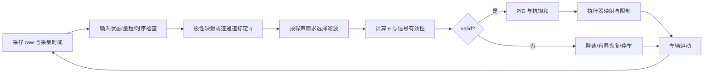

# B：光电数据类型、预处理与感知到 PID

本稿遵守 conventions.md。来源事实、数学推导、工程建议与算例假设分别标明；不推导 A 所负责的两种偏差算法，不涉及惯导，不预设尚未确定的代码接口。

## 1. 读数究竟代表什么

**来源事实。** 反射式光电循迹模块通常用发射器照射地面，再通过接收器观察反射光；输出还受地面材料、安装高度、环境光和电路影响，并非直接给出“线中心坐标”。Pololu QTR-A 的光电晶体管与上拉电阻产生模拟电压，反射强时电压趋低、反射弱时趋高。厂家用黑胶带和白纸的旋转圆盘展示波形：高度增大使黑白输出差缩小，电机噪声可见，因此安装与滤波影响判别能力。[Pololu QTR 模拟输出与波形](https://www.pololu.com/docs/0J13/3)。这些结论针对该电路，不证明所有模块极性相同，也不证明“黑色”在任意红外波长下反射一定最弱。

数字量必须再区分两个概念。一位 DO 是比较后的高低电平，每通道每次只保留阈值哪一侧的信息。例如 DFRobot SEN0017 官方注明黑色 LOW、白色 HIGH；本报告黑线目标时应映射 LOW→q=1、HIGH→q=0。[DFRobot SEN0017 官方说明](https://wiki.dfrobot.com/sen0017/)。模块内部比较器的正负输入、反相器或固件会改变极性，接入其他产品时必须实际测量黑白两种状态。

**GPIO 数字接口不必然只有一位光学信息。** Pololu QTR-RC 先将电容充电，再释放 GPIO，并测量下降到逻辑低电平的时间。反射强时放电较快，时间较短；计时结果是多级反射测量，不等于只读一次 LOW/HIGH。厂家显示安装高度增大可将黑面脉宽从毫秒级拉长，影响更新率，并建议对电机毛刺做持续低电平确认。[Pololu QTR-RC 输出原理和示波器测量](https://www.pololu.com/docs/0J13/2)。RC 计时可沿用连续读数的标定流程，但要保留单位、计时分辨率、超时饱和标志，不能当作 ADC counts。

| 数据类型 | 每次信息与分辨能力 | 阈值/噪声特点 | 用于偏差算法的限制 |
|---|---|---|---|
| 一位比较器 DO | 只有目标/背景分类；空间分辨主要由通道位置、光斑与目标宽度决定 | 阈值附近可能反复跳变；阈值可能固定或可调；只能看到结果，无法恢复原始幅度 | q_i∈{0,1} 可做质心或左右计数差比和，但误差呈台阶；多线/全命中时不能唯一解释 |
| AO+ADC | 多级幅度；理想 B 位 ADC 有 2^B 个码，不等于 2^B 个有效光学等级 | 需考虑参考电压、饱和、噪声、通道差异；可做软件阈值、软权重 | 连续 q 可平滑估计，但需标定，位置精度仍取决于光斑与空间响应 |
| RC+GPIO 计时 | 脉宽多级；计时器分辨率及超时决定可用等级 | 逻辑门限、毛刺、安装高度影响时间；超时截断 | 可作为连续原始量；较长读出时间可能增加延迟，不能误称固定一位输入 |

表中关于量化与信息损失的内容是数学/信号处理结论。ADC 的电压换算若需要可写 V=raw·V_ref/(2^B−1)，但 ADC→电压并不自动得到物理反射率，目标线检测仅需稳定的相对强度标定。

## 2. 标定、归一化、阈值与滤波

**来源事实。** Pololu 的官方库建议在初始化阶段让每个通道实际接触最亮与最暗区域；也提供发射器开/关两次读取来减少非均匀环境光影响。该文档明确针对 QTRSensors **3.1.0**，不能把其接口照搬为当前任意版本。[QTRSensors 3.1.0 校准与读出模式](https://www.pololu.com/docs/0j19/all)。本文借鉴原理，不依赖该库。

**报告定义与数学推导。** 令 r_i 为 ADC counts 或 RC 秒数，b_i 为背景读数，ℓ_i 为目标线读数，不要求 ℓ_i>b_i。统一目标强度为

\[
q_i=\operatorname{clip}_{[0,1]}\left(\frac{r_i-b_i}{\ell_i-b_i}\right).
\]

这样背景映射 0，目标映射 1，即使原始极性相反也成立。分母 |ℓ_i−b_i| 过小意味着缺乏对比，必须将标定判为无效，而不是加极小数继续运行。可用重复采样估计目标/背景均值、标准差和分位数：背景与目标分布间隔应明显大于噪声及环境变化；阈值选在两类分布之间。0.5 只在归一化且两类误判代价相近时是示例起点，不能替代分布检验。归一化后的噪声近似 σ_q=σ_r/|ℓ−b|，解释了低对比归一化为何放大噪声。截断是算法边界约束；原始超量程与截断仍应记录，不能用 clip 隐藏断线/饱和。

**算例假设。** 五通道均设 b=100、ℓ=900 counts，读取 [180,260,420,740,820]，则 q=[0.10,0.20,0.40,0.80,0.90]。若实际电路极性相反，b=900、ℓ=100，读数 [820,740,580,260,180] 得到同一个 q。若 σ_r=8 counts，对比 800 counts 时 σ_q≈0.01；对比只有 80 counts 时约 0.1，这不是 PID 调参能够恢复的信息。

**工程建议。** 标定在最终安装高度、赛道材料和供电条件下进行，逐通道存储参数；边缘线宽及光斑分布用横向扫描标定。环境光影响明显且模块允许控制发射器时，可做开/关采样，但具体补偿公式须匹配电路；非线性 AO/RC 不能无条件用 r_on−r_off 当反射率。两次采样还增加耗时，并受车辆运动造成的空间错位影响。

连续 q 如确有噪声，可以一阶低通

\[
\bar q_{i,k}=\bar q_{i,k-1}+\alpha_k(q_{i,k}-\bar q_{i,k-1}),\qquad
\alpha_k=\frac{\Delta t_k}{\tau_q+\Delta t_k}.
\]

这是连续一阶滤波的后向欧拉离散化，τ_q 单位 s；τ_q=0 时直接通过。初始化用首个有效 q，而不是把滤波器初始化为全零后制造假的丢线。中值滤波适于孤立尖峰，均值滤波适于独立随机噪声；不是每种滤波都要叠加。M 点滑动平均低频附近群延迟约 (M−1)T/2，一阶低通低频附近延迟约 τ_q，因此滤波越重通常越迟钝。硬件低通可在 ADC 前降低带外噪声；软件滤波无法消除已经发生的混叠。

一位 DO 可用迟滞或时间一致性抑制抖动，但迟滞只在可读 AO 或可配置比较器时能实现完整上下阈值：q≥θ_on 判目标，q≤θ_off 判背景，中间保留前次，且 θ_on>θ_off。只有 DO 时可连续 K 次一致才切换，代价是约 (K−1)T 的附加延迟且可能抹掉窄线；其参数应由噪声持续时间与最短真实事件持续时间共同决定。

## 3. 从采样到控制输出

下表为完整闭环。偏差公式遵守共同约定；这里只讨论接口语义与处理依赖。

| 步骤 | 输入 → 输出 | 目的与必须/可选处理 |
|---|---|---|
| 定时采样 | 电压/DO/RC → 原始通道数组、采集时间戳、硬件状态 | 明确极性、量程、通道顺序；检查 ADC 饱和、RC 超时、通信校验、采样新鲜度；记录实际 Δt |
| 标定与统一强度 | 原始数组、b_i、ℓ_i → q_i∈[0,1]、标定有效标志 | 模拟/计时需归一化并验证对比；DO 做极性映射；必要时补偿环境光 |
| 选择性滤波/门限 | q_i、历史 → 处理后强度、检测状态 | 只在噪声需求下采用；计入延迟；原始异常不能因滤波而继续显示正常 |
| 偏差计算 | 有效强度、y_i/左右组 → e、signal、valid、reason | 质心总强度和差比和分母要分别判断；空间形状与总信号可用于低置信度/多线判断 |
| 控制 | 有效 e、Δt、PID 状态 → 限幅转向 u | 首帧/恢复帧抑制导数跳变；可选小积分；导数低通；考虑饱和与实际执行器限制 |
| 执行 | u、基础速度、硬件映射 → PWM/转角/轮速命令 | 再检查输出范围/变化率；硬件符号必须试验；执行器是闭环一部分，不是公式输出即实际转角 |

**几何限制。** 阵列若在车体中心前方距离 a，局部近直线时读到的横向位置同时含车体横向偏移及航向误差的投影，近似为“横向项+a·sin(航向项)”；符号取决于几何定义。因此单排阵列偏差不等于独立完整测量“车身横向误差”，PID 参数也与预瞄距离相关。赛道交叉、多线、过宽线与线离开阵列时，需要状态机或更多观测。

**报告 PID 定义。** 目标线在左时 e>0，u>0 表示左转。本报告让 PID 输入就是这个转向误差信号，相当于在所选执行器约定下使用 measurement−reference，而不是直接套用常见 setpoint−measurement 后忘记反号。对于归一化 u，e、u 均无量纲，K_p 无量纲，K_i 单位 s⁻¹，K_d 单位 s：

\[
d_k^{raw}=\frac{e_k-e_{k-1}}{\Delta t_k},\quad
d_k=d_{k-1}+\frac{\Delta t_k}{\tau_d+\Delta t_k}(d_k^{raw}-d_{k-1}),
\]
\[
I_k^{try}=I_{k-1}+K_i e_k\Delta t_k,\quad
u_k^*=K_p e_k+I_k^{try}+K_d d_k,\quad
u_k=\operatorname{clip}_{[-u_{max},u_{max}]}u_k^*.
\]

I 是已经乘过 K_i 的积分输出，因此其单位与 u 相同。若 u_k^*>u_max 且 K_i e_k>0，或 u_k^*<−u_max 且 K_i e_k<0，则拒绝本次向饱和方向增长的积分，并用旧 I 重算输出；反方向积分允许退饱和。若下游轮速/舵机又限幅，应按真实可执行输出做跟踪抗饱和；仅限制 PID 前级不保证执行器不饱和。MathWorks 官方文档说明带一阶导数滤波的离散 PID、显式采样时间及实际 Δt 接口；其抗饱和示例说明条件积分/回算与执行器饱和的关系。[PID 结构与离散采样](https://www.mathworks.com/help/simulink/slref/pidcontroller.html)、[抗积分饱和官方示例](https://www.mathworks.com/help/simulink/slref/anti-windup-control-using-a-pid-controller.html)。上述具体递推式是本文选择的通用实现，不声称照抄某软件。

**算例假设。** Δt=0.01 s，e_prev=0.20，e=0.30，d_prev=0，τ_d=0.02 s，K_p=0.8、K_i=0.1 s⁻¹、K_d=0.02 s、I_prev=0。得 d_raw=10 s⁻¹、d=3.3333 s⁻¹、I_try=0.0003、u*=0.306967；u_max=0.5 时不饱和。若 u_max=0.25，正误差把积分推向上饱和，拒绝 I_try，再算 u*=0.306667，输出 0.25。首帧 d=0，不能凭不存在的上一帧做差分。

差速车一个示例映射是 v_L=v_0−k_u u、v_R=v_0+k_u u，其中速度单位 m/s，k_u 单位 m/s，u>0 时右轮较快，向左转；具体轮距 B 下角速度 ω=(v_R−v_L)/B。若左/右轮速限制为 [0,v_max]，要满足 |k_u u|≤min(v_0,v_max−v_0)，或统一缩放轮速并让 PID 知道实际饱和。PWM 相等不保证轮速相等，可增设编码器轮速内环。舵机车则输出左转为正的转角映射，必须标定中位、机械限位、死区与响应；不能直接套用差速映射。

## 4. 异常与丢线：不可把缺失数据当零误差

**工程策略。** valid/reason 必须伴随数值；没有足够线信息时 e=0 只能是存储占位，不能向 PID 宣称车辆居中。

- 全阵列信号不足（Σq_i 小、峰值低且与背景统计一致）：标为 LOW_SIGNAL/LOST。短时丢线可冻结积分、关闭导数、降速，使用最后可靠方向执行有界恢复；持续超时停车。恢复时用新 e 重新初始化导数，避免大脉冲。所需停车超时取决于制动距离、场地和最短丢线事件；未指定车辆时不能给保证通用安全的秒数。
- 差比和 L+R 小：先看全阵列。若中间通道强而左右弱，是 CENTER_ONLY，不能等同 LOST；应切换质心并使用该算法专属增益、或明确实现条件成立的居中保持策略。缺乏这样的前提时使差比和输出无效。加 ε 到分母只能避免浮点除零，不能恢复信息。
- 超量程、NaN、长度不符、无效标定、过期帧、Δt≤0：标为输入/时序故障，不继续更新 PID 状态；上层降速或停车。容忍单坏通道并剔除后重新归一化是一种额外策略，但会改变空间响应，应有独立校验；通用示例可以直接拒绝整帧。
- 全部强/对称两侧强：可能是宽线、路口、标记或环境干扰。两算法即使算出 e=0，也不能证明单条线居中；必须利用已知赛道规则、连通分组/形状判据或附加传感器。保留 AMBIGUOUS 状态。
- ADC 满量程或 RC 超时：可能是真黑面，也可能高度异常/断线。仅凭一个读数不能判断；必须结合标定范围、其他通道、持续性和硬件诊断。

## 5. 采样与参数的依据

**数学推导。** 假设采样、滤波、计算、通信、执行器合计延迟 τ，在速度 v 下车体前进 vτ；纯延迟在角频率 ω 处附加相位 −ωτ。因此更长滤波、RC 超时或阻塞串口打印都会消耗相位裕量；更快 CPU 不会自动降低光学读出、执行器和机械延迟。名义 T=0.01 s 只是本报告示例。实际周期应依据传感器读出上限、目标带宽、执行器动态、最高速度下的事件宽度和 CPU 负载确定；有效事件尺度 l 对应时间 l/v，需要多个样本才能可靠识别，不能只满足抽象 Nyquist 后忽略传感器光斑和运动。

**工程建议。** 先用静止和横向扫线日志测噪声/对比/线宽/算法 e 的单调区，再确定滤波强度与低信号阈值。确认“目标在左→命令左转”的符号后，从低速 P 或 PD 开始：K_p 提高使同偏差下转向更强，但过大会振荡或频繁饱和；K_d 提高阻尼及趋势响应，却放大差分噪声；只有持续静差且不是机械/标定/左右速度问题时才增小量 K_i。通过相同赛道与速度下的横向 RMS、峰值、丢线次数、饱和占比和执行器抖动评价，之后逐级增速重新辨识。两算法 e 尺度虽同为 [−1,1]，局部斜率不同，不能无条件共享 PID 增益。

**公开工程的支持边界。** Pololu 3pi 官方给出从 line position 到 PID 再到限幅差速的源码，并建议逐步升速调参；这是可核验工程依据，支持“连续偏差+闭环转向可实际实施”。其码值 255 是电机命令，不是 m/s，示例增益与离散求和/差分的采样方式绑定，不能转移为本报告 SI 时间公式中的增益，也不能据此宣称任意车辆高速。[Pololu 3pi PID 循迹公开实现](https://www.pololu.com/docs/0J21/7.c)。未获得本车的光电型号、车体动力学、安装几何与赛道实验，不能给绝对最高速度或保证不丢线。

## 6. 核验过的参考资料及支持范围

| 编号 | 主来源 | 本文采用的支持范围 | 不支持的外推 |
|---|---|---|---|
| B1 | [Pololu QTR AO 应用说明](https://www.pololu.com/docs/0J13/3) | AO 电路极性、距离/对比变化、实测电机噪声、滤波需求 | 任意模块相同极性；整车速度证明 |
| B2 | [Pololu QTR RC 应用说明](https://www.pololu.com/docs/0J13/2) | 充放电计时、多级脉宽、读出与安装高度相关、毛刺处理 | 数字接口必为一位分类；保证固定 100 Hz |
| B3 | [DFRobot SEN0017](https://wiki.dfrobot.com/sen0017/) | 特定模块黑 LOW/白 HIGH，型号例证 | 所有 DO 都黑 LOW；模块必有可调阈值 |
| B4 | [QTRSensors 3.1.0 文档](https://www.pololu.com/docs/0j19/all) | 黑白标定，开/关环境光模式，ADC/RC 读法 | 当前库 API 或任意电路补偿公式 |
| B5 | [MathWorks PID Controller](https://www.mathworks.com/help/simulink/slref/pidcontroller.html) | 离散 PID、导数滤波、采样时间的重要性 | 本车闭环稳定保证 |
| B6 | [MathWorks Anti-Windup 示例](https://www.mathworks.com/help/simulink/slref/anti-windup-control-using-a-pid-controller.html) | 条件积分、回算、下游饱和/跟踪机制 | 任意参数均稳定；单纯积分限幅即可处理所有饱和 |
| B7 | [Pololu 3pi PID 源码与指南](https://www.pololu.com/docs/0J21/7.c) | 实际偏差到 PID、输出限幅、差速、逐步升速调参 | 电机命令等于运动速度；示例增益可直接移植 |

以上网页已联网打开核验。本文未引入未核验的论文或实验结果。

## 7. 交给主 agent 的接口/实现建议与未决条件

### 供离线 HTML 直接呈现的公式版本

```text
标定：q[i] = clip((raw[i] − background[i]) / (line[i] − background[i]), 0, 1)
要求：abs(line[i] − background[i]) ≥ 最小有效对比。
滤波：α = dt / (τq + dt)
      q_filtered[i] = q_prev[i] + α · (q[i] − q_prev[i])
导数：D_raw = (e − e_prev) / dt
      D = D_prev + dt / (τd + dt) · (D_raw − D_prev)
积分：I_try = I_prev + Ki · e · dt
输出：u_raw = Kp · e + I_try + Kd · D
      u = clip(u_raw, −u_max, +u_max)
抗饱和：若向已饱和方向继续积分，拒绝 I_try，用 I_prev 重算输出。
差速示例：v_left = v_base − k_u · u
          v_right = v_base + k_u · u
          yaw_rate = (v_right − v_left) / wheel_track
延迟：运动距离 = v · τ；附加相位 = −ω · τ。
```

dt、τq、τd、τ 均为 s；e 和 u 无量纲；I 是积分控制输出而非未乘 Ki 的误差积分；D 为 s⁻¹；Kp 无量纲、Ki 为 s⁻¹、Kd 为 s；v 为 m/s、wheel_track 为 m、yaw_rate 为 rad/s（rad 在量纲计算中视为无量纲）。



Mermaid 为流程语义参考；正式离线报告应转换为 SVG 或纯 HTML 方框箭头，不能依赖在线脚本。

第二轮统一接口时应包含原始模式（analog/digital/RC）、原始单位、target_level、逐通道背景/目标标定、timestamp、q、算法名称、valid、reason、signal、PID 输出与实际执行器饱和标志；接口由主 agent 最终定案。可运行 Python 示例可以抽象光电为 analog/digital，明确 RC 驱动未实现。异常状态必须独立于 e；中心通道单独命中与全阵列 LOST 必须分开。建议用实际 Δt 的连续时间增益参数、首帧导数置零、导数低通与条件积分。

未决问题均不阻碍通用算法报告：具体模块是否 AO、DO 或 RC；逻辑电平是否适配主控；安装高度与前置距离；机械类型（差速/舵机）；线宽与路口规则；实际制动能力；ADC 有效位数和噪声谱。缺失这些条件限制硬件驱动、最终参数和实车性能结论，不限制本文公式/接口的通用说明。
