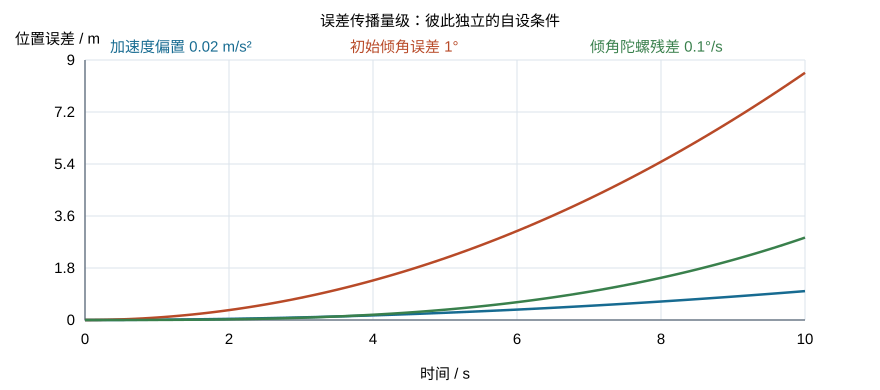
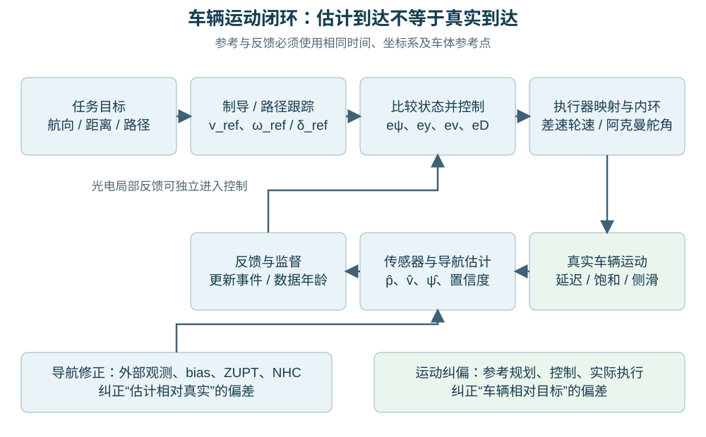
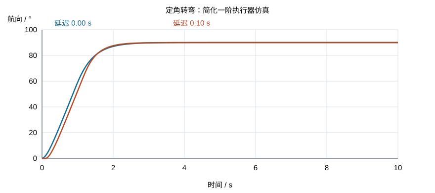

# 惯导系统原理、偏差修正与车辆运动控制：论文与公开实例分析

研究日期：2026年10月7日。对象：地面轮式车辆，先讨论局部平面，再扩展坡道与三维运动。

本报告基于实际联网检索、公开全文及作者代码阅读。它是一份独立研究报告，未修改已有报告、固件或工程配置。已有《光电感知与惯性导航》报告仅作为缺口参考；采用其中的坐标约定与物理解释前，重新核验了原始来源。

**主要判断。** IMU提供运动增量，不直接提供无漂移的位置。导航估计器利用惯性预测、轮地约束和外部观测估计状态与误差；制导算法把目标变成参考速度、角速度或转角；控制器使真实车辆跟随这些参考。只有估计链路和执行链路都成立，才能讨论“到达目标”。复杂滤波器不会创造缺失的观测，轮程准确也不等于全局航向准确。

证据分为四类：**【文献事实】** 表示原文明确支持的算法或结论；**【公开实验】** 表示作者报告的实验结果；**【本文推导】** 表示在声明假设下自行推导；**【建议方案】** 表示尚需实车验证的设计。引用编号S01等对应第17章及独立文献索引。章节、图、表号以该索引注明的版本为准。本文算例实际运行，但不构成论文复现或实车性能验证。

为便于后文阅读，常用缩写预先说明：

| 缩写 | 中文解释 |
|---|---|
| GNSS / RTK / PPK | 全球导航卫星系统 / 实时动态差分定位 / 后处理动态定位 |
| EKF / ESKF | 扩展卡尔曼滤波 / 误差状态卡尔曼滤波（本文以扩展滤波实现） |
| MEKF / UKF / IEKF | 乘法扩展卡尔曼滤波 / 无迹卡尔曼滤波 / 不变扩展卡尔曼滤波（本报告此缩写不表示迭代EKF） |
| NHC / ZUPT | 非完整运动约束（限制独立侧移等自由度） / 零速度更新 |
| VO / VIO / SLAM | 视觉里程计 / 视觉惯性里程计 / 同时定位与地图构建 |
| UWB / NLOS | 超宽带无线测距 / 非视距传播（直达路径受遮挡） |
| RMS / RMSE / ATE / RPE | 均方根 / 均方根误差 / 绝对轨迹误差 / 相对轨迹误差 |
| SI / ADC / PWM | 国际单位制 / 模数转换 / 脉冲宽度调制 |

“滤波”在此主要指状态估计，并非简单低通；“创新”是观测减预测观测的残差；“协方差”描述误差二阶统计量；“可观测性”指不同状态是否能由测量历史区分。神经网络、卡尔曼和控制PID各有不同职责，不能用名称代替物理模型。

## 1. 整体架构：测量、估计、制导和控制

惯性测量单元（Inertial Measurement Unit，IMU）通常包含三轴陀螺仪和三轴加速度计，分别输出角速度及比力；有些产品另含磁力计，但“九轴”并不自动具备可靠定位。姿态与航向参考系统（Attitude and Heading Reference System，AHRS）估计旋转，通常借助重力和磁场；六轴模式的航向仍缺绝对参考。纯惯性导航系统（Inertial Navigation System，INS）由初始姿态、速度、位置出发，积分惯性测量得到姿态、速度和位置。组合导航增加轮速、卫星、视觉或测距观测，修正状态及误差。[S01](https://www.cl.cam.ac.uk/techreports/UCAM-CL-TR-696.pdf)，[S13](https://github.com/xioTechnologies/Fusion)

图中辅助观测既可能进入导航估计，也可能直接进入局部控制，二者需要显式区分。例如光电阵列读数可直接产生循迹转向误差，却不能未经几何建模就作为全局位置。控制器输出也不是新传感器真值：电机命令不保证轮速，轮速不保证地面速度。

| 层次 | 输入与输出 | 能力和必要条件 | 边界 |
|---|---|---|---|
| 测量层 | 原始计数、时间戳、温度→SI量 | 量程、轴向、比例和时钟已核对 | 读数正常不代表无零偏或不打滑 |
| 姿态/导航估计器 | IMU与辅助观测→姿态、速度、位置、协方差 | 初值、标定、观测模型成立 | 协方差描述模型内不确定性，不保证覆盖所有故障 |
| 制导/路径跟踪 | 目标与估计状态→参考量 | 路径可执行、参考点定义一致 | 不能修复未知定位偏差 |
| 运动控制器 | 参考与反馈→轮速/舵机/驱动力命令 | 执行器有足够带宽和余量 | 饱和、延迟和轮胎力可能使跟随失败 |
| 监督层 | 创新、健康状态、任务状态→接受、降级、停车、恢复 | 独立诊断及明确模式转换 | 无独立信息时一些故障无法可靠识别 |

Stanley论文§3、§4、§9展示了从时戳化传感器、状态估计、路径规划到转向及速度闭环的分层公开工程；本报告结构借鉴其职责分离，不搬用其车辆参数。[S09](https://robots.stanford.edu/papers/thrun.stanley05.pdf)

## 2. 完整导航解算：从原始量到位置

### 2.1 坐标、符号与初值

| 符号 | 定义 | 单位/约定 |
|---|---|---|
| $s,b,n$ | 传感器系、车体系、局部导航系 | $b$：$x$前、$y$左、$z$上；$n$：起点固定水平右手系，$x$方向事先指定 |
| $R_{nb}$、$R_{bs}$ | 分别把$b$向量转到$n$、把s向量转到$b$ | 正交矩阵，行列式+1；逆为转置 |
| $q_{nb}$ | 与$R_{nb}$等价的单位四元数 | Hamilton乘法、标量在前；旋转为$q\otimes[0,u_b]\otimes q^{*}$ |
| $\phi$、$\theta$、$\psi$ | 横滚、俯仰、航向 | rad；$R_{nb}=R_z(\psi)R_y(\theta)R_x(\phi)$，逆时针航向为正 |
| $f$、$\omega$ | 比力、角速度 | $\mathrm{m/s^2}$、rad/s；角度制先乘$\pi/180$ |
| $p_{n}$、$v_{n}$、$g_{n}$ | 位置、速度、重力 | m、m/s、$\mathrm{m/s^2}$；$g_n=(0,0,-g)$，示例$g=9.80665$ |
| $b_{g}$、$b_{a}$ | 校准后剩余陀螺/加速度零偏 | rad/s、$\mathrm{m/s^2}$；在$b$系表达 |
| $t_{k}$、$\Delta t$ | 采集时刻、$t_{k+1}-t_k$ | s，单调同源时间，不用通信到达时间替代 |
| hat、$\delta$ | hat表示估计；第6章$\delta=\mathrm{true}-\mathrm{nominal}$ | 控制偏差另记$e$，避免混淆 |

若$n$是“初始前向为$x$”的局部系，则$\psi=0$只是相对初始方向，不是正北。若改用ENU（东、北、天），必须整体转换姿态、观测和地图。平面位置参考点固定在后轴中心/差速轮轴中点；IMU不在该点时要补偿杆臂。

初值必须包括$q_{0}$、$v_{0}$、$p_{0}$及其不确定性。静止可设置$v_0=0$；运动中启动不能强行置零。$p_0=0$可以是局部原点约定；真实全球位置需要外部定位。静止重力给出倾角，不能给出绝对航向。

### 2.2 原始测量与标定

在s系采用测量模型：

$$
\begin{aligned}
\omega_m^s &= M_g\omega_{\mathrm{true}}^s+b_g^s(T)+n_g,\\
f_m^s &= M_af_{\mathrm{true}}^s+b_a^s(T)+n_a.
\end{aligned}
\tag{2-1}
$$

$$
\begin{aligned}
\omega_c^b &= R_{bs}M_g^{-1}\bigl[\omega_m^s-b_g^s(T)\bigr],\\
f_c^b &= R_{bs}M_a^{-1}\bigl[f_m^s-b_a^s(T)\bigr].
\end{aligned}
\tag{2-2}
$$

原始ADC/寄存器计数先乘对应灵敏度变为SI量；$M_{g}$、$M_{a}$为无量纲比例/非正交矩阵，$n$为随机噪声。在线残差零偏应在离线补偿后扣除，不能重复扣同一项。某些厂家或论文把偏置定义为“加回的校准量”，符号与(2-1)相反；索引S04原式就是另一种定义，本文统一按减法模型重写。

比力满足$f^b=R_{nb}^{\mathsf T}(a^n-g^n)$。因此水平静止加速度计输出约$(0,0,+g)$，而真实线加速度为零。自由落体接近零比力；这两种情况不能混淆。[S03](https://arxiv.org/pdf/1711.02508)，[S04](https://albertopretto.altervista.org/papers/tpm_icra2014.pdf)

### 2.3 姿态更新与重力补偿

小范围、短时间导航暂忽略地球自转与导航系运输角速度，角速度视作$b$相对$n$的角速度。对区间平均角速度$\bar\omega$和旋转向量$d=\bar\omega\,\Delta t$：

$$
\begin{aligned}
\dot q_{nb} &= \frac12q_{nb}\otimes[0,\omega_c^b],\\
\Delta q(d) &=
\left[\cos\frac{\lVert d\rVert}{2},
\frac{d}{\lVert d\rVert}\sin\frac{\lVert d\rVert}{2}\right].
\end{aligned}
\tag{2-3}
$$

$$
\begin{aligned}
q_{k+1} &= \operatorname{normalize}\bigl(q_k\otimes\Delta q(d)\bigr),\\
R_{k+\frac12} &= R\bigl(q_k\otimes\Delta q(d/2)\bigr),\\
a_{k+\frac12}^n &= R_{k+\frac12}\bar f_c^b+g^n.
\end{aligned}
\tag{2-4}
$$

$\lVert d\rVert$接近零时$\Delta q$向量部分用$d/2$的极限，避免除零。归一化仅维持单位四元数，不能消除姿态偏差。非交换的多轴转动不能靠三个欧拉角各自积分；高动态时需要锥运动/划桨补偿、足够采样率及抗混叠。[S03原文旋转积分与误差状态部分](https://arxiv.org/pdf/1711.02508)

### 2.4 速度与位置离散积分

若区间加速度按中点常值近似：

$$
\begin{aligned}
v_{k+1} &= v_k+a_{k+\frac12}\Delta t,\\
p_{k+1} &= p_k+v_k\Delta t+\frac12a_{k+\frac12}(\Delta t)^2.
\end{aligned}
\tag{2-5}
$$

或者用$a_{k}$、$a_{k+1}$的梯形平均更新速度，再用$\frac{v_k+v_{k+1}}{2}\Delta t$更新位置；必须明确计算时序。直接用新速度乘$\Delta t$更新位置会给恒加速问题多加半个步长的位移。中点/梯形方法改进离散近似，不抑制恒定零偏。起始样本只有时间和测量基线，未经过一个区间不能凭空积分。

**【本文算例】** 已校准、无姿态误差，$f_b=(1,0,g)$，$q=\text{单位四元数}$，$v_0=p_0=0$，$\Delta t=0.01\,\mathrm{s}$：$a_n=(1,0,0)$，第一步$v_x=0.01\,\mathrm{m/s}$、$p_x=0.00005\,\mathrm m$；1 s后$v_x=1\,\mathrm{m/s}$、$p_x=0.5\,\mathrm m$。持续采样时的时戳抖动需使用实际$\Delta t$，丢掉一个样本不能自动知道该区间真实角增量。

### 2.5 平面轮式替代链路

水平、无侧滑条件下，常用“陀螺定向+轮程定平移”，减少低成本加速度的双积分依赖：

$$
\Delta s_i=\frac{2\pi r_i\Delta N_i}{N_{\mathrm{rev}}},
\qquad i\in\{L,R\}.
\tag{2-6}
$$

$$
\begin{aligned}
\Delta s &= \frac{\Delta s_R+\Delta s_L}{2},
&\Delta\psi_{\mathrm{odo}}&=\frac{\Delta s_R-\Delta s_L}{B},\\
\Delta\psi_{\mathrm{gyro}} &=
(\omega_z-b_{g,z})\Delta t,
&\psi_{\mathrm{mid}}&=\psi_k+\frac{\Delta\psi}{2},\\
\Delta p &=
\Delta s\,\operatorname{sinc}\!\left(\frac{\Delta\psi}{2}\right)
\begin{bmatrix}\cos\psi_{\mathrm{mid}}\\\sin\psi_{\mathrm{mid}}\end{bmatrix}.
\end{aligned}
\tag{2-7}
$$

$r$为有效轮半径m，$B$为轮距m，$N_{\mathrm{rev}}$是含减速与倍频的一轮转计数；$\operatorname{sinc}(u)=\frac{\sin u}{u}$且$\operatorname{sinc}(0)=1$。(2-7)是假设区间曲率恒定的圆弧积分，$\Delta \psi$小才可省去sinc。此链路是组合航位推算，不是纯INS，也不是三维导航。两种$\Delta \psi$不能随意当独立真值相加，融合见第6章。[S05](https://www.cs.cmu.edu/~motionplanning/papers/sbp_papers/integrated2/borenstien_gyro.pdf)，[S06](https://arxiv.org/pdf/1912.07805v4)

## 3. 误差来源、传播与量级

### 3.1 误差类别与识别线索

| 误差 | 作用方式 | 识别办法 | 修正边界 |
|---|---|---|---|
| 陀螺零偏 | 未补偿残差$\beta_{g}$持续积分 | 静止均值、独立角参考、转弯后残差 | 匀速真实转动与偏置可混淆 |
| 加速度零偏 | 恒定残差$\beta_{a}$被双积分 | 多姿态重力、速度/位置创新 | 单姿态中与倾角混淆 |
| 白噪声/偏置慢变 | 角/速度随机游走及低频漂移 | 长静态日志、Allan偏差、频谱 | Allan“偏置不稳定性”不等于恒定偏置可全减掉 |
| 比例因子 | 测量增益随真实运动幅度偏差 | 已知角度/速率、重力多姿态、已知距离 | 静止陀螺均值不能标定旋转比例 |
| 轴间非正交与安装误差 | 跨轴耦合、错误投影 | 多轴激励与安装几何校验 | 传感器内部轴误差和整车安装旋转应分别处理 |
| 温漂/自热/迟滞 | $b(T)$、$M(T)$随温度和历史变化 | 升温降温与恒温对照 | 单次线性温补不能保证全温度范围 |
| 初始姿态/速度/位置 | 初值偏差持续传播 | 起始外部参考与初始化检查 | 无绝对信息时原点和航向规范自由度保留 |
| 时间/外参/杆臂 | 同一运动在不同点/时刻被比较 | 延迟扫描、多方向转弯、时间脉冲 | 长期恒速时某些时延和位置偏移难分离 |
| 振动、量化、饱和 | 混叠、整流、丢失真实增量 | 原始高频/量程日志、频谱、过量程标志 | 被削顶的角增量不能由滤波器重建 |

误差分类及Allan分析可追溯S01§3–5；将其旧器件结果外推为当代所有IMU精度是不成立的。[S01](https://www.cl.cam.ac.uk/techreports/UCAM-CL-TR-696.pdf)

### 3.2 为什么姿态误差会变成位置误差

**【本文推导】** 定义估计减真实的姿态小扰动$\varepsilon_{\theta}$在$n$系表达，$\widehat R\approx(I+[\varepsilon_\theta]_\times)R_{\mathrm{true}}$。残余比力误差$\beta_{a}$在$b$系表达，则

$$
\begin{aligned}
\varepsilon_a &\approx
R_{\mathrm{true}}\beta_a+
[\varepsilon_\theta]_\times R_{\mathrm{true}}f_{\mathrm{true}},\\
\dot\varepsilon_v &= \varepsilon_a,
&\dot\varepsilon_p&=\varepsilon_v.
\end{aligned}
\tag{3-1}
$$

$[u]_\times v=u\times v$，扰动角rad视为无量纲。静止时$R_{\mathrm{true}}f_{\mathrm{true}}\approx(0,0,g)$，水平倾角误差大小$\varepsilon_{\mathrm{tilt}}$导致约$g\varepsilon_{\mathrm{tilt}}$的水平伪加速度。因此：

$$
\begin{aligned}
\text{恒定加速度残差:}\quad
\lVert\varepsilon_v\rVert&\approx\lVert\beta_a\rVert t,
&\lVert\varepsilon_p\rVert&\approx\frac12\lVert\beta_a\rVert t^2,\\
\text{恒定初始倾角:}\quad
\lVert\varepsilon_p\rVert&\approx
\frac12g|\varepsilon_{\mathrm{tilt},0}|t^2,\\
\text{倾角陀螺残差:}\quad
|\varepsilon_{\mathrm{tilt}}|&\approx|\beta_{g,\mathrm{tilt}}|t,
&\lVert\varepsilon_p\rVert&\approx
\frac{g|\beta_{g,\mathrm{tilt}}|t^3}{6},\\
\text{初始速度残差:}\quad
\varepsilon_p(t)&=\varepsilon_p(0)+\varepsilon_v(0)t.
\end{aligned}
\tag{3-2}
$$

这里三次增长是短时、局部、小角、无辅助修正下的量级，不适用于已长期校正的滤波器或任意三维运动。**纯yaw误差不把垂直重力泄漏到水平面。** 但轮式车辆以恒速$v$沿真实$x$直行时，yaw残差$\beta_{g,z}$使横向位移：

$$
\begin{aligned}
\varepsilon_y
&=\int_0^t v\sin(\beta_{g,z}\tau)\,\mathrm d\tau\\
&=\frac{v[1-\cos(\beta_{g,z}t)]}{\beta_{g,z}}
\approx\frac12v\beta_{g,z}t^2.
\end{aligned}
\tag{3-3}
$$

$$
\text{初始yaw误差 }\varepsilon_{\psi,0}:\qquad
\varepsilon_y\approx vt\sin\varepsilon_{\psi,0}.
$$

独立连续白噪声定义$\mathbb E[n(t)n(t')]=q\delta(t-t')$时：加速度噪声$\sigma_v=\sqrt{q_a t}$、$\sigma_p=\sqrt{q_a t^3/3}$；gyro噪声$\sigma_\theta=\sqrt{q_g t}$。若其倾角噪声通过重力传播，忽略其他耦合有$\sigma_p\approx g\sqrt{q_g t^5/20}$。采样方差$\sigma_{\mathrm{sample}}^2$与连续强度$q$不能混用：理想区间平均白噪声$\sigma_{\mathrm{sample}}^2=q/\Delta t$，实际滤波带宽和时域相关性可能使此关系失效。

### 3.3 已运行的数值算例

以下参数全部自设，各行独立，不代表某一器件。结果由`tools/numerical_examples.py`实际计算，原始输出在`data/results.json`。

| 情况 | 条件 | 结果 |
|---|---|---|
| 加速度残差 | 0.02 $\mathrm{m/s^2}$，10 s | 速度误差0.2 m/s、位置误差1.000 m |
| 初始倾角 | 1°，10 s，不反馈 | 重力泄漏0.171150 $\mathrm{m/s^2}$，位置误差8.557482 m |
| 倾角gyro残差 | 0.1°/s，10 s，小角 | 位置误差2.852639 m |
| yaw gyro残差+轮程 | 0.1°/s，$v=1\,\mathrm{m/s}$，10 s | 横向误差精确0.087264 m，近似0.087266 m |
| 初始yaw误差+轮程 | 1°，行驶10 m | 横向误差0.174524 m（直接几何计算） |
| 时间错位 | $v=2\,\mathrm{m/s}$、$\omega=0.5\,\mathrm{rad/s}$，错位50 ms | 约0.1 m的比较位置错位、$0.025\,\mathrm{rad}\approx1.43^\circ$姿态错位 |

时间例的位移/转角是$v\Delta\tau$、$\omega\Delta\tau$的一阶项。它们可被误认作传感器偏置、安装角或控制跟随误差；同步应先于调滤波增益。

## 4. 标定与初始对准

### 4.1 采集和计算步骤

**陀螺静态标定。** 固定IMU，预热至目标工况，记录温度、时戳、三轴角速率和静止证据；在通过静止判定的窗口计算$\widehat b=\operatorname{mean}(\omega_m)$。均值方差需考虑样本相关性，不能一概按$\sigma^2/N$估计。分开验证另一静止窗口、不同启动和不同温度；再用已知转角或转台测比例。高等级设备还需扣除地球自转投影；普通低成本MEMS不宜声称依靠地球自转可靠寻北。

**加速度多姿态标定。** 简化六面法要求每轴精确向上/向下：$b_i=\frac{f_{i,+}+f_{i,-}}{2}$，比例$m_i=\frac{f_{i,+}-f_{i,-}}{2g}$，校正$\frac{f_i-b_i}{m_i}$。六面偏斜会混入其他轴；若估计完整非正交矩阵，应采集分布良好的更多姿态。一般优化：

$$
\min_{C,b}\sum_j
\left[\left\lVert C(\bar f_j-b)\right\rVert^2-g^2\right]^2.
\tag{4-1}
$$

$C=M_a^{-1}$，$\bar f_{j}$为第j个静态均值。仅有模长约束时任意左乘旋转仍保持模长，因此必须用上三角/规范化参数固定自由度，或增加已知姿态。不要宣称该拟合同时得到完整整车安装旋转。

**【文献事实】** Tedaldi等2014年方法先利用多姿态重力范数标定加速度，再使两段静止重力方向与中间gyro积分相符，求gyro比例和轴间误差；原文§III公式(10)、(13)及§IV给出检测、积分和采集流程。其参数模型至少需9个不同姿态；实际Xsens实验使用初始约50 s静止与37次旋转，段间静止2–4 s。这些是该模型和设备的条件，不是任何IMU的统一门槛。[S04](https://albertopretto.altervista.org/papers/tpm_icra2014.pdf)

**温度补偿。** 建议在多个稳定温度点分别静态估计$b_{g}(T)$、$b_{a}(T)$，必要时$M(T)$，用分段插值或低阶模型拟合；保留升温、降温、恒温和自热数据验证迟滞。温度传感器位置、芯片热滞后和外壳温差会使“同温度同偏置”失效。超出标定温区时标记外推，并增加不确定性，不能把曲线输出视作确定真值。

**安装旋转与杆臂。** 用车体已知水平面确定竖直轴，用多次直行/双向转弯或机械基准确定前向，求$R_{bs}$；还需测量IMU到车轴、GNSS天线、相机和光电阵列的杆臂。轴排列映射只能处理90°正交安装；任意安装角需连续旋转矩阵。验证项目包括：静止$a_n\approx0$、左转yaw增、直行体轴速度前向、往返一致。

### 4.2 初始倾角与航向

在静止且加速度校准可信时，按本报告旋转约定：

$$
\begin{aligned}
\varphi_0&=\operatorname{atan2}(f_y,f_z),\\
\theta_0&=\operatorname{atan2}
\left(-f_x,\sqrt{f_y^2+f_z^2}\right).
\end{aligned}
\tag{4-2}
$$

$\psi_{0}$可来自已知起始方向、可靠倾斜补偿磁航向、双天线GNSS方向，或足够速度下的GNSS运动方向。运动方向只有在侧滑小、倒车符号已处理时近似车体航向；单天线GNSS静止位置不能提供航向。磁北、真北及$n$系$x$方向需转换。运动中持续加速时用$f$直接对准会把运动加速度当作倾角。

### 4.3 验证与剩余误差

把数据按“拟合/独立验证”分开；检查校正后重力范数残差及其随姿态/温度变化、正反转角误差、速度/位置漂移和参数重复性。只检验范数会漏掉整体安装旋转。标定可以减少稳定系统误差，不能消除随机噪声、每次上电偏置、时钟漂移、动态形变、轮滑或外部观测的错误。S04以工厂校准参数作为实测对照，有坐标换算和参数舍入局限，不提供车辆长期位置精度保证。

## 5. 姿态算法：原理、版本和选择边界

### 5.1 代表性更新式

gyro积分见(2-3)。一维互补滤波把积分的短时动态与重力倾角的低频参考结合：$\widehat\phi_k=\alpha(\widehat\phi_{k-1}+\omega_x\Delta t)+(1-\alpha)\phi_{\mathrm{acc},k}$，$\alpha\approx\exp(-\Delta t/\tau_f)$。$\phi_{\mathrm{acc}}$需处在相同连续角分支；三维不应直接把三个角按此式机械拼接。

Mahony显式互补观测器用已知方向向量的叉积反馈；改写到本报告坐标：

$$
\begin{aligned}
\hat u_i&=\hat R^\top u_i^n,
&e_R&=\sum_iw_i(u_i^b\times\hat u_i),\\
\omega_{\mathrm{corr}}&=
\omega_m-\hat b_g+K_Pe_R,\\
\dot{\hat R}&=\hat R[\omega_{\mathrm{corr}}]_\times,
&\dot{\hat b}_g&=-K_Ie_R.
\end{aligned}
\tag{5-1}
$$

$u_{i}$是单位参考/测量向量，$w_{i}$无量纲可信权；$K_{P}$单位$\mathrm{s^{-1}}$、$K_{I}$单位$\mathrm{s^{-2}}$。可信静止重力可作为$u_{i}$；受扰磁场不宜硬充参考。原文§V公式(32)及定理的充分条件包括多方向观测、激励等；其“几乎全局稳定”不是任意加速度与磁干扰下保证完整航向收敛。只有重力时绕重力轴的绝对yaw不受约束。[S02](https://www.mikrocontroller.net/attachment/197058/2007_Mahony.etal_TAC-06-396_v3.pdf)

Madgwick **2010年原始报告版本** 最小化预测重力/磁场方向与观测之差，采用解析梯度：

$$
\begin{aligned}
d&=J_{\mathrm{dir}}(q)^\top
r_{\mathrm{dir}}(q,\mathrm{observations}),\\
\dot q&=\frac12q\otimes[0,\omega]
-\beta\frac{d}{\lVert d\rVert}.
\end{aligned}
\tag{5-2}
$$

$r_{\mathrm{dir}}$是无量纲方向残差函数，$J_{\mathrm{dir}}$是它对四元数分量的雅可比，$d$是梯度；$\beta$单位$\mathrm{s^{-1}}$，$\lVert d\rVert$近零时跳过该项。IMU和MARG（磁、角速率、重力传感器阵列）形式不同。原报告还讨论磁失真与gyro漂移补偿，其附录算法版本需要逐项核对；名称相同的社区简化代码可能没有全部补偿项。[S12§3及附录](https://x-io.co.uk/downloads/madgwick_internal_report.pdf)

卡尔曼类方法预测姿态、零偏及协方差，以方向残差更新；MEKF/ESKF用三维小旋转误差更新单位四元数，避免把四个分量当独立无约束量。UKF采用采样点传播非线性；不变EKF利用系统几何组织误差。是否优于互补滤波取决于模型、可观测性、噪声和故障处理，不由算法名称决定。[S03](https://arxiv.org/pdf/1711.02508)

### 5.2 横向比较

| 方法/本报告所指版本 | 观测需求 | 动态与收敛 | 运算/调参 | 主要局限 |
|---|---|---|---|---|
| gyro积分(2-3) | 陀螺、初值 | 短时响应直接；无外部收敛机制 | 少量四元数运算；校准与积分率关键 | 零偏、初值、量程与时钟误差累积 |
| 一维互补示例 | gyro+可信重力倾角 | $\tau_{f}$控制漂移修正与动态污染折中 | 最小；一个时间常数 | 不适合直接替代完整三维状态估计 |
| Mahony，2008论文显式观测器 | gyro+参考方向，可带bias | 有条件的稳定性分析；可在线估bias | 叉积及四元数；$K_{P}$/$K_{I}$和权重 | 单方向缺yaw；持续线加速度破坏重力观测 |
| Madgwick，2010技术报告 | gyro+加速度，MARG再加磁场 | 梯度快速校正；$\beta$兼顾收敛和扰动 | 摘要操作数IMU109、MARG277（结论把IMU写108，有内部差异） | 不是时钟周期；不能直接套到不同代码/芯片 |
| $x$-io Fusion，S13固定commit | gyro+加速度，磁场或外部航向可选 | 拒绝与恢复、启动增益管理 | 多项诊断和门限；无完整位置滤波 | 作者明确说明它是博士论文第7章改进算法，**不同于原始Madgwick** |
| MEKF/ESKF/UKF等 | 惯性预测+有信息的观测 | 按状态相关性校正；大误差需重初始化或迭代 | 状态/观测矩阵、$Q$/$R$；计算随维数增长 | 模型失配、重复信息或不一致协方差会产生虚假高置信度 |

本表是结构和条件比较，不是同一数据集性能排名。S12的操作数只属于该报告实现；S13当前代码版本确认于`source_manifest.json`。低采样率可计算不代表车辆振动/高速转动没有混叠。持续加速度或向心加速度时应按运动信息降低重力观测可信度；$\lVert f\rVert\approx g$只是必要线索之一，不能充分判定“无加速”。

## 6. 组合导航：具体观测机制与完整平面融合方案

### 6.1 各种辅助观测约束什么

| 观测 | 典型模型/受约束状态 | 条件与局限 |
|---|---|---|
| 编码器前向速度 | $v_f=e_x^{\mathsf T}R^{\mathsf T}v$ | 约束速度和通过相关性约束加速度bias；轮径/轮滑误差混入速度 |
| 编码器/转角转速 | 差速$\frac{v_R-v_L}{B}$；阿克曼$v\tan\delta/L$ | 帮助区分gyro偏置；依赖有效轮距、转角标定和无滑动 |
| 非完整运动约束NHC | 车体侧向/竖直速度约0 | 可约束速度、姿态及相关bias；侧滑、跳跃时不成立 |
| 磁力计 | $m^b\approx R^{\mathsf T}m^n$ | 加上重力可约束yaw；硬铁/软铁、电机电流和环境磁场影响大 |
| GNSS位置/速度 | 天线位置$p+R l_G$，速度$v+R(\omega\times l_G)$ | 位置及其时间变化约束速度/姿态/bias；遮挡、多径、天线杆臂需处理 |
| 视觉里程计/VIO/地图定位 | 相机相对位姿、特征重投影或地图位姿 | 有纹理、光照与外参/时延；无地图VIO通常保留全局平移/yaw规范自由度 |
| UWB/激光/超声测距 | $\rho_i=\lVert p+Rl_{\mathrm{sensor}}-a_i\rVert$ | 锚点/环境几何决定可观测性；单距离不是完整位置，NLOS可严重偏置 |
| 已知线/地标 | 线法向距离、点/标记几何 | 明确地图、数据关联和安装位置；单排阵列不能独立观测全姿态位置 |

松耦合融合各模块已解算的位姿/速度，易接入但必须知道其协方差和已用信息；紧耦合直接使用原始量（伪距、特征、轮计数等），更可控但模型复杂。滑窗/因子图可以处理多时刻约束和重线性化，不能免除外参、同步和可观测性问题。

表中简化观测式是本文按测量物理重写的模型示意：$e_{x}$为车体前向单位向量；$l_{G}$、$l_{\mathrm{sensor}}$是从导航参考点指向天线/测距点的$b$系杆臂（m），$a_{i}$是$n$系已知锚点位置（m），$\rho_{i}$是距离（m）。相机外参把IMU/车体位姿转换到相机，特征投影残差通常以像素衡量；不同观测的$R_{z}$因此具有不同单位，不能统一填相同数字。视觉及测距的全部算法与性能并未在本报告逐一复现。

### 6.2 声明条件与状态

下面是**【本文推导/建议方案】**：水平地面、IMU对准车轴参考点或已完成杆臂补偿，采样足够快；gyro $z$预测yaw，校准后的水平比力预测速度；编码器前向速度与NHC更新，GNSS或已知标记可选。它是可审查的8维误差状态EKF教学模型，** 不是Wheel-INS代码逐式复刻，尚未实车验证**。坡道需第14.1节三维扩展；侧滑时按第14.2节放松或停用NHC，必要时增加侧偏/轮胎动力学。现有独立$v_{x}$/$v_{y}$状态本身可以表示侧向速度。

$$
x=
\begin{bmatrix}
p_x&p_y&v_x&v_y&\psi&b_g&b_{ax}&b_{ay}
\end{bmatrix}^{\!\top}.
\tag{6-1}
$$

$$
\begin{gathered}
\delta x=x_{\mathrm{true}}-x_{\mathrm{nominal}},
\qquad\text{$\delta\psi$用小角局部差; $b_g$为$z$陀螺bias},\\
R(\psi)=
\begin{bmatrix}
\cos\psi&-\sin\psi\\
\sin\psi&\cos\psi
\end{bmatrix},
\qquad
J=\begin{bmatrix}0&-1\\1&0\end{bmatrix},\\
u_g=\omega_{m,z},
\qquad
u_a=\begin{bmatrix}f_{m,x}\\f_{m,y}\end{bmatrix}
\quad\text{(离线校准后)}.
\end{gathered}
$$

$$
\begin{aligned}
\dot p&=v,
&\dot v&=R(\psi)(u_a-b_a),
&\dot\psi&=u_g-b_g,\\
\dot b_g&=w_{bg},
&\dot b_a&=w_{ba}.
\end{aligned}
\tag{6-2}
$$

在严格水平模型里重力水平投影为零。若只把有误差的AHRS输出用于“去重力”再视为确定输入，滤波器会漏算倾角不确定性；应在三维联合模型中传播，或把其影响作为有相关性的额外过程噪声保守处理。

预测采用中点$\psi_{\mathrm{mid}}=\psi_k+\frac{(u_g-b_g)\Delta t}{2}$、$a_{\mathrm{mid}}=R(\psi_{\mathrm{mid}})(u_a-b_a)$，按(2-5)更新$p$/$v$；bias均值保持。线性化连续$F$的非零块：

$$
\begin{aligned}
F_{pv}&=I_2,
&F_{v\psi}&=JR(\psi)(u_a-b_a),\\
F_{vb_a}&=-R(\psi),
&F_{\psi b_g}&=-1.
\end{aligned}
\qquad\text{其余为0}.
\tag{6-3}
$$

每个块单位取决于其输入/输出状态；不能把整个$P$无单位化。噪声$\eta=[n_{ax},n_{ay},n_g,w_{bg},w_{bax},w_{bay}]^{\mathsf T}$，$G$在$v$行对$n_{a}$为−$R$，在$\psi$行对$n_{g}$为−1，在bias行对相应$w$为$I$。负号来自以测量作输入时$\mathrm{true}=\mathrm{measurement}-\mathrm{bias}-\mathrm{noise}$；对独立白噪声$Q$的方差无影响，相关噪声时不可忽略。

### 6.3 噪声、协方差与离散化

设$\mathbb E[\eta(t)\eta(t')^{\mathsf T}]=Q_c\delta(t-t')$，则

$$
\begin{aligned}
\Phi&=\exp(F\Delta t),\\
Q_d&=\int_0^{\Delta t}
\exp(F\tau)GQ_cG^\top\exp(F^\top\tau)\,\mathrm d\tau,\\
P^-&=\Phi P^+\Phi^\top+Q_d.
\end{aligned}
\tag{6-4}
$$

短步长可用$\Phi\approx I+F\Delta t$、$Q_d\approx GQ_cG^{\mathsf T}\Delta t$；高要求采用矩阵指数积分，保留同一加速度噪声引出的$p$/$v$交叉项。例如一维白加速度$q_{a}$的精确位置速度噪声块为$q_a\begin{bmatrix}\Delta t^3/3&\Delta t^2/2\\\Delta t^2/2&\Delta t\end{bmatrix}$。$Q_{c}$的加速度噪声强度单位$\mathrm{m^2/s^3}$，角速率强度$\mathrm{rad^2/s}$，gyro bias随机游走强度$\mathrm{rad^2/s^3}$，加速度bias随机游走强度$\mathrm{m^2/s^5}$。

**自设初始化示例。** 标准差可暂取$p$每轴0.05 m、$v$每轴0.05 m/s、$\psi=2^\circ$、$b_g=0.5\,{}^\circ/\mathrm s$、$b_{a}$每轴0.05 $\mathrm{m/s^2}$，$P_{0}$取这些数的平方；独立仅为初始教学假设。若没有外部航向，2°这个值没有依据，应如实设定较大不确定性或仅定义局部yaw。$Q_{c}$可由静态噪声密度、Allan分析及动态日志拟合；示范强度平方根取加速度0.03 $\mathrm{m/s^2}/\sqrt{\mathrm{Hz}}$、gyro0.002 $\mathrm{rad/s}/\sqrt{\mathrm{Hz}}$，bias驱动分别0.005 $\mathrm{m/s^2}/\sqrt{\mathrm s}$与0.0002 $\mathrm{rad/s}/\sqrt{\mathrm s}$，实际必须明确单双边谱和带宽约定，不能把这些值当推荐器件参数。

编码器速度观测方差应含计数量化、区间长度、轮径和滑动统计。相同速度时$\Delta t$更短，单窗计数少、量化相对误差可能更大。NHC是软约束，建议示范$\sigma_f=0.05\,\mathrm{m/s}$、$\sigma_{\mathrm{lat}}=0.03\,\mathrm{m/s}$，侧滑/转弯振动时增大或停用；这些也是自设值。

### 6.4 观测模型及雅可比

以编码器速度$v_{\mathrm{enc}}$与零侧向速度共同观测：

$$
\begin{aligned}
z_w&=\begin{bmatrix}v_{\mathrm{enc}}\\0\end{bmatrix},
&h_w(x)&=R(\psi)^\top v=
\begin{bmatrix}v_{bx}\\v_{by}\end{bmatrix},\\
H_w&=
\begin{bmatrix}
0_{2\times2}&R^\top&-JR^\top v&0_{2\times1}&0_{2\times2}
\end{bmatrix}.
\end{aligned}
\tag{6-5}
$$

$H$的$\psi$列为$[v_{by},-v_{bx}]^{\mathsf T}$。这说明移动时侧向约束对yaw敏感；静止$v=0$时此列为零。观测零不是“没测到所以填零”，而是车轮无侧滑运动模型给出的物理约束。

若车体IMU点到车轴参考点杆臂为$l^b$，先把IMU点速度变为$v_{\mathrm{axis}}^b=R^{\mathsf T}v_{\mathrm{IMU}}+\omega^b\times l^b$，再构建轮速/NHC观测；其中$\omega$含bias，$H$也随之扩展。明确$l$从哪个点指向哪个点，不能把杆臂符号反过来。

可选独立GNSS位置：$z_G=p+R l_G+\nu_G$；$H_{G}$的位置块$I$，$\psi$列$J R l_G$（$l_{G}$在车体平面，m）。无杆臂时简化$H_G=[I,0,\ldots]$。可靠独立磁/双天线yaw：$r_\psi=\operatorname{wrap}(z_\psi-\widehat\psi)$，$H_{\psi}$只在$\psi$列为1。不同坐标基准要先转换。

轮差角速度可识别gyro bias，但不要无条件把“$\omega_m-b_g$”与$\omega_{odo}$当作另一个独立观测：gyro噪声已参与本步预测。应显式保留过程—观测噪声相关项，或构建跨区间轮角增量观测并传播该相关性；教学方案(6-5)只用前向轮速及NHC，没有偷偷再融合轮差姿态。

### 6.5 更新、注入和一轮完整流程

$$
\begin{aligned}
r&=z-h(\hat x^-),\\
S&=HP^-H^\top+R_z,
&\operatorname{NIS}&=r^\top S^{-1}r.
\end{aligned}
\tag{6-6}
$$

$$
\begin{aligned}
K&=P^-H^\top S^{-1},
&\widehat{\delta x}&=Kr,\\
P_{\mathrm{corr}}&=(I-KH)P^-(I-KH)^\top+KR_zK^\top.
\end{aligned}
\tag{6-7}
$$

$$
\begin{aligned}
\hat x^+&=\hat x^-+\widehat{\delta x},\\
\hat\psi^+&=\operatorname{wrap}
\bigl(\hat\psi^-+\widehat{\delta\psi}\bigr).
\end{aligned}
$$

$R_{z}$是观测协方差，避免与旋转$R$混淆。用线性方程求解$S$而不是显式求逆。NIS是归一化创新平方，在模型/独立高斯噪声成立时可按观测维数的卡方门限检查；模型失配、时间相关和数据关联错误可能让这种检验失去统计意义。

平面加性误差注入后$\delta$均值归零，重置雅可比为$I$（角度只切换表示分支）。三维乘法旋转误差则需做误差重置与$P$坐标变换，见S03的ESKF注入/重置部分。[S03](https://arxiv.org/pdf/1711.02508)

完整顺序是：①核验采样、温度和时间；②预测至观测采集时刻并传播$P$；③外参及杆臂变换；④依据质量和运动模式生成$R_{z}$；⑤计算残差和NIS，拒绝故障观测；⑥接受观测后更新、注入、重置；⑦输出状态、$P$和更新来源；⑧预测至控制当前时刻，交给监督及控制层。初始化应先校准、判断静止或运动、建立原点及yaw参考，再启用观测，不能在未经对准时以极小$P$强行融合。

**已运行标量更新例。** 仅考察前向速度子问题，先验1.0 m/s、方差0.04 $(\mathrm{m/s})^2$，独立轮速0.8 m/s、方差0.01 $(\mathrm{m/s})^2$：$K=0.8$，后验0.84 m/s、方差0.008 $(\mathrm{m/s})^2$。完整滤波还会因$P$中的相关块修正bias/yaw；没有相关性就不会自动修正那些状态。该算例验证更新算术，不验证8维滤波的实车效果。

### 6.6 同步、外参与相关性

延迟观测应更新历史时刻状态并重传播，或在滑窗中处理；直接把旧GNSS位置对比当前INS会制造伪创新。编码器增量对应一个区间，不能与单个瞬时gyro混配；区间平均速度时间最好定义在区间中点。相机要考虑曝光中点及滚动快门，GNSS接收机时间要转换到IMU时钟。

同一轮计数产生的速度、yaw、位置存在相关性；同一IMU产生的AHRS姿态和原始gyro也是如此；VIO已经使用同一IMU时，再当作独立pose融合会重复信息。可以只使用一个基本观测，或正确建模联合协方差/跨相关性。`robot_localization`配置教程明确提醒避免重复轮来源，并说明二维模式是人为强加的约束。其教程也有将“瞬时无侧向速度”和“无侧向加速度”混淆的表述：转弯即便$v_{by}=0$，仍有$a_{by}=v\omega$，本文不沿用这一推论。[S14](https://github.com/cra-ros-pkg/robot_localization/blob/7dfb6aa97b2082185d2fac3420888ae8474bfc1a/doc/configuring_robot_localization.rst)

## 7. 在线偏差修正：触发、反馈、退出和效果

图中状态校正和控制纠偏是两个闭环。导航更新改变“我们认为车在哪”；只有执行器真正使车运动，才改变“车相对目标在哪”。

| 修正方法 | 触发条件 | 实际修正过程 | 退出/恢复 | 效果和边界 |
|---|---|---|---|---|
| 静止gyro零速率更新 | gyro低方差、轮程近零、独立停车证据同时成立 | $z_\omega=\omega_m$，$h=b_g$（忽略地球自转）；更新bias及$P$ | 任一运动证据出现即退出；重新静止后需驻留确认 | 消除静止可识别的bias；不能用匀速行驶时“gyro小”判停 |
| 在线bias状态估计 | 有信息的轮速/NHC/位置/方向创新 | 通过K的bias行与状态相关块更新$b$，再反馈扣除 | 故障观测拒绝后仅预测，$P$增加；恢复后渐进确认 | 仅估可观测分量；可能把模型误差误吸入bias |
| 温漂前馈+残差估计 | 温度在已标定范围、传感器热状态可接受 | 扣$b_{cal}(T)$，滤波估剩余$b_{\mathrm{residual}}$ | 外推/热瞬态降置信；稳定后恢复 | 不替代在线观测；需防重复扣bias |
| 姿态反馈 | 可信重力/磁场/外部方向 | 叉积、梯度或卡尔曼小角纠正$q$，必要时估bias | 加速/磁异常暂降权；驻留和一致性确认后恢复 | 可稳倾角/yaw；强制恢复可能接收持续坏参考 |
| 零速更新ZUPT | **真实静止**，不只是低加速度 | $z_v=0$，$h=v$；更新$v$及通过相关性更新姿态/bias | 移动时立即停止；防起步窗口误判 | 阻止静止速度漂移；不是绝对位置观测，不能把$p$也清零 |
| NHC运动约束 | 无侧滑、无明显离地或弹跳 | 车轴点$v_{by}\approx0$、$v_{bz}\approx0$的软更新 | 侧滑/颠簸时增$R$或停用；正常窗口后恢复 | 不依赖全球定位；不适用于麦克纳姆任意横移 |
| 外部观测更新 | 同步/外参/质量/关联通过检查 | GNSS、地标、测距等残差更新状态及$P$ | 失效只预测；恢复做一致性检验或重定位 | 可限制全球漂移；坏观测会把正确惯导拉错 |

这些模型是本文按第6章机制展开的建议。Wheel-INS论文§II–IV提供轮速和约束抑制惯导误差的车辆证据；S13官方实现提供加速度/磁拒绝及恢复的具体工程例。S13在持续拒绝后会进入强制使用对应观测的恢复状态，其用途是避免永久gyro独走；这仍不保证长期真实加速或持续磁异常已消失。[S06](https://arxiv.org/pdf/1912.07805v4)，[S13固定代码](https://github.com/xioTechnologies/Fusion/tree/a8d7224f36a0ec82345ef49a3db50e65f8d3bab8)

静止检测建议使用窗口中的gyro模长/方差、加速度方差、轮程、电机状态及独立场景证据。$\lVert f\rVert\approx g$与$\omega\approx0$同样可见于匀速直行，不能单凭IMU宣布ZUPT。双轮空转或车辆被运输时，轮程/电机状态也可能误导。无法确认时宁可保留速度不确定性，不把未知强改为零。

静止零速率观测若复用已参与预测的同一gyro样本，仍需处理过程—观测噪声相关性；可以用明确的静止标定窗口重新估bias并建立初始协方差，或在联合滤波中保留相关项。窗口均值降低噪声，但并不自动变成独立的新信息。

## 8. 可观测性与不可修正边界

可观测性指不同候选状态/误差是否会生成可区分的测量历史。局部线性时可检查$H$、$HF$、$HF^2$等构成的可观测矩阵及其秩/奇异值；实际非线性问题需要用对应运动轨迹的$F$、$H$累计信息，而不能只看一个时刻状态向量是否“大而全”。

| 条件 | 可识别的信息 | 仍不可识别或易混淆的信息 |
|---|---|---|
| 单姿态静止六轴IMU | 重力方向；有静止先验时gyro bias | yaw绝对角、全球位置；加速度bias与倾角耦合 |
| 平面匀速直行，编码器+gyro+NHC | 前向速度；部分bias在模型先验下受约束 | 全局平移/yaw；轮径比例与真实速度比例可能混淆 |
| 多速度、正反转及多方向转弯 | 激励有助分离比例/安装角/bias/轮距 | 无外部参考时规范自由度仍保留，侧滑仍可能吸入参数 |
| GNSS位置连续且有运动激励 | 全局位置，间接约束速度和部分姿态/bias | 静止单天线航向弱；杆臂/时间偏移可能互相关 |
| 重力+稳定非共线磁场 | 完整方向参考 | 磁偏置与环境变化可能伪装成真实yaw变化 |
| 单已知无限直线的单排光电 | 一组合横向/航向几何量 | 沿线位置；单时刻不能分离横向位置与yaw |
| 独立已知位置标记/丰富视觉地图 | 地图位置及视几何约束的姿态 | 关联歧义、地图误差和标记几何退化 |

**【本文推导】** 未知全球原点下，将全轨迹平移任意常量不改变IMU和轮测量；平面模型下同时旋转全轨迹与航向一个常角，也不改变它们。没有全球观测，滤波器无法选择其中哪个是真实全球解。把$P$初始设很小只是自信，并没有消除规范自由度。

gyro读数偏大可来自真实转弯、gyro bias、轮距错误引出的轮差预测偏小，或侧滑。若滤波假定轮地模型绝对正确，它可能把真实侧滑修正成bias；如果把所有误差都放开，有限观测又可能无法分离。需要通过不同速度/方向激励和外部真值设计实验辨别，而不是不断增加状态。

AI-IMU虽在线只输入IMU，却显式使用轮式非完整运动先验、学习的协方差和训练真值；因此不能据其结果推断自由运动六轴纯积分已无漂移。Wheel-INS利用轮上安装和旋转调制改变误差结构，也不是把普通车体IMU换个滤波名即可获得同样效果。[S07](https://arxiv.org/pdf/1904.06064v1)，[S06](https://arxiv.org/pdf/1912.07805v4)

## 9. 运动目标与参考量生成

### 9.1 把任务表达成可验证的目标

航向保持目标$\psi_{\mathrm{ref}}$是$n$系角度；定角转弯目标是相对起始的累计角$\Delta \Psi_{\mathrm{ref}}$；距离目标必须说明是轮行程、地面路程、沿目标方向进度还是到某个坐标点。速度目标应说明参考点、车体前向速度或导航系向量。参考路径$p_d(s)$以弧长s（m）参数化，方向$\psi_d=\operatorname{atan2}(y'_d,x'_d)$，曲率$\kappa_d=\frac{x'y''-y'x''}{(x'^2+y'^2)^{3/2}}$，单位$\mathrm{m^{-1}}$。

制导算法选择路径投影点、前视目标点及速度曲线，然后产生$(v_{\mathrm{ref}},\omega_{\mathrm{ref}})$或$(v_{\mathrm{ref}},\delta_{\mathrm{ref}})$。估计器提供$(\widehat p,\widehat v,\widehat\psi)$和质量；控制器比较参考与反馈后执行。地图目标点不会自动变成当前车体系，需要$R^{\mathsf T}(p_{\mathrm{goal}}-\widehat p)$变换。

多分支/回环路径上的最近点可能跳到另一段，应结合上一进度、候选窗口、运动方向和任务分支做关联。倒车路径要定义前后向切换和车体朝向，不能只对前视公式把$v$加负号就默认有效。

### 9.2 Pure Pursuit（纯追踪）几何

在后轴/差速轮轴参考点的$b$系中，目标点为$(x_L,y_L)$，弦长$L_d=\sqrt{x_L^2+y_L^2}>0$。连接目标点的圆弧曲率：

$$
\begin{aligned}
\kappa_{\mathrm{ref}}
&=\frac{2y_L}{L_d^2}
=\frac{2\sin\alpha}{L_d},
&\alpha&=\operatorname{atan2}(y_L,x_L),\\
\omega_{\mathrm{ref}}
&=v_{\mathrm{ref}}\kappa_{\mathrm{ref}},
&\delta_{\mathrm{ref}}
&=\arctan(L\kappa_{\mathrm{ref}}).
\end{aligned}
\tag{9-1}
$$

$L$是阿克曼车辆轴距m。上述输出是曲率参考，不是已实现转向。前视距大时平滑但可能切角，小时追踪紧但对噪声和延迟敏感。可以设$L_d=\operatorname{clip}(L_0+T_L\lvert v\rvert,L_{\min},L_{\max})$，或用前视时间；其参数需按车速、几何与带宽验证。Coulter1992技术报告§2–§4给出原始几何和前视距讨论。[S10](https://publications.ri.cmu.edu/storage/publications/pub_files/pub3/coulter_r_craig_1992_1/coulter_r_craig_1992_1.pdf)

**已运行算例。** $x_L=0.8\,\mathrm m$、$y_L=0.2\,\mathrm m$，$L_d^2=0.68\,\mathrm{m^2}$，$\kappa_{\mathrm{ref}}=0.588235\,\mathrm{m^{-1}}$；$v_{\mathrm{ref}}=0.6\,\mathrm{m/s}$时$\omega_{\mathrm{ref}}=0.352941\,\mathrm{rad/s}$。这里目标线在左，曲率为正，左转符号一致。

### 9.3 速度规划与可执行性

**【本文推导/建议】** 可以用横向加速度限制和剩余距离限制：

$$
\begin{aligned}
v_{\mathrm{curve}}&\le
\sqrt{\frac{a_{\mathrm{lat,max}}}
{\max(|\kappa_{\mathrm{ref}}|,\varepsilon_\kappa)}},\\
v_{\mathrm{stop}}&\le
\sqrt{2a_{\mathrm{brake}}\max
(d_{\mathrm{remaining}}-d_{\mathrm{margin}},0)},\\
v_{\mathrm{ref}}&=
\min(v_{\mathrm{task}},v_{\mathrm{curve}},v_{\mathrm{stop}},
v_{\mathrm{obstacle}},v_{\mathrm{quality}}).
\end{aligned}
\tag{9-2}
$$

$a_{\mathrm{lat},\mathrm{max}}$、$a_{\mathrm{brake}}$单位$\mathrm{m/s^2}$，$\varepsilon_{\kappa}$为数值小量$\mathrm{m^{-1}}$，$d$为m。再施加纵向加速度和必要的jerk限制；$\varepsilon_{\kappa}$不是允许直线速度无限大，而仍受$v_{\mathrm{task}}$限制。考虑延迟$\tau$时停车距离至少约$v\tau+\frac{v^2}{2a_{\mathrm{brake}}}$，且轮滑/坡道使可用减速度变化。导航不确定性升高时缩小允许速度和独走距离，是监督策略，不是精度修正。

RPP论文在Pure Pursuit基础上用曲率、障碍接近及碰撞预测调节速度，给出服务机器人实验；本文(9-2)是物理限幅示例，不声称等同其启发式实现。RPP硬件试验包含SLAM地图和AMCL定位，并非纯惯导控制。[S11§3–§5](https://arxiv.org/pdf/2305.20026v1)

## 10. 导航参与的车辆运动闭环

反馈既包括导航状态，也包括轮速、转角、电流等执行器量。位置和航向估计用于外环纠偏，速度/转角内环用于克服执行器与负载变化；独立外部定位在其有效时进入导航更新。图中真实运动是物理过程，并非估计器输出自己反馈即可完成。

### 10.1 差速与阿克曼必须分开

理想差速车辆以轮轴中点为参考：

$$
\begin{aligned}
v&=\frac{v_R+v_L}{2},
&\omega&=\frac{v_R-v_L}{B},\\
\dot p_x&=v\cos\psi,
&\dot p_y&=v\sin\psi,
&\dot\psi&=\omega,\\
v_{L,\mathrm{ref}}&=v_{\mathrm{ref}}-\frac{B\omega_{\mathrm{ref}}}{2},
&v_{R,\mathrm{ref}}&=v_{\mathrm{ref}}+\frac{B\omega_{\mathrm{ref}}}{2},\\
\omega_{\mathrm{wheel},L}&=\frac{v_L}{r_L},
&\omega_{\mathrm{wheel},R}&=\frac{v_R}{r_R}.
\end{aligned}
\tag{10-1}
$$

轮速单位m/s，轮角速度rad/s；进一步经电机减速比和速度闭环映射PWM/电压/电流。PWM不是m/s。履带或四轮滑移转向会有转弯滑移，有效$B$随地面和转弯半径改变；Pololu Zumo属于履带平台，不能把其命令直接当理想轮式差速模型的精确参数。

阿克曼车辆用后轴中心自行车模型：

$$
\begin{aligned}
\dot p_x&=v\cos\psi,
&\dot p_y&=v\sin\psi,
&\dot\psi&=\frac vL\tan\delta,\\
\delta_{\mathrm{ref}}&=
\arctan\!\left(\frac{L\omega_{\mathrm{ref}}}{v_{\mathrm{ref}}}\right),
&&\text{仅适用 }v_{\mathrm{ref}}\text{ 远离0}.
\end{aligned}
\tag{10-2}
$$

$$
\begin{aligned}
\delta_{\mathrm{in}}&=
\arctan\!\left(\frac{L}{R_{\mathrm{turn}}-B_f/2}\right),\\
\delta_{\mathrm{out}}&=
\arctan\!\left(\frac{L}{R_{\mathrm{turn}}+B_f/2}\right),
&R_{\mathrm{turn}}&=\frac{L}{|\tan\delta|}.
\end{aligned}
\tag{10-3}
$$

$\delta$是等效前轮转角rad，$B_{f}$是前轮轮距m；(10-3)给出转角大小，左右轮内外关系由转向方向决定。实际舵机/方向盘命令来自经标定的连杆或转向比函数，不能假设舵机角就是$\delta$。理想普通阿克曼车$v=0$时不能靠转向改变车体yaw，定角转弯必须规划可行圆弧或多段前后移动；不能照搬差速车原地旋转。高速时自行车运动学需扩展到侧偏角、轮胎力和车辆动力学。

**已运行映射例。** $v_{\mathrm{ref}}=0.8\,\mathrm{m/s}$、$\omega_{\mathrm{ref}}=0.3\,\mathrm{rad/s}$、$B=0.3\,\mathrm m$时$v_L=0.755$、$v_R=0.845\,\mathrm{m/s}$。若阿克曼$L=0.5\,\mathrm m$，相同曲率需要$\delta\approx10.6197^\circ$；这不保证两车动态响应相同。

### 10.2 五种目标的闭环实现

| 任务 | 估计/参考 | 控制过程 | 到达/稳定判定与实例支持 |
|---|---|---|---|
| 航向保持 | $\psi_{\mathrm{ref}}$，$\widehat{\psi}$、$\widehat{\omega}$ | 外环角误差产生$\omega_{\mathrm{ref}}$或$\delta_{\mathrm{ref}}$，内环执行 | 角误差及转速共同小；Pololu RotationResist给出gyro角+角速率反馈 |
| 定角转弯 | 初始累计角$\Psi$₀，目标$\Psi$₀+ΔΨ | 转速限幅、接近减速、角速度阻尼 | 角/速率/驻留联合判定；Pololu迷宫用gyro先转大段再光电捕线 |
| 定距离行驶 | 明确$D$或路径进度s，速度与终点 | 剩余距离形成减速速度参考，航向/横向外环保持方向 | 位置/距离误差小且低速；没有外部真值时只能称估计到达 |
| 速度控制 | 参考$v$、轮速/独立地速或导航速度 | 前馈+速度PI，饱和和制动协调 | 速度误差、稳定时间；Stanley§9.1有油门/制动协调闭环 |
| 路径跟踪 | 路径、$\widehat{p}$、$\widehat{\psi}$、$\widehat{v}$ | 目标点/横向误差→曲率，再速度规划和执行器闭环 | 终点、路径/航向/低速共同判定；Coulter、Stanley、RPP提供不同结构证据 |

表中的通用到达判定与定距离外环是建议模型；**没有找到上述作者工程对任意轮式平台“定距离准确到达”的统一实验结论**。公开代码支持控制结构可实现，不等于本文建议参数已经验证。[S15](https://github.com/pololu/zumo-32u4-arduino-library/tree/f4dfe054e23176ba445748b4b91f463701e7eb76/examples/MazeSolver)，[S17](https://github.com/pololu/zumo-32u4-arduino-library/blob/f4dfe054e23176ba445748b4b91f463701e7eb76/examples/RotationResist/RotationResist.ino)，[S09](https://robots.stanford.edu/papers/thrun.stanley05.pdf)

## 11. 偏差计算、纠正律与执行细节

### 11.1 统一误差定义和角度跨界

$$
\begin{aligned}
\operatorname{wrap}(a)
&=\operatorname{atan2}(\sin a,\cos a),\\
&\text{表示最短角差 ($\pm\pi$处分支需约定)},\\
e_\psi&=\operatorname{wrap}(\psi_{\mathrm{ref}}-\hat\psi),
&e_v&=v_{\mathrm{ref}}-\hat v.
\end{aligned}
\tag{11-1}
$$

$$
\begin{aligned}
e_y&=n_d^\top(p_d-\hat p),
&n_d&=\begin{bmatrix}-\sin\psi_d\\\cos\psi_d\end{bmatrix},\\
e_s&=s_{\mathrm{ref}}-\hat s,
&e_D&=D_{\mathrm{ref}}-\hat D.
\end{aligned}
\tag{11-2}
$$

$e_{y}$为**目标路径相对车在左则正**，单位m。与“车在路径左为正”的常见论文定义正好相反，引用控制律须同步改符号。距离$D$表示明确约定的累计地面路程；进度s是参考路径的弧长坐标。车辆蛇形、倒退或空转时，累计$D$、目标方向投影和到终点距离不相等。

**跨界算例已运行：** $\psi_{\mathrm{ref}}=-179^\circ$、$\widehat\psi=179^\circ$，直接减得−358°，最短差为+2°。但目标“向左转270°”不能用wrap成−90°执行；用累计角$\Psi_k=\Psi_{k-1}+\operatorname{wrap}(\psi_k-\psi_{k-1})$，并保证相邻真实角增量小于$\pi$，或直接累积gyro增量。重定位yaw跳变不是物理转角，必须单独标识，不进入累计转角。

### 11.2 航向/横向纠偏的实际公式

低速平面正向路径跟踪可用**【本文推导】**：

$$
\omega_{\mathrm{ref}}=
v_{\mathrm{ref}}\kappa_d+K_\psi e_\psi+K_y e_y.
\tag{11-3}
$$

$K_{\psi}$单位$\mathrm{s^{-1}}$、$K_{y}$单位$(\mathrm{m\cdot s})^{-1}$。直线路径、$v>0$、误差小时有$\dot e_y\approx v e_\psi$、$\dot e_\psi\approx-K_\psi e_\psi-K_y e_y$，其线性特征多项式$\lambda^2+K_\psi\lambda+vK_y$，对正增益局部稳定。该证明依赖准确状态、无饱和/时延的转速跟随，不能覆盖高速侧滑或$v=0$的横向误差收敛。倒车需重新推导符号和参考点。

阿克曼Stanley基础律可写$\delta_{\mathrm{ref}}=e_\psi+\operatorname{atan2}(k e_y,v+v_{\mathrm{soft}})$，参考点取**前轴中心**，$v>0$，$k$单位$\mathrm{s^{-1}}$，$v_{\mathrm{soft}}$单位m/s。它与后轴Pure Pursuit不能在未换参考点时直接比较。$v_{\mathrm{soft}}$是本文防低速奇异的建议，原论文§9.2公式(7)以$v$作分母并另讨论饱和、延迟、阻尼和侧偏补偿；不能只搬核心式就声称复现完整Stanley。[S09](https://robots.stanford.edu/papers/thrun.stanley05.pdf)

自设例：直线、$e_y=+0.05\,\mathrm m$、$e_\psi=+3^\circ$、$K_\psi=2\,\mathrm{s^{-1}}$、$K_y=3\,(\mathrm{m\cdot s})^{-1}$，$\omega_{\mathrm{ref}}\approx0.10472+0.15=0.25472\,\mathrm{rad/s}$；若差速$B=0.3\,\mathrm m$、$v_{\mathrm{ref}}=0.5\,\mathrm{m/s}$，则$v_L\approx0.46179$、$v_R\approx0.53821\,\mathrm{m/s}$，向左纠正符号正确。

### 11.3 定角转弯和定距离的减速逻辑

差速定角转弯可先设$v_{\mathrm{ref}}=0$，以累计误差$e_\Psi=\Psi_{\mathrm{target}}-\widehat\Psi$产生转速：

$$
\begin{aligned}
\omega_{\mathrm{raw}}&=K_\Psi e_\Psi-K_\omega\hat\omega,\\
|\omega_{\mathrm{ref}}|&\le
\min\!\left(\omega_{\max},
\sqrt{2\alpha_{\mathrm{brake}}|e_\Psi|}\right).
\end{aligned}
\tag{11-4}
$$

$K_{\Psi}$单位$\mathrm{s^{-1}}$、$K_{\omega}$无量纲、$\alpha_{\mathrm{brake}}$单位$\mathrm{rad/s^2}$；再限制转速变化。平方根限幅只考虑角加速度制动，实际应增加时延角距离$\lvert\omega\rvert\tau$。接近目标时若存在死区，应依据已标定执行器补偿，而不是持续增积分使突然跃动。阿克曼转弯改用路径弧段和转角参考，不能设$v=0$原地旋转。

定距离用$v_{\mathrm{ref}}\le\sqrt{2a_{\mathrm{brake}}\max(e_D-d_{\mathrm{margin}},0)}$，并根据航向/横向误差减速；$e_D<0$表示超过目标，是否允许倒退应由任务决定，不由比例器无条件输出负速。到达可要求$\lvert e_D\rvert<\varepsilon_D$、$\lvert e_y\rvert<\varepsilon_y$、$\lvert e_\psi\rvert<\varepsilon_\psi$、$\lvert\widehat v\rvert<\varepsilon_v$，在$T_{\mathrm{hold}}$内持续满足且估计可信。重复采样不能弥补缺失的真实位置参考。

**已运行停车例：** $v=1\,\mathrm{m/s}$、可靠可用减速度0.5 $\mathrm{m/s^2}$、总延迟0.1 s，理想停车距离$=0.1+\frac{1}{2\times0.5}=1.1\,\mathrm m$。剩0.1 m才停显然来不及。坡道、轮滑和执行器不确定性需增加余量。

### 11.4 速度内环、饱和和抗积分饱和

轮速或前向速度内环可用：

$$
\begin{aligned}
u^*&=u_{\mathrm{ff}}(v_{\mathrm{ref}},a_{\mathrm{ref}})
+K_{Pv}e_v+I,\\
u&=\operatorname{clip}(u^*,u_{\min},u_{\max}),\\
\dot I&=K_{Iv}e_v+K_{\mathrm{aw}}(u_{\mathrm{actual}}-u^*).
\end{aligned}
\tag{11-5}
$$

若$u$是归一化电机命令，$K_{Pv}$单位$\mathrm{s/m}$，$K_{Iv}$单位$1/\mathrm m$，$K_{\mathrm{aw}}$单位$\mathrm{s^{-1}}$；$I$与$u$同单位。$u_{\mathrm{actual}}$应是下游约束后的可执行命令；仅对PID输出限幅却忽略轮速、转角或电压饱和仍会积累积分。也可条件积分：误差使饱和进一步加深时冻结，回退方向允许积分。制动/油门应避免同时对抗，换模式时保留或匹配积分状态。

差速限幅若分别夹紧左右轮，会改变$v$和$\kappa$；可将两轮参考共同按$c=\min\!\left(1,\frac{v_{w,\max}}{\max(\lvert v_L\rvert,\lvert v_R\rvert)}\right)$缩放，以保留曲率，再反馈实际可达参考。若死区太大，微小轮速无法执行，应减速计划、调整可执行曲率或停车重定向。阿克曼$\delta_{\mathrm{max}}$限制$\lvert\kappa\rvert\le\tan\delta_{\max}/L$，还需转角速率限制；速度和转角命令必须同时可执行。

控制延迟包括传感器采集、滤波、调度、通信和执行器响应。对控制当前时刻可短时预测状态，但预测不能弥补长期错误；$D$项优先用测得角速率/速度反馈，而不是对含重定位跳变的误差直接差分。

### 11.5 实际运行的转弯示例及验证范围

`numerical_examples.py`用$\mathrm{d}t=0.01\,\mathrm s$、一阶角速度执行器$\tau_m=0.15\,\mathrm s$，目标90°，$\omega_{\mathrm{command}}=\operatorname{clip}(3e_\Psi-0.6\omega,\pm1.2\,\mathrm{rad/s})$，分别加入0和0.1 s命令延迟。角速度用显式Euler更新，角度用更新后的角速度积分（顺序/半隐式Euler）；无侧滑、噪声、bias、轮速内环和定位跳变。

| 仿真条件 | 最大超调 | 稳定时间：此后角误差$\le1^\circ$且$\lvert\omega\rvert\le0.02\,\mathrm{rad/s}$ |
|---|---|---|
| 无额外延迟 | 0° | 2.78 s |
| 0.10 s延迟 | 0° | 2.64 s |

这组参数中短延迟没有导致过冲，所定义稳定时间甚至略小；不能据此宣称延迟有益或任何增益都稳定。结果只支持该简化模型的数值流程。代码和完整时序CSV一起交付，未运行论文控制器或实车。饱和、延迟改变稳定性需要在具体系统模型下重新验证。

## 12. 导航修正与运动控制协同

### 12.1 两种偏差不能互相代替

估计误差是$\widehat p-p_{\mathrm{true}}$、$\widehat\psi-\psi_{\mathrm{true}}$；控制误差是$p_{\mathrm{target}}-\widehat p$、$\psi_{\mathrm{target}}-\widehat\psi$。控制器实际看到的是后者。若$\widehat{p}$错误但与目标相等，误差闭环可能完全正常，却把车停错。把“控制误差为零”当成“导航误差为零”会掩盖系统失效。

**【已运行分析案例】** 直线目标10 m，真实轮地行程与编码器比例存在+5%误差，$\widehat D=1.05D_{\mathrm{true}}$；控制在$\widehat D=10\,\mathrm m$停止时，$D_{\mathrm{true}}=9.523810\,\mathrm m$，真实车辆还差0.476190 m。若双轮同步空转，$\widehat{D}$增加但车几乎不动，问题会更大。此时航向闭环正常也不能识别纵向偏差；只有独立距离/位置/地速或已知标记等约束才能纠正。外部定位恢复并把估计改到9.52 m，并没有移动真实车，控制还需安全继续行驶剩余距离。

导航噪声还会使控制命令抖动。对(11-3)，一阶命令误差$\delta\omega\approx K_\psi\delta e_\psi+K_y\delta e_y$；自设$K_\psi=2\,\mathrm{s^{-1}}$时，yaw修正跳10°单独会造成约0.349 rad/s的参考转速变化。应同时处理状态一致性和执行器命令连续性。

### 12.2 状态跳变、重定位与无扰切换

**【建议方案】** 区分连续局部里程计坐标和全局地图坐标：全局定位更新地图到局部的变换；局部控制短时在连续系运行，但目标/路径也须通过相同变换。只平滑车位而不变换目标会制造假控制误差。若地图修正很大或安全边界被改变，应停车/降速、重新关联路径并确认后恢复，不用平滑隐藏错误。

观测恢复过程可采用质量驻留、合理的创新检验、调整协方差或明确重初始化；长时间失锁后如果$P$被低估，门限会把所有正确观测拒绝，此时需要独立重定位证据及重新估计$P$。不能靠不断放宽门限把错误观测吸收。

控制切换时：①标记状态修正事件与幅度；②重算路径目标及误差；③冻结/跟踪积分，使$I_{\mathrm{new}}=u_{\mathrm{previous}}-u_{\mathrm{ff}}-K_P e_{\mathrm{new}}$（在可行范围内）；④用角速率反馈而非跳变误差差分；⑤限制参考/执行器命令变化率；⑥重新判定到达，防旧的“完成”状态误保留。限制命令变化率属于运动安全处理，**估计器内仍需保存真实修正和不确定性**，不能伪造连续真值。

用于控制的状态必须对应当前时刻：观测历史更新后的状态重传播，控制读取统一快照及时间戳；若时钟或同步故障未解决，仅低通位置不能修正问题。Stanley§3的统一时戳和日志工程支持时序管理的重要性；本节具体无扰切换流程为建议，未找到同场景实车对照数据。[S09](https://robots.stanford.edu/papers/thrun.stanley05.pdf)

**【公开源码事实】** S11关联的Nav2固定2026版本，在`computeVelocityCommands()`把全局路径交给到达检查器，把车体系路径用于前视点。该处作者注释指出：把车体系路径与全局查询/目标位姿混用，会生成错误路径末端方向并误报到达。它是坐标一致性影响任务完成判定的直接工程例，本报告未运行该版本或据注释估计故障率；也不把这一2026实现当作2023论文实验。[固定源码](https://github.com/ros-navigation/navigation2/blob/235fc5ce55bdf94d9be360fdbca39d89dc0e4f74/nav2_regulated_pure_pursuit_controller/src/regulated_pure_pursuit_controller.cpp)

## 13. 光电感知与惯导协同：直接证据和分析边界

### 13.1 公开实例真正做了什么

**【文献/代码事实】** Pololu QTR以标定通道的加权位置提供循迹误差；`readLine`在失线时可返回根据上次方向选的边界值。边界输出是控制提示，** 不是一次真实检测到的线位置**。旧QTRSensors 3.1.0说明和4.0.0代码接口不能混用。[S16](https://www.pololu.com/docs/0j19/all)

Pololu Zumo迷宫工程是直接光电+gyro协同证据：`followSegment()`用阵列偏差形成差动电机命令并检测路口；`turn()`先用gyro转过大段，再由靠近目标线的内侧光电探头捕线结束转弯。源码对$L$/$R$分支先转45°，$B$分支条件为3×45°（135°），尽管相邻注释写125°，本报告以实际条件为准。它还用gyro辅助光电标定。条件是黑线白底、正交路口，学习阶段假设无环；**没有完整导航EKF、定量地面位置真值或通用失线恢复精度试验**。[S15固定版本GridMovement.h与MazeSolver.ino](https://github.com/pololu/zumo-32u4-arduino-library/tree/f4dfe054e23176ba445748b4b91f463701e7eb76/examples/MazeSolver)

这说明“局部光电控制+短时角运动+重新捕线”是可核验工程组合；不能把它描述为在任意未知弯道上INS已准确知道路径。该代码的固定路口前进延时受电池、速度和负载影响，不能等同距离闭环。它的无限捕线循环也没有通用超时安全保证。

### 13.2 单排光电到底观测什么

设阵列在车轴前方$l_{x}$，探头横向位置$y_{i}$（m），目标线强度$q_i\ge0$，质心$y_c=\frac{\sum_i y_iq_i}{\sum_i q_i}$。若检测足够可靠、局部路径近直线，且已知路径方向$\psi_{d}$，用第11章定义$e_{y}$、$e_{\psi}$，有小角关系：

$$
z_{\mathrm{line}}=y_c\approx
e_y+l_xe_\psi+\nu_{\mathrm{line}}.
\tag{13-1}
$$

**【本文推导】** 车偏离路径与车头旋转均会改变前置阵列看到的线位置。已知$\psi_{d}$和路径时，单次测量的雅可比对$[p_x,p_y,\psi]$约为$[-n_{dx},-n_{dy},-l_x]$；一行观测不可能单独解出三个未知量。已知直线不观测沿线位置；若沿时间行进、有独立运动激励，相关状态可能逐步受约束，仍需分析可观测性。线宽、曲率、探头视场、高度、黑白分布与航向夹角使质心偏离理想交点。

未知路径时，$\psi_{d}$和路径位置本来也是未知，不能把$y_{c}$当作全球$p_{y}$或$\psi$真值；只能作为局部相对误差控制或与地图构建联合估计。双排阵列相距$l_2-l_1$且观察同一局部直线时，可由$\frac{y_{c2}-y_{c1}}{l_2-l_1}$估局部航向差，再求横向误差；这是新增几何信息，仍不是全球定位。已知唯一标记/路口可增加沿线位置约束，但需要地图、标记识别及关联无歧义。

### 13.3 失线接管和恢复

**【建议方案，未取得充分直接量化证据】**

| 模式 | 进入依据 | 动作 | 退出与限制 |
|---|---|---|---|
| 正常循迹 | 通道对比/总强度/形态/时序一致 | 光电直接横向控制；若地图已知再单独形成导航约束 | 路口、多线、全黑需分类，不能都当线中心 |
| 短时失线 | 光电无有效目标，IMU/轮速健康 | 冻结最近可靠方向/局部曲率，gyro保角、轮程限制独走，降速 | 未知路形无法推断新弯道；到预算边界停车或搜索 |
| 捕线候选 | 多帧检测到合理线形态 | 校验方向、位置变化和与预测的相容性 | 不能把瞬时反光/另一条线直接认回原路径 |
| 恢复 | 持续一致与必要地图关联通过 | 渐变权重/参考、重置失线$D$项与积分；导航更新另行处理 | 错分支风险未解决则停止，不能以低误差假装成功 |

预算应按不确定性与几何安全余量确定。例如自设允许横向漂移0.05 m、$v=0.5\,\mathrm{m/s}$、yaw残差0.1°/s且其他误差忽略，由$\tfrac12 v\beta_g t^2\le0.05$得到$t\le10.70\,\mathrm s$；这仅是理想上界量级，未知弯道、初始yaw误差和轮滑往往更早限制。不能把该算式当推荐失线持续时间。

本次检索找到公开协同代码，但未找到足以支持“单排光电+IMU在未知路径长时间失线仍精确定位”的原始实测数据；也未获得同设备下不同接管/恢复策略的定量对照。已知线导航观测(13-1)、双排几何和预算策略均明确标为本文分析。

## 14. 三维扩展、复杂运动与异常工况

### 14.1 坡道及三维扩展

严格平面模型要求$\phi$、$\theta$小且地面局部水平；坡道需用$q_{nb}$、三维$p$/$v$和三轴bias，典型误差状态$[\delta p_3,\delta v_3,\delta\theta_3,\delta b_{g3},\delta b_{a3}]$为15维。姿态与速度按第2章三维重力补偿积分；NHC施加在车轴点的**车体侧向和法向速度**，不能设导航系竖直速度$v_{n,z}=0$，因为爬坡时该量非零。车轴沿坡速度$v$时，水平分量$v\cos\theta$，竖直分量与该坐标俯仰符号有关，应直接由$R$变换。

按本报告$R_{y}$约定，车头向上对应$\theta<0$；静止坡道比力满足$f_x=-g\sin\theta$。若$\theta=-10^\circ$，前向比力约+1.703 $\mathrm{m/s^2}$，把它当线加速度会严重错误。爬坡地面路径长10 m，其水平投影为9.848 m；行程与水平地图距离须区分。悬挂形变使IMU与车体安装角动态变化，NHC不是绝对刚性约束。

IMU与车轴分离时线加速度还需考虑$a_{\mathrm{IMU}}=a_{\mathrm{axis}}+R[\alpha\times l+\omega\times(\omega\times l)]$，$l$定义为axis到IMU的$b$系杆臂，$\alpha$为角加速度$\mathrm{rad/s^2}$。远程/长时高精度导航还需地球自转、科氏、运输速率、曲率及当地重力模型；局部小车忽略这些项是有范围的近似。[S03](https://arxiv.org/pdf/1711.02508)，[S08](https://arxiv.org/pdf/2501.03079v1)

### 14.2 识别、拒绝、降级和恢复

| 工况 | 可用识别线索 | 调整/降级 | 恢复及不可可靠识别部分 |
|---|---|---|---|
| 持续加减速 | 编码器速度变化、独立地速、加速度创新 | 降重力方向权；联合运动模型估姿态 | 平稳窗口后恢复；仅六轴IMU可能分不清倾斜与加速 |
| 连续转弯 | gyro、转角、轮差与向心加速度相容性 | $a_{by}\approx v\omega$不能置零；杆臂补偿，适度放松NHC | 低动态后恢复；转弯同时侧滑会破坏关系 |
| 坡道/上下坡 | 三维姿态、高度或地形变化 | 切三维模型，保持车体NHC，避免$n$系$z$锁零 | 地面条件稳定后确认；未知加速可能伪装坡度 |
| 振动/颠簸 | 原始方差、频谱、量程、NHC创新 | 抗混叠、机械安装改进、增$R$/$Q$或拒绝NHC | 多窗口正常再恢复；混叠后低频伪bias难从低速日志区分 |
| 侧滑 | gyro/轮差/转角、视觉/GNSS地速与NHC矛盾 | 放松侧向约束，限制速度/曲率，必要停车 | 独立地速一致后恢复；无独立观测时bias/安装角/侧滑可混淆 |
| 双轮空转 | 独立位置/地速不增但编码器增，电流/加速线索 | 降轮速权，停止距离到达判定 | 地面重新接触并一致后恢复；等速同步空转无法仅靠gyro+轮可靠检测 |
| 陀螺/加速饱和 | 数据接近端点、硬件标志 | 标记该区间失去增量，增不确定性，降速或重初始化 | 外部姿态/位置重新对准；不得插值冒充真实过量程角速度 |
| 丢帧/重复/乱序 | 单调时戳、序号、$\Delta t$和设备计数 | 拒绝重复，缓冲乱序；短缺口按模型预测并增$P$ | 长缺口需要外部校准；端点不足以恢复中间高速转动 |
| 时间错位/时钟漂移 | 多源创新随速度转速变化、同步事件 | 停止错误融合，校正时钟/延迟，历史更新 | 重回放确认；恒速单段下与杆臂/位置bias可能不可分 |
| GNSS/视觉/测距中断 | 来源健康、年龄、质量与创新 | 独走计时/计程、$P$增长、限速，必要停车 | 驻留+一致性或明确重定位；缓慢一致的多径可能通过门限 |
| 执行器饱和/死区 | 命令与实际轮速/转角/电流不符 | 抗积分饱和、重规划、降低参考 | 执行余量恢复后平滑切换；轮速正常并不保证地速正常 |

检测器需要记录拒绝理由及观测年龄，不能只给一个“valid”。多源互相一致也可能共享同一错误（同一IMU、同一轮地假设或同一地图）。残差小是模型相容证据，不是独立真实性证明。

**公开证据的边界。** Wheel-INS在颠簸、轨迹类型和约10°坡度下有特定实测，但其原版本对水平运动的假设不能据此推广到任意三维地形；Wheel-GINS通过GNSS观测及扩展模型提供三维系统实例。不同安装、速度、车轮和卫星条件的结果不能互换。[S06§IV](https://arxiv.org/pdf/1912.07805v4)，[S08§IV](https://arxiv.org/pdf/2501.03079v1)

## 15. 数据记录、实验设计和评价指标

### 15.1 需要记录的数据

| 层次 | 必须记录的量 | 目的 |
|---|---|---|
| 原始输入 | IMU原始/校准值、温度、量程；轮计数/轮速；磁场；GNSS原测量与质量；视觉/光电/测距原始信息 | 重查标定、饱和和异常；只记录最终轨迹不能定位根因 |
| 时间 | 设备采集、接收、融合、输出和控制时刻，时钟域/偏移/漂移、序号 | 分离网络延迟、数据年龄与物理变化 |
| 配置 | 软件commit、采样/滤波带宽、$M/b(T)$、外参/杆臂、轮径/轮距/轴距、$Q$/$R$/$P_0$、控制增益/限幅 | 使回放与对照实验可重复 |
| 导航状态 | $q$、$p$、$v$、bias、$P$关键块、参考坐标系/参考点、辅助来源、更新次数 | 检查漂移、置信和修正过程 |
| 诊断 | 创新$r$/$S$/NIS、拒绝原因、ZUPT/NHC标志、饱和/丢帧/重定位事件、运算时延 | 解释估计跳变和故障策略 |
| 控制 | 目标/路径进度、参考与实际速度/转角、各误差、$P$/$I$/$D$或前馈项、饱和前后命令、任务/安全模式 | 分离制导、估计及执行器误差 |
| 独立真值 | RTK/测量系统/动捕/高等级组合导航及其自身精度、杆臂和时戳 | 验证真实效果；被测滤波输出不得作为自身真值 |

数据应带单位、轴向、坐标转换和时戳语义。真值可用动捕、全站仪、可靠RTK或后处理高等级导航；若真值与被测系统共享GNSS，误差相关性可能使结果过于乐观。视觉地面真值也须校准摄像机和时间。KITTI公开评估使用指定子轨迹长度，且小尺度GNSS/OXTS误差会影响结果，因此不能借用其百米指标评价厘米级停车。[S18](https://www.cvlibs.net/datasets/kitti/eval_odometry.php)

### 15.2 对照实验和回放

先进行静止、多姿态、已知正反转角及温度实验，再进行直线往返、正反绕圈、不同速度转弯、停止起步、坡道、不同路面和空转/滑移实验。只跑闭环回到起点不足以评价全程误差，轨迹对称可能使漂移部分抵消。

建议对照：纯gyro+轮程；加离线标定；加在线bias；加NHC/ZUPT；加外部观测；不同制导算法；相同制导下不同估计器。各组使用同一设备、路线、速度曲线和真值，随机化顺序，报告温度、电池、载荷和重复次数；额外传感器和训练真值必须公开。

导航算法可以对同一日志回放，以隔离噪声和轨迹差异。**离线改变控制算法并回放原轨迹不能证明新的闭环控制性能**，因为新命令会改变真实轨迹。控制对照需要仿真/硬件在环/实车闭环；本文仅做了明确范围的简化数值例。

误差注入应在保存原日志的基础上另建副本，注明注入层、起止和幅度：gyro/加速度恒偏、温度模型失配、wheel比例、时延/时钟漂移、丢帧、GNSS中断/缓慢bias。先验证检测与退出，再验证恢复；注入噪声应声明分布、随机种子及相关性。不能把人为设定bias等同真实复杂滑移或磁场。

### 15.3 导航与控制分别评价

| 类别/指标 | 定义 | 解释和实验限制 |
|---|---|---|
| 姿态误差 | $\theta_{\mathrm{err}}=\arccos\!\left[\operatorname{clip}\!\left(\frac{\operatorname{tr}(R_{\mathrm{true}}^{\mathsf T}\widehat R)-1}{2},-1,1\right)\right]$；yaw误差取wrap | $\mathrm{rad}/{}^\circ$；全姿态角避免欧拉奇异，磁北/真北基准须一致 |
| 速度/位置RMSE | $\sqrt{\operatorname{mean}(\lVert\mathrm{estimate}-\mathrm{truth}\rVert^2)}$ | m/s、m；标明2D/3D、每轴/范数、时间区间 |
| ATE绝对轨迹误差 | 全时刻$\widehat{p}$与$p_{\mathrm{true}}$差的RMSE | 说明只做初值对齐还是SE(3)/Sim(3)对齐；事后尺度/yaw拟合会隐藏误差 |
| RPE相对轨迹误差 | $E_{ij}=(T_{\mathrm{true},i}^{-1}T_{\mathrm{true},j})^{-1}(\widehat T_i^{-1}\widehat T_j)$ | 分别统计平移m/路程%、旋转°/m或°/s；不同间隔不直接比较 |
| 漂移率/失锁误差 | 指定时段最大/终点误差除时间或路程 | m/min、%等；必须说明分母、统计段、起点和是否回环 |
| 一致性 | NIS与有真值时的$\mathrm{NEES}=\delta x^{\mathsf T}P^{-1}\delta x$ | 统计模型条件需成立；误差状态和单位一致；不是单次通过即可靠 |
| 路径偏差 | 独立真值对指定路径的横向距离：RMS/P95/max | m；用路径进度关联而非无约束最近点，注意参考点 |
| 转弯超调 | 到首次越过目标后最大超出角度 | °；仅凭估计yaw计算会掩盖yaw bias |
| 稳定时间 | 进入误差/速率容差并此后保持的时间 | s；需规定容差、驻留、持续窗口和未稳定的处理 |
| 停车误差/重复性 | 真实终点位置/方向差及多次均值、方差、最坏值 | m/°；分别给系统偏差与离散性，不以估计到达代真值 |
| 实时性/鲁棒性 | 更新率、P50/P95/P99/最大端到端年龄、丢帧、拒绝率、恢复时间 | Hz、ms、%/s；平均运算快不保证最坏控制延迟可接受 |

必须报告成功及失败试验，不仅挑最平滑曲线。导航RMSE小不自动保证控制轨迹安全，控制横向误差小也可能依赖光电直接反馈而掩盖全球定位漂移。单元测试/算例通过只证明公式算术或逻辑一致，无法证明温漂、振动、轮胎和真实执行器下的性能。

指标表中$T_{i}$为时刻i的位姿齐次变换（旋转无量纲、平移m），$E_{ij}$为相对位姿误差；RMSE/ATE的真值和估计须在同一参考点、同一时刻和同一坐标系。NIS使用观测残差及$S$，NEES使用状态误差及$P$，二者统计量均无量纲，但检验维数和对象不同。

## 16. 论文与公开工程的深入分析和横向结论

### 16.1 基础姿态与标定案例

**S01 Woodman（2007，剑桥技术报告）。** 问题是MEMS捷联惯导的误差结构；配置为Xsens Mtx及测量/仿真分析。§6–§8考察姿态误差传播和辅助修正，报告其示例系统60 s后平均位置误差超过150 m；§8.1图23用厂商磁场/惯性姿态输出替代纯积分姿态后为5.21 m。这些轨迹漂移来自静止设备日志，以真实应保持原点为参考，并与噪声仿真比较，不是车辆动态实测benchmark。可复用结论是姿态误差经重力与积分放大、需要外部/领域约束；这些数字不能当2026年MEMS普遍精度或误差下限。

**S02 Mahony、Hamel、Pflimlin（2008）。** 问题是低成本IMU姿态与gyro bias观测；结构为SO(3)上的直接、被动、显式互补滤波。作者稿§VI包含机械测试台/飞行平台实验，理论定理有观测方向与激励条件。本报告采用§V公式(32)结构，不转述图线为未经核实的数字；其参考平台和运动也不同于地面车辆长期位置试验。可复用的是方向残差反馈与有条件的稳定性，局限是运动加速度、单方向yaw及受扰磁场。

**S12 Madgwick（2010技术报告）。** 配置为Xsens MTx和光学姿态参考，人工多轴旋转、8次试验；§4进行坐标对齐和时序同步，§5评价静/动态欧拉角RMS，并对采样率和增益作实验。参考光学系统120 Hz，传感器原始输出512 Hz；这不是轮式路面振动试验。[S12全文](https://x-io.co.uk/downloads/madgwick_internal_report.pdf)

| S12表1：八次均值，单位° | 专有Kalman：静态/动态 | 原始Madgwick MARG：静态/动态 | IMU：静态/动态 |
|---|---|---|---|
| 原文$\phi$分量（$x$轴转角） | 0.789 / 0.769 | 0.581 / 0.625 | 0.594 / 0.623 |
| 原文$\theta$分量（$y$轴转角） | 0.819 / 0.847 | 0.502 / 0.668 | 0.497 / 0.668 |
| $\psi$航向 | 1.150 / 1.344 | 1.073 / 1.110 | 不评价：无航向漂移修正 |

原文$\phi$/$\theta$的文字名称与本报告横滚/俯仰术语不同，表按转轴标识，未混用符号。§5.2以对应角速度5°/s划静/动态，仅评价该轴旋转段，排除初始收敛与欧拉奇异污染；文摘小于0.6°/0.8°不可扩成所有分量尤其yaw的统一上限。表1支持该装置所测条件下的姿态效果，不支持车辆位置精度，也不把专有Kalman对照泛化为所有EKF。

**S04 Tedaldi、Pretto、Menegatti（2014）。** 问题为不使用专门外部设备的IMU比例、bias及轴误差标定；多静态姿态与中间旋转、LM拟合、归一化RK4。实测Xsens MTi，初始约50 s静止和37次旋转，2–4 s间隔；参考为厂商校准参数，经坐标转换后比较，表VIII–XII及图5展示结果。其参数舍入及坐标变换误差也是对照限制。可复用的是采集激励与拟合方法，不是“无外部设备即可校准整车所有外参和绝对yaw”。

### 16.2 轮式导航案例：不能只读摘要的百分数

**S05 Gyrodometry（Borenstein、Feng，1996）。** LabMate差速机器人、轮编码器和Murata Gyrostar，双侧向超声沿直墙估航向作为参考（原文给约±0.25°的典型精度）。在约0.1 m/s、140 s、14 m直行中，单侧车轮跨15个6/9/12 mm电缆障碍；瞬时gyro与轮差角变化分歧超过门限时用gyro，其余时间依轮程。§2–§4、图2–4显示该测试常态误差低于约±0.5°，末端轮程/gyro各有明显误差。局限是只测试直行和特定颠簸，参考自身有误差；不能据“瞬时分歧”可靠识别同步双轮空转。可复用的是按错误机理选择信息源，复杂滤波并非唯一方式。

**S06 Wheel-INS（Niu、Wu、Kuang，2021）。** 读取的是arXiv **v4，12页**，不是早期WM-INS v2。问题是在不增加编码器成本下改善轮式航位推算；轮中心MEMS gyro生成轮速，轮旋转调制部分恒偏，ESKF融合轮速和运动约束。实验为Pioneer 3DX与汽车、ICM20602多芯片自制IMU，车体同类IMU+轮程作对照；参考为POS320/LD A15的平滑PPK/INS。初始位置/航向取自参考，滚转/俯仰与gyro bias由静止数据初始化。

| S06表III原始结果（选列） | Wheel-INS分段漂移率均值% | ODO/INS均值% | Wheel-INS航向RMS° | 条件（表II） |
|---|---|---|---|---|
| Test 1 | 0.59 | 0.58 | 1.93 | 机器人回环，约1227 m，平均1.39 m/s |
| Test 2 | 1.43 | 0.57 | 3.88 | 同轨迹另一芯片数据，性能明显未占优 |
| Test 3 | 1.17 | 2.25 | 2.16 | 机器人不回环折线，约1146 m，1.25 m/s |
| Test 4 | 1.78 | 2.20 | 4.44 | 同折线另一芯片 |
| Test 5 | 0.62 | 1.14 | 0.96 | 汽车回环，约12199 m，4.70 m/s |
| Test 6 | 0.83 | 1.62 | 1.60 | 同汽车轨迹另一芯片 |

**指标限制。** 表III按从起点累积的100 m距离段计算最大水平漂移率，再取这些段的均值/标准差；不等同KITTI所有起点子段RPE，也不等同每个时刻误差$\le\text{路程}\times1.8\%$。论文摘要“最大漂移$<1.8\%$”必须与§IV.$B$具体定义一起读。六组平均改善23%（位置）/15%（航向）不表示每组都提升；Test 2反例应保留。公开库提供两套例数据和真值，其`dataset/ReadMe.pdf`不是六试验完整复现记录。本报告核对数据说明和版本，** 未执行作者库及数据复现**。

**S07 AI-IMU Dead-Reckoning（Brossard、Barrau、Bonnabel，2019预印本/2020期刊）。** 问题为车体IMU独走；不变EKF利用车体侧向和竖向速度先验，卷积网络根据IMU动态调节该约束的观测协方差，同时估bias和安装相关状态。KITTI原始IMU100 Hz，OXTS RT3003，参考为数据集GNSS/INS姿态轨迹；以100–800 m子段相对平移/旋转误差评价。

原文§V表1在所列7个序列报告平均平移1.10%；03因原始数据缺失不测，00/02/05异常另讨论；初始姿态、速度、位置使用真值。§V.$B$对评测序列使用排除该序列的训练方式，不能与“无训练真值纯INS”比较。**当前代码README提供的预训练参数在00、01、04–11训练，说明只有02为测试序列**，因此直接跑此包再在训练序列报1.10%不能称独立复现原文评测。本报告没有训练网络或复跑KITTI。可复用的是按运动状态调整伪观测可信度；局限包括先验失效、数据质量、训练域和初始化依赖。[S07原文表1/§V](https://arxiv.org/pdf/1904.06064v1)，[固定代码README](https://github.com/mbrossar/ai-imu-dr/tree/32967812139af82cf12654c93438bf9065b7a241)

**S08 Wheel-GINS（Wu等，2025预印本v1）。** 在轮上IMU导航中融合GNSS并在线估安装/轮径等参数，扩展三维定位。三个平台是Pioneer机器人、手推车和汽车，平均速度分别1.25/1.41/6.00 m/s，距离约1146/1990/6566 m；参考为高等级IMU的平滑PPK/INS，且两被测系统使用同一PPK GNSS位置；GNSS更新1 Hz、速度2 Hz，初始位置/yaw仍取参考。该实验使用后处理高质量位置，不可等同普通实时单点GNSS。

| S08表V：120 s人工GNSS中断 | Wheel-GINS水平RMSE / 最大误差m | ODO-GINS水平RMSE / 最大误差m |
|---|---|---|
| 机器人Seq.1 | 0.68 / 1.28 | 0.93 / 1.86 |
| 手推车Seq.2 | 0.73 / 1.47 | 1.23 / 2.36 |
| 汽车Seq.3 | 1.37 / 2.23 | 2.45 / 4.46 |

每个序列设两处人工中断，论文报告30/60/120 s中断RMSE平均减少28/32/37%；不是任意故障下都减少37%。持续GNSS有效时两方法无显著统一优势，表IV也包含轮上姿态更差的机器人情况。作者的控制器没有作为本篇核心实验，不能据导航RMSE宣称路径控制同样改善。[S08§IV、表II–V](https://arxiv.org/pdf/2501.03079v1)

### 16.3 运动控制与光电工程案例

**S10 Coulter（1992）。** 原始Pure Pursuit报告针对陆地车辆路径跟踪，输入车辆位姿和前视目标，不是一套惯导融合器。§2–§4是几何推导、实施及前视距影响；报告讨论NavLab经验，但没有统一独立导航真值下与现代算法横评的RMS数据。可复用的是后轴点目标弦长到曲率的转换；局限是切角、前视参数与执行器/状态误差。本文未从示意图推算不存在的厘米级性能。

**S09 Stanley（Thrun等，2006）。** 传感器包括惯性、GPS/GPS compass、车辆CAN以及激光/相机；UKF估姿态、位置、速度，地图/路面规划生成路径与速度，20 Hz转向控制，速度PI协调油门和制动。§9公式(7)与图24给出横向/航向反馈，另补阻尼、延迟与侧偏。公开结果是完成2005 DARPA约132 mile沙漠赛道，工程系统级成功不是某导航模块的独立RMSE；没有因此证明仅gyro即可完成赛道。可复用的是从规划到执行的闭环分工和动态补偿，限制是特定SUV、传感器与赛道条件。[S09全文](https://robots.stanford.edu/papers/thrun.stanley05.pdf)

**S11 Regulated Pure Pursuit（Macenski、Singh、Martin、Gines，2023）。** 目标是服务机器人局部跟踪中根据曲率、接近障碍和预测碰撞调速度。§5有一次Gazebo/Turtlebot3仿真（使用真值去除定位误差）及三组实体Tiago试验（SLAM Toolbox地图、AMCL定位），硬件$v_{\max}=0.8\,\mathrm{m/s}$、$a_{\max}=0.2\,\mathrm{m/s^2}$，前视距0.25–1.2 m，未重规划。

| S11表II狭窄走廊，五次试验 | PP | APP | RPP |
|---|---|---|---|
| 平均到路径距离m | 0.100 | 0.059 | 0.052 |
| 时间s | 13.0 | 12.7 | 13.3 |
| 碰撞数 | 0 | 0 | 0 |

该表衡量其定位框架输出的路径距离，硬件部分未声明独立动捕轨迹真值，不能将0.052 m当完整真实绝对定位精度。仿真§5.1的0.03 m跟踪误差另有条件，不能混入实体表。原文§5参数把“最大角速度”写为$\mathrm{rad/s^2}$，存在量纲不一致；本文不把这一数值用作角速率规格。可复用的是曲率/环境约束下减速，但最小速度等启发式不构成所有场景安全证明。[S11全文](https://arxiv.org/pdf/2305.20026v1)

**S15/S17 Pololu固定公开代码。** 迷宫程序提供光电跟踪、gyro转角、捕线恢复的完整可读流程；RotationResist用累计角和角速率形成$P$/$D$命令，LineFollower用线位置误差及离散差分形成左右电机命令。其电机命令范围与实际m/s未直接等价，注释适用特定电机/电池/线形。官方示例证明实现方式与分工，未提供独立真值、路径RMS、失线恢复成功率或执行器时延分布。本报告只做源码分析，没有下载程序到车辆。

**S13 Fusion固定公开代码。** 它提供姿态、重力方向、去重力加速度及诊断，拒绝不相容加速度/磁方向并管理恢复。源码/README可验证算法流程及当前版本，与Madgwick2010版本区分；仓库示例不构成地面车辆导航与控制实测。可复用的是诊断输出、拒绝/恢复机制和明确单位/坐标约定，不能直接双积分其加速度便声称长期精确定位。

### 16.4 横向比较与可复用结论

| 案例 | 提升来自哪里 | 参考/评价类型 | 不能跨案例直接比较的原因 |
|---|---|---|---|
| Mahony/Madgwick/Fusion | 姿态方向反馈、bias及拒绝机制 | 姿态台架/光学参考或代码结构 | 评的是姿态，非车体位置/路径误差 |
| Tedaldi | 静态/旋转激励辨识稳定参数 | 合成真值、工厂参数对照 | 标定参数接近不等于动态车体漂移小 |
| Gyrodometry | 短时轮程失效时选择gyro | 低速直行、超声墙参考、航向误差 | 单侧颠簸、旧gyro、短路径，与高速/双轮滑移不同 |
| Wheel-INS | 轮速观测+旋转调制+约束 | PPK/INS参考、分段漂移率 | 轮上安装、初始真值、轨迹形状和指标定义特殊 |
| AI-IMU | NHC+学习协方差+几何滤波 | KITTI子段误差、训练真值 | 百米指标、初始化/训练划分，非未知平台普适纯INS |
| Wheel-GINS | 全球位置+轮上参数估计 | 高质量PPK观测及人工失锁 | 后处理输入、共用GNSS、失锁前已校准，不同于冷启动 |
| Coulter/Stanley/RPP | 制导几何、反馈、速度和动态约束 | 推导、赛事系统结果、仿真/服务机器人实验 | 定位框架、参考点、速度和车辆不同 |
| Pololu光电+gyro | 局部循线与短时转向分工 | 官方代码及演示，缺定量独立真值 | 特定正交迷宫、履带命令尺度，与任意地图导航不同 |

因此，能转移的是模型、观测作用、初始化要求、诊断和实验方法；百分数与厘米数只有在各自设备、速度、轨迹、真值和指标定义下成立。对于普通平面车，先校准与同步，再使用可信轮地约束和独立辅助参考，随后验证制导及执行器闭环，是有证据支持的研究路径；本报告不要求选定某一种复杂滤波器，也不把其分析转化为具体固件改造。

<!-- GENERATED-APPENDICES -->

## 17. 文献与公开案例索引

检索和阅读日期：2026年10月7日。编号与报告中的 S01–S18 一致。以下记录区分论文年份、实际读取的稿本版本、公开代码版本；代码能证明实现结构，不能替代独立实车性能数据。章节与表号按所链接版本，不按期刊排版版自动换算。

代码commit日期按GitHub原始UTC记录；论文日期保留出版/存档记录。报告研究日期使用北京时间。

全文阅读的含义：获取并阅读可检索全文，重点复核正文所用公式、实验方法及结果位置；不是仅依据摘要。PDF原件与文本暂存于本次研究缓存，下载状态、PDF页数、SHA-256和代码commit记录在 `source_manifest.json`。Mahony与Coulter本地下载失败，但联网全文工具成功读取；清单中的下载失败不表示只能访问摘要。未实际运行任何作者项目、训练模型或复跑公开数据集。报告内自编数值算例另行标注。

### S01：惯导基础与误差传播

**Oliver $J$. Woodman. _An introduction to inertial navigation_. 2007.** University of Cambridge Computer Laboratory Technical Report UCAM-CL-TR-696，37页。[官方报告](https://www.cl.cam.ac.uk/techreports/UCAM-CL-TR-696.pdf)

- 访问：已下载和阅读全文；技术报告未采用未经核验的DOI。
- 定位：§2捷联架构；§3–§4传感器及误差；§5 Allan方差；§6导航解算、静止日志漂移；§7噪声模拟；§8.1磁观测修正。表2/3列误差源，图19–21展示误差模拟，§8.1给出60 s后平均位置误差5.21 m。
- 支持：初始姿态、比力变换、重力泄漏和积分漂移的解释；特定Xsens Mtx示例中60 s超过150 m以及磁观测改善的结果。
- 不支持：当代所有IMU统一精度、车辆实测性能或无辅助长期精确定位；作者2007年技术判断不作为2026年器件上限。

### S02：Mahony互补滤波

**Robert Mahony, Tarek Hamel, Jean-Michel Pflimlin. _Nonlinear Complementary Filters on the Special Orthogonal Group_. 2008.** IEEE Transactions on Automatic Control 53(5)。[DOI：10.1109/TAC.2008.923738](https://doi.org/10.1109/TAC.2008.923738)，[实际读取的16页作者稿](https://www.mikrocontroller.net/attachment/197058/2007_Mahony.etal_TAC-06-396_v3.pdf)

- 版本/访问：稿件2007年修订，HAL hal-00488376 v1于2010年存档；本地403，联网全文读取成功。
- 定位：§II测量模型；§III直接/被动滤波；§IV在线bias与稳定性；§V公式(32)显式滤波；§VI实验；附录$B$四元数形式。
- 支持：方向残差反馈、gyro bias估计及条件化稳定性；不支持任意加速/磁干扰下的全姿态收敛或车辆位置精度。只有重力时不能套用完整航向可观测结论。

### S03：四元数与ESKF基础

**Joan Solà. _Quaternion kinematics for the error-state Kalman filter_. 2017.** [arXiv:1711.02508v1](https://arxiv.org/abs/1711.02508v1)，[全文](https://arxiv.org/pdf/1711.02508v1)

- 访问：已下载和阅读95页全文；封面日期2017-11-08，arXiv v1记录为2017-11-03。
- 定位：§3四元数约定；§4.6角速率积分；§5.3–5.4真值、名义与误差状态动力学；§6.1观测、§6.2注入、§6.3重置；附录A中点/RK4、附录$B$–$E$协方差与随机扰动离散化。
- 支持：姿态乘法顺序、IMU预测、误差雅可比、注入与重置结构；本文平面八状态模型是按这些原则重新推导的模型，未称为原文轮式算法。此数学文献不提供本文车辆控制实测结论。

### S04：多姿态IMU标定

**David Tedaldi, Alberto Pretto, Emanuele Menegatti. _A Robust and Easy to Implement Method for IMU Calibration without External Equipments_. 2014.** IEEE ICRA。[作者公开全文](https://albertopretto.altervista.org/papers/tpm_icra2014.pdf)

[DOI：10.1109/ICRA.2014.6907297](https://doi.org/10.1109/ICRA.2014.6907297)。

- 访问：已下载和阅读8页全文。
- 定位：§II轴误差/比例模型；§III式(10)/(13)加速度与gyro拟合；§IV采集协议；§V合成与实际数据；表VIII–XII、图5为Xsens实际结果。
- 支持：重力范数约束、多静态姿态、旋转期间积分的标定；原文要求至少9种姿态，实际约50 s初始静止、37次旋转及2–4 s静止间隔。工厂参数是实测对照，坐标转换和舍入有影响。
- 不支持：完整安装外参、时钟、温度迟滞或绝对yaw可由该手持流程全部解决。其bias符号与本报告减法定义不同，需转换。

### S05：陀螺与轮程按故障机理融合

**Johann Borenstein, Liqiang Feng. _Gyrodometry: A New Method for Combining Data from Gyros and Odometry in Mobile Robots_. 1996.** IEEE ICRA，pp.423–428。[公开论文原件](https://www.cs.cmu.edu/~motionplanning/papers/sbp_papers/integrated2/borenstien_gyro.pdf)

- 访问：已下载和阅读7页作者版本。
- 定位：§2误差机理及gyro；§3融合方法；§4实测与图2–4；表1障碍物。
- 支持：gyro/轮差瞬时角增量分歧大时切换信息源。LabMate+Murata Gyrostar在约0.1 m/s、140 s、14 m直线上单侧越过15个6/9/12 mm障碍，墙面双超声给航向参考（约±0.25°）；正文给融合误差通常约±0.5°内。
- 不支持：高速度、任意地形或双轮同步空转检测；参考误差不可忽略。

### S06：Wheel-INS轮上惯导

**Xiaoji Niu, Yibin Wu, Jian Kuang. _Wheel-INS: A Wheel-mounted MEMS IMU-based Dead Reckoning System_. 2021.** IEEE Transactions on Vehicular Technology。[实际读取arXiv v4](https://arxiv.org/pdf/1912.07805v4)，[作者代码固定版本](https://github.com/i2Nav-WHU/Wheel-INS/tree/1a3cc22f61b058612e8e69f6ecdcf5ec1dc95b5f)

[DOI：10.1109/TVT.2021.3108008](https://doi.org/10.1109/TVT.2021.3108008)，由作者仓库书目核验。

- 版本/访问：已读v4全文12页；早期v2的WM-INS标题与结果不替代v4。代码commit `1a3cc22f61b058612e8e69f6ecdcf5ec1dc95b5f`，2025-01-25；读README、`config/robot.yaml`、`dataset/ReadMe.pdf`，未编译或运行代码。
- 定位：§II轮上安装及误差；§III轮速/NHC/ESKF；§IV实验。表$I$器件、表II轨迹、表III位置漂移率和航向误差，§IV.$B$明确从起点累积100 m段的指标定义。
- 支持：轮转调制、轮上gyro生成轮速、条件化轮地约束；表III六组数字及平均位置/航向改善23%/15%。Test 2位置和航向均未占优。
- 不支持：每时刻绝对误差$\le\text{路程}\times1.8\%$、任意三维地形或车体IMU等效效果；真值初始位置/yaw、静态bias及轮参数条件须保留。公开两套例数据不等于完整六试验复现记录。

### S07：AI-IMU惯性航位推算

**Martin Brossard, Axel Barrau, Silvère Bonnabel. _AI-IMU Dead-Reckoning_. 2019预印本，2020 IEEE Transactions on Intelligent Vehicles.** [读取的arXiv v1](https://arxiv.org/pdf/1904.06064v1)，[作者代码固定版本](https://github.com/mbrossar/ai-imu-dr/tree/32967812139af82cf12654c93438bf9065b7a241)

[期刊DOI：10.1109/TIV.2020.2980758](https://doi.org/10.1109/TIV.2020.2980758)。性能定位采用实际阅读的v1，而非推测期刊版表号。

- 访问：已读10页全文和固定README；commit `32967812139af82cf12654c93438bf9065b7a241`，2025-01-08；未训练或执行。
- 定位：§III状态与侧向/竖向约束；§IV不变EKF和网络协方差；§V.A评价、§V.$B$逐序列排除训练及真值初值；表1平均平移1.10%，§V.$C$/表2异常数据。
- 支持：100 Hz KITTI IMU、车体约束、网络动态调$R$和条件化实测效果。原文每条被测序列训练400 epochs且排除该序列，$R$₀/$v$₀/$p$₀来自真值。
- 边界：固定README预训练参数使用00、01、04–11，说明只有02是测试序列；不能在训练序列上宣称独立复现原文。在线只输入IMU不等于无先验、无训练真值的自由运动纯INS。

### S08：Wheel-GINS组合导航

**Yibin Wu, Jian Kuang, Xiaoji Niu, Cyrill Stachniss, Lasse Klingbeil, Heiner Kuhlmann. _Wheel-GINS: A GNSS/INS Integrated Navigation System with a Wheel-mounted IMU_. 2025.** [arXiv:2501.03079v1全文](https://arxiv.org/pdf/2501.03079v1)，[作者项目](https://github.com/i2Nav-WHU/Wheel-GINS)

- 访问：已下载和阅读13页v1预印本；项目链接仅指出作者实现，未固定/审阅该项目代码，不作为源码结论依据。
- 定位：§II坐标与参数；§III GNSS位置和运动约束模型、安装与轮径在线估计；§IV实测；表II器件、表III轨迹、表IV连续GNSS结果、表V人工中断、图9–10安装角估计。
- 支持：三平台三维GNSS/Wheel-IMU组合；30/60/120 s人工失锁平均RMSE减少28/32/37%，报告列出的120 s三平台数值均取表V。每条序列两处失锁。
- 边界：后处理PPK GNSS位置作为观测，初始位置/yaw来自参考，两系统共用GNSS；不是普通实时单点GPS或冷启动纯INS效果。未实验本报告运动控制器。

### S09：Stanley完整车辆工程

**Sebastian Thrun, Mike Montemerlo, Hendrik Dahlkamp等. _Stanley: The Robot that Won the DARPA Grand Challenge_. 2006.** Journal of Field Robotics 23(9):661–692。[DOI：10.1002/rob.20147](https://doi.org/10.1002/rob.20147)，[作者公开全文](https://robots.stanford.edu/papers/thrun.stanley05.pdf)

- 访问：已下载和阅读32页全文。标题中的赛事发生于2005年；论文为2006年。
- 定位：§2车辆及传感器；§3软件、时戳和日志；§4 UKF状态估计；§8路径规划；§9控制，式(7)、图24横向控制及稳定性，速度PI与转向动态补偿；§10赛事结果。
- 支持：惯性/GPS/CAN联合状态、制导与控制分层、20 Hz转向、前轴参考点Stanley纠偏结构，以及约132 mile赛事完成。
- 不支持：仅靠惯导完成赛事、定位模块独立RMSE或只用式(7)即可复现完整车辆控制；本文低速正则项不是原论文式(7)。

### S10：Pure Pursuit原始工程报告

**$R$. Craig Coulter. _Implementation of the Pure Pursuit Path Tracking Algorithm_. 1992.** CMU-RI-TR-92-01。[CMU官方全文](https://publications.ri.cmu.edu/storage/publications/pub_files/pub3/coulter_r_craig_1992_1/coulter_r_craig_1992_1.pdf)

- 访问：本地下载证书失败，联网全文读取15页成功；正文从PDF第9页起（印刷第3页），勿混淆页码。
- 定位：§2、图1、式(2.1)起为几何推导；§3.1路径数据、§3.3执行步骤；§4.1前视距影响、§4.2曲率和前视点的非唯一性。
- 支持：后轴参考点、目标点→车体系→曲率→执行请求的完整步骤。原文轴定义与本报告$x$前/$y$左不同，本文重新表达曲率符号。
- 不支持：其算法是定位器或特定厘米级跟踪精度；报告没有本研究条件下统一独立真值的现代横评。

### S11：Regulated Pure Pursuit与Nav2实现

**Steve Macenski, Shrijit Singh, Francisco Martí$n$, Jonatan Ginés. _Regulated Pure Pursuit for Robot Path Tracking_. 2023.** Autonomous Robots；[实际读取arXiv v1](https://arxiv.org/pdf/2305.20026v1)，[DOI：10.1007/s10514-023-10097-6](https://doi.org/10.1007/s10514-023-10097-6)。DOI另经[作者出版列表](https://fmrico.github.io/publications.html)核对，出版社全文页访问失败不影响v1全文已读。

- 访问：已读11页全文；§2纯追踪、§3曲率/障碍/碰撞约束、§4实现；§5.1仿真、§5.2–5.4实体Tiago；表1–3。表2五次狭窄走廊平均路径距离PP/APP/RPP=0.100/0.059/0.052 m，时间13.0/12.7/13.3 s。
- 条件：仿真用真值，实体用SLAM Toolbox地图和AMCL；没有明确独立动捕真值。原文“最大角速度”的$\mathrm{rad/s^2}$量纲有问题，本文不作为角速度参数采用。
- 关联代码：Nav2 commit `235fc5ce55bdf94d9be360fdbca39d89dc0e4f74`，2026-10-06。[固定控制器源码](https://github.com/ros-navigation/navigation2/blob/235fc5ce55bdf94d9be360fdbca39d89dc0e4f74/nav2_regulated_pure_pursuit_controller/src/regulated_pure_pursuit_controller.cpp)，读`computeVelocityCommands`、`calculateCurvature`、`applyConstraints`及README。此2026代码与2023论文不可当作同版复现。
- 支持：曲率及环境调速机制和限定实验；不支持0.052 m是完整真实绝对定位精度或任何场景安全保证。
- 2026关联源码还明确区分全局到达检查与车体系前视路径；其注释说明混用坐标会导致错误方向和误报到达。报告第12章使用这一源码事实，不推断未运行的故障率或2023论文结论。

### S12：原始Madgwick算法报告

**Sebastian O. $H$. Madgwick. _An efficient orientation filter for inertial and inertial/magnetic sensor arrays_. 2010-04-30.** [x-io原始报告](https://x-io.co.uk/downloads/madgwick_internal_report.pdf)

- 访问：已下载和阅读32页全文；不把2011后续会议论文或当前Fusion替代该版本。
- 定位：§3.1角积分、§3.2梯度下降、§3.3融合、§3.4磁失真、§3.5 gyro bias、§3.6增益；§4设备、光学参考、外参与同步；§5.2表1各欧拉分量静/动态RMS，图7–11增益/采样率等；附录A/$B$原$C$实现。
- 支持：IMU与MARG结构不同，人工旋转/Xsens MTx/光学参考条件下姿态评价。表1不能简化为所有分量均小于摘要的汇总阈值。
- 边界：报告摘要IMU运算量109，结论108，内部数值不一致；只能说该实现计算量低，不能未经说明套用统一操作数。没有车辆位置或控制实验。

### S13：x-io Fusion当前公开实现

**$x$-io Technologies，_Fusion_官方$C$库。** [固定版本](https://github.com/xioTechnologies/Fusion/tree/a8d7224f36a0ec82345ef49a3db50e65f8d3bab8)

- 版本：commit `a8d7224f36a0ec82345ef49a3db50e65f8d3bab8`，2026-09-18；实际读README及[源码FusionAhrs.c](https://github.com/xioTechnologies/Fusion/blob/a8d7224f36a0ec82345ef49a3db50e65f8d3bab8/Fusion/FusionAhrs.c)，未运行。
- 定位：README算法说明、启动/角速率恢复、加速度/磁拒绝及恢复、settings/内部状态；源码`FusionAhrsUpdate`、`FusionAhrsSetSettings`、`FusionAhrsGetInternalStates`、`FusionAhrsGetFlags`。
- 支持：明确是Madgwick博士论文第7章改进算法，区别2010原版；方向反馈、去重力输出与拒绝/恢复可核验。持续拒绝后的恢复阶段可强制使用观测，不代表物理干扰必定消失。
- 不支持：完整INS位置滤波、任意场景姿态保证、车辆实测漂移或控制效果。

### S14：robot_localization融合配置规则

**robot_localization维护团队，_Configuring robot_localization_官方配置文档。** [固定文档](https://github.com/cra-ros-pkg/robot_localization/blob/7dfb6aa97b2082185d2fac3420888ae8474bfc1a/doc/configuring_robot_localization.rst)

- 版本：rolling-devel commit `7dfb6aa97b2082185d2fac3420888ae8474bfc1a`，2026-07-16；读取该文档，没有审阅整个滤波实现或运行ROS。
- 定位：二维模式、轮程重复来源、零侧向速度伪观测、差分/相对输入、协方差说明。
- 支持：避免重复融合来自同一轮来源的姿态/位置/速度；二维模式是人为施加约束。
- 限制：文档把无侧向速度与无侧向加速度关联的句子不能沿用；转弯车体即使$v_{by}=0$，仍可有$a_{by}=v\omega$。本文NHC模型按物理方程推导，未把文档该表述作为依据。

### S15：光电与gyro迷宫工程

**Pololu，_Zumo 32U4 Arduino Library / MazeSolver_官方示例。** [固定代码目录](https://github.com/pololu/zumo-32u4-arduino-library/tree/f4dfe054e23176ba445748b4b91f463701e7eb76/examples/MazeSolver)

- 版本：库`2.0.1`（`library.properties`），commit `f4dfe054e23176ba445748b4b91f463701e7eb76`，2022-09-07；读取`MazeSolver.ino`、`GridMovement.h`、`TurnSensor.h`，未实车执行。
- 定位：`followSegment()`光电误差/路口；`turn()`gyro预转及捕线；`turnSensorSetup()`静态gyro与标定；迷宫学习/解路流程。
- 支持：正交迷宫中光电直接循线和gyro定角分工。$B$分支实际代码为3×45°即135°，注释125°不一致；分析采用实际条件。
- 不支持：完整全局导航EKF、任意未知曲线丢线接管或定量恢复成功率。原示例假定黑线白底、学习阶段无环。

### S16：QTR反射阵列读数

**Pololu，_QTRSensors Arduino library_与官方应用说明。** [官方说明](https://www.pololu.com/docs/0j19/all)，[固定4.0.0源码](https://github.com/pololu/qtr-sensors-arduino/blob/4a0d1c59842307164735f923f0eb99cbb2538428/QTRSensors.cpp)

- 版本：`library.properties`确认`4.0.0`；commit `4a0d1c59842307164735f923f0eb99cbb2538428`，2019-03-16；读README、源码及版本文件。旧官方应用说明针对3.1.0接口，概念可参考但API名称不混用。
- 定位：`calibrate()`、`readCalibrated()`、`readLinePrivate()`（固定代码第644–687行）。加权位置与失线返回上次方向边界可由源码核验。
- 支持：局部线偏差的形成和失线语义；内部阈值只属于该实现，不是光电通用判据。
- 不支持：单排读数能提供完整位置/yaw、边界返回值是真实线观测、具有独立实测定位精度。

### S17：航向保持与循线控制源码

**Pololu，_RotationResist_、_LineFollower_官方示例。** 同S15的2.0.1和固定commit。[RotationResist](https://github.com/pololu/zumo-32u4-arduino-library/blob/f4dfe054e23176ba445748b4b91f463701e7eb76/examples/RotationResist/RotationResist.ino)，[LineFollower](https://github.com/pololu/zumo-32u4-arduino-library/blob/f4dfe054e23176ba445748b4b91f463701e7eb76/examples/LineFollower/LineFollower.ino)

- 访问：完整读取两份源码及共享转角辅助文件；未烧录或运行车辆。
- 定位：`loop()`中RotationResist以累计gyro角与角速率形成$P$/$D$命令；LineFollower以`readLine`偏差和离散差分生成差动电机命令并限幅。
- 支持：公开可读控制闭环、命令映射及饱和的具体实现；代码注释限定电池、电机和赛道条件。
- 不支持：整数电机命令等于m/s、特定真实超调/稳定时间或任何机器人通用增益；示例没有报告独立真值和定量控制性能。

### S18：KITTI数据与评价规范

**KITTI团队（Andreas Geiger、Philip Lenz、Christoph Stiller、Raquel Urtasun等），_The KITTI Vision Benchmark Suite / Visual Odometry–SLAM Evaluation 2012_.** [官方评价页](https://www.cvlibs.net/datasets/kitti/eval_odometry.php)，[官方原始数据说明](https://www.cvlibs.net/datasets/kitti/raw_data.php)

- 访问：联网阅读官方网页，2026-10-07；本项是数据/评价规范，不冒称已经阅读所有关联KITTI论文或下载全数据。AI-IMU实际用的100 Hz原始IMU与odometry位姿的对应条件见S07。
- 定位：评价页“Visual Odometry / SLAM Evaluation 2012”正文的序列划分、指标及2013-10-03更新说明。
- 支持：00–10公开训练真值，11–21隐藏评测真值；所有起点的100–800 m子轨迹，平移百分比/旋转deg/m；小段GPS/OXTS真值误差促使评价改用长段。
- 不支持：榜单百分数可直接评价厘米级停车或跨传感器/数据划分的公平性。本文不引用动态榜单名次作为当前算法优劣结论。

### 索引核验与使用规则

1. 报告实验数字已逐项对照：S06表III、S08表V、S11表2、S07表1与训练协议、S04实际采集段、S12表1；S01回到正文静止日志和磁修正说明。没有根据图片自行估算厘米数。
2. 网络访问成功与否、版本及SHA应以本目录`source_manifest.json`为审计材料；网址可能更新，固定commit链接优先。全文文件是研究阅读缓存，不依赖它们才能离线阅读报告正文。
3. 所有论文数字都保留设备、路线、速度、初始化、真值和指标条件；不形成未经同条件实验的“精度排行榜”。源码审阅不称实验复现。
4. 直接证据不足的部分见`coverage.md`：未知路径通用光电失线恢复、外部观测恢复后控制无扰切换、全部异常的检测阈值，以及本文融合/控制建议的实车效果。

## 18. 16项覆盖与证据对照表

审核对象：`report.md`，研究日期2026-10-07。表中的“已覆盖”表示完成原理、计算/流程、条件、来源和局限的分析，不表示每一种建议都有实车验证。$S$编号对应`sources.md`。论文实验、源码事实、本文推导和建议必须按报告标签解释。

| 项 | 要求与对应章节 | 覆盖内容及主要证据 | 本文推导/建议及尚存证据缺口 |
|---|---|---|---|
| 1 | 整体架构；第1章，架构图 | IMU/AHRS/纯INS/组合导航；测量、估计、辅助观测、纠偏、制导、控制与监督职责。S01§2、S13官方README、S09§3/4/9。**已覆盖。** | 架构图是本文综合，不宣称单一论文完整采用全部图中传感器；代码可运行性不等于车辆性能。 |
| 2 | 完整导航计算；第2章，导航流程图 | s/$b$/$n$、单位/初值；原始量、标定、四元数、中点姿态、比力/重力、速度/位置；平面轮程圆弧链路。S03§3/4.6/5及附录A，S01§6、S04§II/III、S05/S06。**已覆盖。** | 报告按统一$x$前/$y$左/$z$上重写式子；局部近似略地球项，短时中点算例不能证明量产导航精度。 |
| 3 | 误差与传播；第3章及误差算例 | bias、白噪声、比例、轴误差、温漂、初始姿态、时间；重力泄漏$t$²、gyro倾角漂移$t$³、wheel+gyro横向误差及数值。S01§3–7、S03§5。**已覆盖。** | 自设误差参数和传播曲线为本文解析/数值，不是论文重现；真实振动、慢漂与相关噪声还需日志辨识。 |
| 4 | 标定与对准；第4章 | gyro静止均值、加速多姿态、温度/安装旋转、对准、采集/拟合/验证/剩余误差。S04§III–V表VIII–XII，S01§5，S06初始化。**已覆盖。** | 温度/整车外参/独立验证协议是综合建议；未找到一篇本文平台同条件证明所有标定可一次解决的实测，磁/双天线/运动航向条件分别说明。 |
| 5 | 姿态算法；第5章，算法比较表、第16.1节 | gyro、互补、Mahony、Madgwick、卡尔曼类；方向残差/梯度式、观测、动态、稳定性、计算和版本。S02§III–VI式(32)、S12§3–5表1/附录、S03、S13固定源码。**已覆盖。** | 比较为结构和条件分析；没有同一轮式数据上的统一性能排名。Madgwick摘要与结论操作数不一致，Fusion不是2010原版。 |
| 6 | 组合导航机制；第6章 | IMU/encoder/mag/GNSS/视觉/测距的状态约束；八状态平面误差滤波，预测$F$/$G$、Qc/Qd/$P$、wheel/NHC/位置/方向观测$H$、初始化、Joseph更新、注入、同步/外参/相关性。S03§5/6、S06§III、S07§III/IV、S08§III、S14。**已覆盖。** | 第6章完整平面模型是本文推导，尚未以实车数据做滤波验证；视觉/测距仅观测机制比较，未完成它们各自论文系统的全面复现。 |
| 7 | 在线修正；第7章，修正反馈图 | bias、温漂、方向反馈、ZUPT、NHC、外部更新的触发/过程/退出恢复/边界；创新和协方差。S02/S03/S06及S13拒绝恢复源码。**已覆盖。** | 各触发阈值、温度模型、驻留和降级为建议；持续强制恢复可能重新引入异常，未声称已消除磁扰/持续真实加速。 |
| 8 | 可观测性；第8章 | 无绝对位置/yaw的规约自由度；直行与转弯激励；bias/倾角/侧滑/轮比例/安装角混淆；复杂滤波不创造信息。S02定理条件、S03误差观测模型、S06/S07/S08。**已覆盖。** | 采用物理对称性和局部模型推理，未提供每个扩展状态的全局秩证明；变工况下参数收敛不能无条件保证。 |
| 9 | 目标与指令；第9章 | 航向/累计角/距离/速度/路径的目标定义；进度、前视点、Pure Pursuit曲率、速度/横向加速度/制动规划。S10§2–4、S11§2–4、S09规划。**已覆盖。** | 物理限幅速度式为本文推导，不冒称RPP原启发式；闭环带宽和路径可执行性需设备验证。 |
| 10 | 完整运动闭环；第10章，控制闭环图 | 估计→制导→误差→控制→执行→真实反馈；航向、定角、定距、速度、路径；差速轮速与阿克曼轴距/舵角映射分别列式。S09§9、S10、S11、S15/S17。**已覆盖。** | 定距到达协议和通用外环为建议；没有任意轮式平台精确停车的统一公开实验，官方示例无独立真值。 |
| 11 | 纠偏计算；第11章 | wrap航向/累计转角、路径横向/距离/速度误差；PD/前馈、Stanley、制动、到达驻留、抗饱和、死区、延迟及运行算例。S09式(7)/控制工程、S17源码、S10几何。**已覆盖。** | 转弯例只验证简化离散车辆模型和算术；电机惯性、舵机/轮胎、空转和真实延迟未验证，增益不能直接搬实车。 |
| 12 | 导航控制协同；第12章 | 估计误差与任务误差分离；轮程尺度造成估计到达而真实未到的案例；历史更新重传播、重定位、参考系变换、命令限斜率/积分处理。S09§3时序，S03更新原理；S11关联Nav2固定源码提供路径坐标混用导致误报到达的说明。**已覆盖。** | 无扰切换流程为本文建议；未找到同场景导航恢复→控制命令变化→真值路径的完整实车对照，此证据缺口明确保留。 |
| 13 | 光电与惯导；第13章、第16.3节 | QTR加权线偏差/失线语义，Zumo正交迷宫光电循线+gyro预转+捕线；单排观测几何，已知/未知地图区别、接管/恢复。S15固定源码、S16官方说明/固定4.0.0、S17。**已覆盖。** | 通用未知曲线丢线时保留曲率、已知线地图导航更新为分析/建议；未找到足够直接论文/独立真值量化短时失线恢复精度，不能把单排当完整$p$/yaw观测。 |
| 14 | 异常/三维；第14章 | 加减速、转弯、坡道、振动、侧滑、双轮空转、饱和、丢帧、错时及辅助中断；识别、拒绝、$R$/$Q$调整、降级恢复及不可检测情况。S06§IV、S08§III/IV、S13代码、S03。**已覆盖。** | 异常表是机理分析和建议，未提供每类故障统一检出/误报率；gyro+wheel无法可靠区分同步空转，缓慢一致伪观测可能过门限。 |
| 15 | 记录/实验/指标；第15章 | raw/温度/时戳/配置/$P$/创新/命令/真值；对照、回放、误差注入；姿态、ATE/RPE/RMSE/漂移、控制路径/过冲/稳定/重复/实时性分别定义。S18规范、S07§V、S06/S08/S11实验。**已覆盖。** | 本文实验设计为建议，未开展实车；原轨迹回放不能证明新控制闭环效果，单元/算例正确不能替代真实性能。 |
| 16 | 深入案例；第16章，各案例与横向比较表 | 基础姿态/标定、Gyrodometry、Wheel-INS、AI-IMU、Wheel-GINS、Stanley/Pure Pursuit/RPP、Fusion/Pololu：问题、配置、算法、条件、真值、指标、结果、局限、复用结论。S01–S18及固定版本索引。**已覆盖。** | 不跨设备、速度、真值或指标直接排名；公开源未提供的量化结果明确缺失。作者代码未运行，PPK观测、真值初值、训练划分与定位框架条件均保留。 |

### 保留的证据缺口

1. **光电短时丢线的一般性效果。** 已找到直接光电+gyro的官方迷宫源码；未找到能支持任意未知曲线/速度/路面、具有独立地面真值和量化成功率的完整公开证据。因此地图更新与一般接管方案均不包装成论文实验结论。
2. **修正/重定位的闭环控制实测。** 无扰切换与控制积分管理有物理及系统依据，但本次来源没有统一场景下控制命令突变与真值路径的对照数据。
3. **所有异常的可检测性与阈值。** 本文分析给出检测依据、恢复条件和不可区分状态；没有为所有平台证明阈值、误报率或故障覆盖率。
4. **本文融合与控制参数的真实性能。** 第6章平面滤波和第11章控制律为完整可审查分析；算例不是作者复现、真实车辆试验或固件实现。可执行脚本的结果只支持声明的简化模型。
5. **完全公平的算法精度比较。** 来源传感器、安装、速度、初始化、真值和评价不同。已有结果足够解释方法的收益与局限，不足以建立通用“某滤波器最准确”的排行榜。

### 提交核查要点

- 公式采用统一右手系与SI单位；轮程/比力/角速度/安装杆臂的角色分别定义，控制误差$e$与导航误差$\delta$分离。
- 第6章有状态以外的完整模型和更新流程；第10–12章建立目标、反馈、执行器、修正与到达的闭环链条。
- 论文定量引用定位到表/节，保留反例与初始化条件；源码版本固定，未把代码阅读标成运行。
- 导航、控制及协同建议的证据强度分别列明，未以单元测试替代实车性能。
