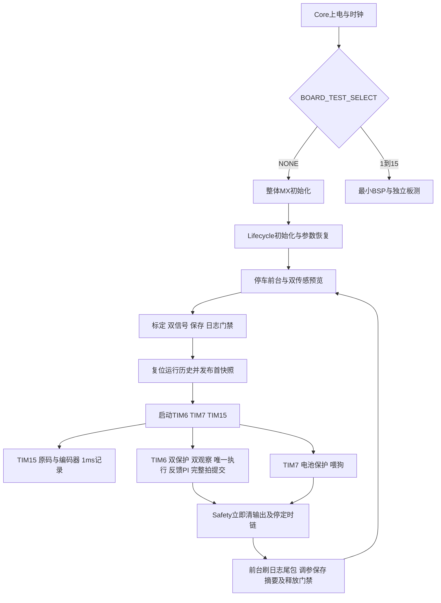

# 功能与模块架构

前层治理约束完整 Phase 的需求、详细设计、决定、映射、计划与验收；Docs 与当前代码语义对应。功能索引见[traceability](traceability.md)。

Core启动/IRQ→BSP固定分发→App薄入口→system编排；sensing提供输入，control观察/执行，services参数/日志/通信，hmi交互。无RTOS、堆或通用事件总线。

## 状态与依赖

- lifecycle起停与模式；safety首因/pending；battery与各传感器私有历史。
- tracking完整拍及监视量；两FSM独立历史；pid增益可见输出、各控制器历史；motor反馈/执行。
- bank/store镜像不反调使用者；system应用协调；tuning纯业务不依赖SCB。
- run_record快照、logger队列/会话、log_store唯一Flash后端、log_export互斥缓存。
- link持协议会话，dispatch业务适配，telemetry独立上传；menu/keys/render/dashboard各持所属状态。
- TIM15/TIM6同级不抢占，队列写完再发布；需要事务用原复制/短锁，const地址不是原子快照。

## 模块到主功能页

每行登记真实物理C/H及主功能；到功能页再看具体函数/状态/错误路径。Core整文件登记为生成/用户区边界，不表示生成区属于自维护。厂商ST7735/font/Drivers作为第三方边界，不列入自维护完整性。

| 模块文件 | 主条目 | 边界 |
|---|---|---|
| `App/app.c` | [F01 初始化与三线调度](system/runtime-and-safety.md#f01) | 自维护 |
| `App/app.h` | [F01 初始化与三线调度](system/runtime-and-safety.md#f01) | 自维护 |
| `App/app_config.h` | [F01 初始化与三线调度](system/runtime-and-safety.md#f01) | 自维护 |
| `App/app_types.h` | [F01 初始化与三线调度](system/runtime-and-safety.md#f01) | 自维护 |
| `App/control/angle_controller.c` | [F08 方向角度速度与执行](control/controllers.md#f08-angle) | 自维护 |
| `App/control/angle_controller.h` | [F08 方向角度速度与执行](control/controllers.md#f08-angle) | 自维护 |
| `App/control/control_profile.c` | [F12 部分配置与全局调参规划](control/profiles.md#f12) | 自维护 |
| `App/control/control_profile.h` | [F12 部分配置与全局调参规划](control/profiles.md#f12) | 自维护 |
| `App/control/direction_controller.c` | [F08 方向角度速度与执行](control/controllers.md#f08-direction) | 自维护 |
| `App/control/direction_controller.h` | [F08 方向角度速度与执行](control/controllers.md#f08-direction) | 自维护 |
| `App/control/electromagnetic_fsm.c` | [F09 活动电磁元素](control/elements-and-dormant-code.md#f09) | 自维护 |
| `App/control/electromagnetic_fsm.h` | [F09 活动电磁元素](control/elements-and-dormant-code.md#f09) | 自维护 |
| `App/control/legacy_control.c` | [F13 legacy与未接入元素](control/elements-and-dormant-code.md#f13) | 自维护 |
| `App/control/legacy_control.h` | [F13 legacy与未接入元素](control/elements-and-dormant-code.md#f13) | 自维护 |
| `App/control/legacy_element.c` | [F13 legacy与未接入元素](control/elements-and-dormant-code.md#f13) | 自维护 |
| `App/control/legacy_element.h` | [F13 legacy与未接入元素](control/elements-and-dormant-code.md#f13) | 自维护 |
| `App/control/legacy_pid.c` | [F13 legacy与未接入元素](control/elements-and-dormant-code.md#f13) | 自维护 |
| `App/control/legacy_pid.h` | [F13 legacy与未接入元素](control/elements-and-dormant-code.md#f13) | 自维护 |
| `App/control/legacy_roundabout.c` | [F13 legacy与未接入元素](control/elements-and-dormant-code.md#f13) | 自维护 |
| `App/control/legacy_roundabout.h` | [F13 legacy与未接入元素](control/elements-and-dormant-code.md#f13) | 自维护 |
| `App/control/motor.c` | [F08 方向角度速度与执行](control/motor-execution.md#f08-motor) | 自维护 |
| `App/control/motor.h` | [F08 方向角度速度与执行](control/motor-execution.md#f08-motor) | 自维护 |
| `App/control/optical_fsm.c` | [F10 光电状态机](control/tracking-modes.md#f10) | 自维护 |
| `App/control/optical_fsm.h` | [F10 光电状态机](control/tracking-modes.md#f10) | 自维护 |
| `App/control/pid.c` | [F08 方向角度速度与执行](control/controllers.md#f08) | 自维护 |
| `App/control/pid.h` | [F08 方向角度速度与执行](control/controllers.md#f08) | 自维护 |
| `App/control/speed_controller.c` | [F08 方向角度速度与执行](control/controllers.md#f08-speed) | 自维护 |
| `App/control/speed_controller.h` | [F08 方向角度速度与执行](control/controllers.md#f08-speed) | 自维护 |
| `App/control/tracking.c` | [F11 双FSM与唯一执行](control/tracking-modes.md#f11) | 自维护 |
| `App/control/tracking.h` | [F11 双FSM与唯一执行](control/tracking-modes.md#f11) | 自维护 |
| `App/control/tuning.c` | [F18 完整拍临时调参](services/runtime-tuning.md#f18) | 自维护 |
| `App/control/tuning.h` | [F18 完整拍临时调参](services/runtime-tuning.md#f18) | 自维护 |
| `App/control/tuning_values.c` | [F18 完整拍临时调参](services/runtime-tuning.md#f18) | 自维护 |
| `App/control/tuning_values.h` | [F18 完整拍临时调参](services/runtime-tuning.md#f18) | 自维护 |
| `App/hmi/dashboard.c` | [F14 菜单按键与显示](hmi/operation.md#f14) | 自维护 |
| `App/hmi/dashboard.h` | [F14 菜单按键与显示](hmi/operation.md#f14) | 自维护 |
| `App/hmi/menu.c` | [F14 菜单按键与显示](hmi/operation.md#f14) | 自维护 |
| `App/hmi/menu.h` | [F14 菜单按键与显示](hmi/operation.md#f14) | 自维护 |
| `App/hmi/menu_keys.c` | [F14 菜单按键与显示](hmi/operation.md#f14) | 自维护 |
| `App/hmi/menu_keys.h` | [F14 菜单按键与显示](hmi/operation.md#f14) | 自维护 |
| `App/hmi/menu_render.c` | [F14 菜单按键与显示](hmi/operation.md#f14) | 自维护 |
| `App/hmi/menu_render.h` | [F14 菜单按键与显示](hmi/operation.md#f14) | 自维护 |
| `App/sensing/battery.c` | [F03 低压持续判定](system/runtime-and-safety.md#f03) | 自维护 |
| `App/sensing/battery.h` | [F03 低压持续判定](system/runtime-and-safety.md#f03) | 自维护 |
| `App/sensing/filter.c` | [F05 电感偏差与对称度](sensing/sensors-and-calibration.md#filters) | 自维护 |
| `App/sensing/filter.h` | [F05 电感偏差与对称度](sensing/sensors-and-calibration.md#filters) | 自维护 |
| `App/sensing/gray_calibration.h` | [F06 灰度采集标定与质心](sensing/grayscale.md#parameters) | 自维护 |
| `App/sensing/gray_sensor.c` | [F06 灰度采集标定与质心](sensing/grayscale.md#f06) | 自维护 |
| `App/sensing/gray_sensor.h` | [F06 灰度采集标定与质心](sensing/grayscale.md#f06) | 自维护 |
| `App/sensing/imu_proc.c` | [F07 IMU校准滤波与积分](sensing/attitude.md#f07) | 自维护 |
| `App/sensing/imu_proc.h` | [F07 IMU校准滤波与积分](sensing/attitude.md#f07) | 自维护 |
| `App/sensing/legacy_imu.c` | [F07 IMU校准滤波与积分](sensing/attitude.md#f07) | 自维护 |
| `App/sensing/legacy_imu.h` | [F07 IMU校准滤波与积分](sensing/attitude.md#f07) | 自维护 |
| `App/sensing/track_sensor.c` | [F05 电感偏差与对称度](sensing/electromagnetic.md#f05) | 自维护 |
| `App/sensing/track_sensor.h` | [F05 电感偏差与对称度](sensing/electromagnetic.md#f05) | 自维护 |
| `App/services/checksum.c` | [F23 SCB帧JSON与命令](services/communication.md#f23) | 自维护 |
| `App/services/checksum.h` | [F23 SCB帧JSON与命令](services/communication.md#f23) | 自维护 |
| `App/services/command_dispatch.c` | [F23 SCB帧JSON与命令](services/communication.md#f23) | 自维护 |
| `App/services/command_dispatch.h` | [F23 SCB帧JSON与命令](services/communication.md#f23) | 自维护 |
| `App/services/datalog.h` | [F19 日志格式容量](services/recording-and-export.md#f19) | 自维护 |
| `App/services/log_export.c` | [F22 二进制流式导出](services/recording-and-export.md#f22) | 自维护 |
| `App/services/log_export.h` | [F22 二进制流式导出](services/recording-and-export.md#f22) | 自维护 |
| `App/services/log_store.c` | [F20 队列前台写入与故障](services/recording-and-export.md#f20) | 自维护 |
| `App/services/log_store.h` | [F20 队列前台写入与故障](services/recording-and-export.md#f20) | 自维护 |
| `App/services/logger.c` | [F20 队列前台写入与故障](services/recording-and-export.md#f20) | 自维护 |
| `App/services/logger.h` | [F20 队列前台写入与故障](services/recording-and-export.md#f20) | 自维护 |
| `App/services/parameter_bank.c` | [F16 参数v3格式](services/parameters.md#f16) | 自维护 |
| `App/services/parameter_bank.h` | [F16 参数v3格式](services/parameters.md#f16) | 自维护 |
| `App/services/parameter_image.h` | [F16 参数v3格式](services/parameters.md#f16) | 自维护 |
| `App/services/parameter_store.c` | [F17 迁移保存与失败](services/parameters.md#f17) | 自维护 |
| `App/services/parameter_store.h` | [F17 迁移保存与失败](services/parameters.md#f17) | 自维护 |
| `App/services/run_record.c` | [F19 日志格式容量](services/recording-and-export.md#f19) | 自维护 |
| `App/services/run_record.h` | [F19 日志格式容量](services/recording-and-export.md#f19) | 自维护 |
| `App/services/scb_command_codec.c` | [F23 SCB帧JSON与命令](services/communication.md#f23) | 自维护 |
| `App/services/scb_command_codec.h` | [F23 SCB帧JSON与命令](services/communication.md#f23) | 自维护 |
| `App/services/scb_frame.c` | [F23 SCB帧JSON与命令](services/communication.md#f23) | 自维护 |
| `App/services/scb_frame.h` | [F23 SCB帧JSON与命令](services/communication.md#f23) | 自维护 |
| `App/services/scb_json.c` | [F23 SCB帧JSON与命令](services/communication.md#f23) | 自维护 |
| `App/services/scb_json.h` | [F23 SCB帧JSON与命令](services/communication.md#f23) | 自维护 |
| `App/services/scb_link.c` | [F24 会话可靠传输与回绕](services/communication.md#f24) | 自维护 |
| `App/services/scb_link.h` | [F24 会话可靠传输与回绕](services/communication.md#f24) | 自维护 |
| `App/services/telemetry.c` | [F25 独立上传](services/communication.md#f25) | 自维护 |
| `App/services/telemetry.h` | [F25 独立上传](services/communication.md#f25) | 自维护 |
| `App/services/wireless.c` | [F15 多入口参数应用](services/parameters.md#f15) | 自维护 |
| `App/services/wireless.h` | [F15 多入口参数应用](services/parameters.md#f15) | 自维护 |
| `App/system/lifecycle.c` | [F02 起停、模式与首因](system/runtime-and-safety.md#f02) | 自维护 |
| `App/system/lifecycle.h` | [F02 起停、模式与首因](system/runtime-and-safety.md#f02) | 自维护 |
| `App/system/parameter_application.c` | [F15 多入口参数应用](services/parameters.md#f15) | 自维护 |
| `App/system/parameter_application.h` | [F15 多入口参数应用](services/parameters.md#f15) | 自维护 |
| `App/system/safety.c` | [F02 起停、模式与首因](system/runtime-and-safety.md#f02) | 自维护 |
| `App/system/safety.h` | [F02 起停、模式与首因](system/runtime-and-safety.md#f02) | 自维护 |
| `App/system/scheduler.c` | [F01 初始化与三线调度](system/runtime-and-safety.md#f01) | 自维护 |
| `App/system/scheduler.h` | [F01 初始化与三线调度](system/runtime-and-safety.md#f01) | 自维护 |
| `App/system/tuning_application.c` | [F18 完整拍临时调参](services/runtime-tuning.md#f18) | 自维护 |
| `App/system/tuning_application.h` | [F18 完整拍临时调参](services/runtime-tuning.md#f18) | 自维护 |
| `BSP/bsp.h` | [F29 时钟DMA采样与驱动](platform/board-and-bsp.md#f29) | 自维护 |
| `BSP/bsp_adc.c` | [F26 ADC编码器PWM](platform/adc.md#f26-adc) | 自维护 |
| `BSP/bsp_adc.h` | [F26 ADC编码器PWM](platform/adc.md#f26-adc) | 自维护 |
| `BSP/bsp_dl1b.c` | [F28 DL1B阻塞边界](platform/dl1b.md#f28) | 自维护 |
| `BSP/bsp_dl1b.h` | [F28 DL1B阻塞边界](platform/dl1b.md#f28) | 自维护 |
| `BSP/bsp_encoder.c` | [F26 ADC编码器PWM](platform/encoders.md#f26-encoder) | 自维护 |
| `BSP/bsp_encoder.h` | [F26 ADC编码器PWM](platform/encoders.md#f26-encoder) | 自维护 |
| `BSP/bsp_flash.c` | [F17 迁移保存与失败](platform/w25q64-and-flash.md#f29-flash) | 自维护 |
| `BSP/bsp_flash.h` | [F17 迁移保存与失败](platform/w25q64-and-flash.md#f29-flash) | 自维护 |
| `BSP/bsp_gray.c` | [F29 时钟DMA采样与驱动](platform/adc.md#gray-raw) | 自维护 |
| `BSP/bsp_gray.h` | [F29 时钟DMA采样与驱动](platform/adc.md#gray-raw) | 自维护 |
| `BSP/bsp_imu660rb.c` | [F29 时钟DMA采样与驱动](platform/imu660rb.md#f29-imu) | 自维护 |
| `BSP/bsp_imu660rb.h` | [F29 时钟DMA采样与驱动](platform/imu660rb.md#f29-imu) | 自维护 |
| `BSP/bsp_key.c` | [F14 菜单按键与显示](hmi/operation.md#f14) | 自维护 |
| `BSP/bsp_key.h` | [F14 菜单按键与显示](hmi/operation.md#f14) | 自维护 |
| `BSP/bsp_lcd.c` | [F29 时钟DMA采样与驱动](platform/lcd.md#f29-lcd) | 自维护 |
| `BSP/bsp_lcd.h` | [F29 时钟DMA采样与驱动](platform/lcd.md#f29-lcd) | 自维护 |
| `BSP/bsp_pwm.c` | [F26 ADC编码器PWM](platform/pwm-and-direction.md#f26-pwm) | 自维护 |
| `BSP/bsp_pwm.h` | [F26 ADC编码器PWM](platform/pwm-and-direction.md#f26-pwm) | 自维护 |
| `BSP/bsp_runtime.c` | [F29 时钟DMA采样与驱动](platform/clocks-and-dma.md#f29-clock-dma) | 自维护 |
| `BSP/bsp_runtime.h` | [F29 时钟DMA采样与驱动](platform/clocks-and-dma.md#f29-clock-dma) | 自维护 |
| `BSP/bsp_sampler.c` | [F29 时钟DMA采样与驱动](platform/sampler.md#f29-sampler) | 自维护 |
| `BSP/bsp_sampler.h` | [F29 时钟DMA采样与驱动](platform/sampler.md#f29-sampler) | 自维护 |
| `BSP/bsp_time.c` | [F29 时钟DMA采样与驱动](platform/clocks-and-dma.md#f29-clock-dma) | 自维护 |
| `BSP/bsp_time.h` | [F29 时钟DMA采样与驱动](platform/clocks-and-dma.md#f29-clock-dma) | 自维护 |
| `BSP/bsp_uart.c` | [F27 UART失败返回](platform/uart.md#f27) | 自维护 |
| `BSP/bsp_uart.h` | [F27 UART失败返回](platform/uart.md#f27) | 自维护 |
| `BSP/bsp_w25q64.c` | [F17 迁移保存与失败](platform/w25q64-and-flash.md#f29-flash) | 自维护 |
| `BSP/bsp_w25q64.h` | [F17 迁移保存与失败](platform/w25q64-and-flash.md#f29-flash) | 自维护 |
| `BSP/bsp_wdt.c` | [F01 初始化与三线调度](system/runtime-and-safety.md#f01) | 自维护 |
| `BSP/bsp_wdt.h` | [F01 初始化与三线调度](system/runtime-and-safety.md#f01) | 自维护 |
| `BSP/bsp_wifi.c` | [F29 时钟DMA采样与驱动](platform/spi-wifi.md#f29-wifi) | 自维护 |
| `BSP/bsp_wifi.h` | [F29 时钟DMA采样与驱动](platform/spi-wifi.md#f29-wifi) | 自维护 |
| `BSP/lcd/lcd.c` | [F29 时钟DMA采样与驱动](platform/lcd.md#f29-lcd) | 自维护 |
| `BSP/lcd/lcd.h` | [F29 时钟DMA采样与驱动](platform/lcd.md#f29-lcd) | 自维护 |
| `Core/Inc/adc.h` | [具体平台机制](platform/adc.md#f26-adc) | Core生成区/USER CODE分界 |
| `Core/Inc/dma.h` | [F29 时钟DMA采样与驱动](platform/clocks-and-dma.md#f29-clock-dma) | Core生成区/USER CODE分界 |
| `Core/Inc/gpio.h` | [F29 时钟DMA采样与驱动](platform/clocks-and-dma.md#f29-clock-dma) | Core生成区/USER CODE分界 |
| `Core/Inc/i2c.h` | [F29 时钟DMA采样与驱动](platform/clocks-and-dma.md#f29-clock-dma) | Core生成区/USER CODE分界 |
| `Core/Inc/main.h` | [F29 时钟DMA采样与驱动](platform/clocks-and-dma.md#f29-clock-dma) | Core生成区/USER CODE分界 |
| `Core/Inc/spi.h` | [F29 时钟DMA采样与驱动](platform/clocks-and-dma.md#f29-clock-dma) | Core生成区/USER CODE分界 |
| `Core/Inc/stm32h7xx_hal_conf.h` | [F29 时钟DMA采样与驱动](platform/board-and-bsp.md#f29) | Core生成区/USER CODE分界 |
| `Core/Inc/stm32h7xx_it.h` | [F29 时钟DMA采样与驱动](platform/board-and-bsp.md#f29) | Core生成区/USER CODE分界 |
| `Core/Inc/tim.h` | [F29 时钟DMA采样与驱动](platform/clocks-and-dma.md#f29-clock-dma) | Core生成区/USER CODE分界 |
| `Core/Inc/usart.h` | [具体平台机制](platform/uart.md#f27) | Core生成区/USER CODE分界 |
| `Core/Src/adc.c` | [具体平台机制](platform/adc.md#f26-adc) | Core生成区/USER CODE分界 |
| `Core/Src/dma.c` | [F29 时钟DMA采样与驱动](platform/clocks-and-dma.md#f29-clock-dma) | Core生成区/USER CODE分界 |
| `Core/Src/gpio.c` | [F29 时钟DMA采样与驱动](platform/clocks-and-dma.md#f29-clock-dma) | Core生成区/USER CODE分界 |
| `Core/Src/i2c.c` | [F29 时钟DMA采样与驱动](platform/clocks-and-dma.md#f29-clock-dma) | Core生成区/USER CODE分界 |
| `Core/Src/main.c` | [F04 fatal与底层启停失败](system/runtime-and-safety.md#f04) | Core生成区/USER CODE分界 |
| `Core/Src/spi.c` | [F29 时钟DMA采样与驱动](platform/clocks-and-dma.md#f29-clock-dma) | Core生成区/USER CODE分界 |
| `Core/Src/stm32h7xx_hal_msp.c` | [F29 时钟DMA采样与驱动](platform/clocks-and-dma.md#f29-clock-dma) | Core生成区/USER CODE分界 |
| `Core/Src/stm32h7xx_it.c` | [F04 fatal与底层启停失败](system/runtime-and-safety.md#f04) | Core生成区/USER CODE分界 |
| `Core/Src/system_stm32h7xx.c` | [F29 时钟DMA采样与驱动](platform/clocks-and-dma.md#f29-clock-dma) | Core生成区/USER CODE分界 |
| `Core/Src/tim.c` | [F29 时钟DMA采样与驱动](platform/clocks-and-dma.md#f29-clock-dma) | Core生成区/USER CODE分界 |
| `Core/Src/usart.c` | [具体平台机制](platform/uart.md#f27) | Core生成区/USER CODE分界 |

历史P17逐符号迁移JSON继续保留原基线，只作迁移/源码导航，不代替本页功能契约。硬件、Material与Tools独立治理；电脑工具README和桥接当前交付边界见通信功能。

独立板测模块App/system/board_test.c/.h及board_test_config.h、BSP/bsp_board_test.c/.h归[F33](platform/isolated-board-tests.md#f33)，main/唯一IRQ协作映射也由该条维护。

## 启动、完整拍与停车数据流

TIM15与TIM6同级0互不抢占，TIM7级1可被二者抢占；SPI4被IMU采样与LCD共享，正常运行不刷新屏幕。TIM6发布的2ms控制快照供1ms记录重复复制，不能解释为全部字段每1ms同时更新。采样器持原码/编码器窗口；感知持转换状态；FSM持观察配置及历史；Motor/PID持活动执行；生命周期和安全持启动与停车；参数镜像由store持有，活动PI与查询镜像可暂时不同。具体顺序见[运行链](system/runtime-and-safety.md#parameters)。

### 独立板测声明与编译选择补充

| 模块文件 | 主说明 | 边界 |
|---|---|---|
| `App/system/board_test.h` | [F33](platform/isolated-board-tests.md#f33) | 独立入口及ISR声明，正常/测试分流 |
| `App/system/board_test_config.h` | [选择与参数](platform/isolated-board-tests.md#parameters) | 编译0～15选择；本次不修改源码 |
| `BSP/bsp_board_test.h` | [F33最小初始化](platform/isolated-board-tests.md#f33) | 最小初始化/发送返回接口 |
