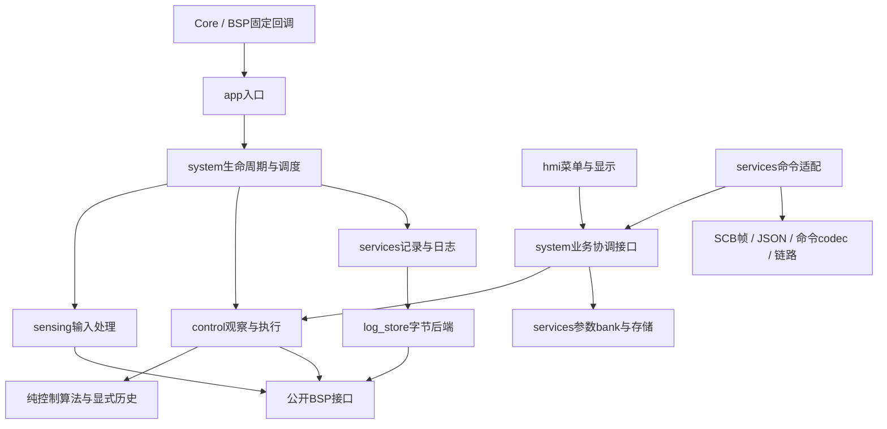

# App 五大类架构与模块边界

文件夹只分 system/sensing/control/services/hmi 五大类，不嵌套。C/H按紧密职责细分，函数执行
具体操作；私有辅助函数保持static。详细接口、失败路径与迁移门禁分别见G2～G6契约，实际验收
状态见[validation.md](validation.md)，本文不把目标结构视为已经通过实车验证。

## 模块导航

每个名称表示同名C/H；只有头文件的条目明确标注。根保留 app.c/app.h、app_config.h、
app_types.h。App五个固定调度入口和停车业务入口仍由Core/BSP调用，app.h不公开HAL类型。

| 目录 | 模块及责任 |
|---|---|
| system | scheduler编排前台与1/2/5ms任务；lifecycle上电/起跑/模式协调；safety首因与立即停车/前台收尾；parameter_application参数应用及保存快照；tuning_application上下文/参数合入/即时发布协调 |
| sensing | track_sensor四电感处理；gray_sensor完整灰度处理链；gray_calibration.h手工标定；imu_proc唯一姿态状态；battery电池采样滤波；filter显式滤波；legacy_imu使用同一owner历史的旧实现 |
| control | tracking双模式观察/选中执行；control_profile部分配置及距离门限；optical_fsm/electromagnetic_fsm独立观察；direction/angle/speed_controller算法；pid增益/输出及薄协调；motor差速/反馈/执行；tuning完整拍事务；tuning_values纯值校验；legacy_control/element/roundabout/pid旧入口 |
| services | parameter_bank四bank；parameter_store镜像/迁移/保存；parameter_image.h布局；run_record快照/组装；logger队列/会话；log_store字节Flash后端；log_export导出；datalog.h业务类型/API聚合；checksum纯CRC32；scb_frame帧；scb_json有界JSON；scb_command_codec命令字段；command_dispatch业务适配；scb_link会话可靠传输；telemetry独立上传；wireless旧串口 |
| hmi | menu页面/编辑/请求；menu_keys采样/按键分类；menu_render只读绘制/显示缓存；dashboard板载仪表盘 |

保留pid薄协调和datalog.h类型聚合是为单一参数/格式定义提供入口，不保留原混合实现。
services使用parameter_/log_/scb_前缀区分内部边界；同目录不允许绕过owner写状态。

## 依赖与硬件边界

- system负责业务协调和调用时点，不实现算法、Flash细节或SCB字段。起停事件通过无协议类型的
  command_dispatch公共入口适配；系统头的App依赖闭包不得带入SCB类型。
- sensing不依赖系统、HMI、通信或记录；纯滤波、控制器与校验不反读车辆状态。方向历史显式
  传入；角度/轮速各自拥有历史。pid仅作增益/可见输出与算法协调，不包含传感器/电机头。
- tracking读取生命周期只读业务量以组织同拍输入，模式切换保存与跨模块reset归lifecycle；
  不把参数存储、菜单或通信路由放回tracking。两套FSM只产观察/配置/复位意图，不执行硬件。
- 参数bank/store/image不依赖其使用者。控制读显式bank，应用协调层才写PID/电机和恢复菜单。
- 记录核心不依赖SCB，通用checksum不依赖帧；raw导出返回日志业务结果及借用字节，dispatch
  映射SCB状态并用codec编码原8B元数据。telemetry是通信适配，仍有自己的传输编码责任。
- App经公开BSP接口接触硬件；BSP聚合头内部HAL依赖作为平台边界，不允许App直接使用HAL、
  CubeMX句柄或寄存器。HAL_TIM_PeriodElapsedCallback唯一固定实现归bsp_runtime。

## 状态所有权与并发

| 唯一owner | 状态 | 读写及一致性约束 |
|---|---|---|
| lifecycle | key/start/run、control_ticks、测距、看门狗生命周期、Flash初始化结果 | 原volatile和独立重读保持；前台启动，控制拍更新，首次停车经命令清标志 |
| safety | stop_pending/首stop_reason/low_count | 首因原PRIMASK区内锁存；保护位在tracking累计；仅前台完成阻塞收尾 |
| battery | raw/filtered/lowpass | 停车前台或TIM7写；起跑不清低通历史；低压策略不在传感器内 |
| track/gray/imu | 各传感器私有状态与历史 | TIM6或停车前台写；灰度失败不覆盖上一整帧；旧IMU借同一状态地址，无第二套历史 |
| tracking | 完整控制拍state和独立监视字段 | 监视输出与state.track_out语义不同，不合并；完整序号、active_error及保护位沿原位置更新 |
| 两套FSM | 各观察阶段、方向历史；电磁另有左右距离与角度 | 同帧推进、历史隔离；复位意图只有当前选中模式应用共享运动基准 |
| control_profile | 七主态表、四环岛表、8000/10000距离门限 | fields未置位组沿用先前值；合并与应用顺序保持 |
| pid / angle / speed / legacy_pid | 增益/输出；角度前拍；左右PI；旧方向与休眠增量历史 | 各状态只有一个owner；ResetAll不新增清休眠增量历史 |
| motor | 基础/目标/反馈/距离/风扇、两个低通 | TIM6执行；紧急停车专用接口立即清目标/活动PI/PWM，风扇由safety协调 |
| parameter_bank / store | 四方向bank；88B镜像、dirty与保存时基 | bank为显式保存来源；镜像与活动PI读值有意不同，实际flush才捕获活动PI及菜单位置 |
| tuning | baseline/pending/last_success/effective/revision/final、即时发布位和单事件槽 | TIM6完整拍提交；前台原短临界区复制final后只清id；单事件槽必须在同上下文即时消费 |
| run_record | 唯一96B快照和256B当前头 | TIM6发布、TIM15复制；两中断同级不抢占，原DMB发布点保留 |
| logger | 1024槽/可用1023、8条batch、head/tail、会话统计/首故障 | TIM15生产、前台消费；Flash成功才推进tail，失败不重试，无Flash ISR |
| log_export | 身份、冻结前缀、租期、最近块及968B缓存、CSV临时对象 | 前台串行；重复块不续租，不重读或重复累计CRC，借用bytes必须同调用内复制 |
| scb_link / telemetry | 请求/可靠帧/事件/会话；256上传槽与索引/drop | 上传和Flash独立消费；上传拥塞只丢上传，Flash故障仍触发原停车 |
| command_dispatch / JSON / codec | 原结果/查询缓存；唯一8层解析栈；命令解析工作区 | 前台串行、无堆；运行事件仍在原发生上下文组装，不增加缓冲队列 |
| menu / keys / render / dashboard | 页面编辑与按键沿；ADC滤波；绘图缓存；仪表时基 | 停车前台执行；渲染只读业务，BACK保存先于导航，RST原早退保留 |

const状态指针不保证跨ISR原子快照：仅沿既有停车/同级契约读取；明确需要一致性的事务用复制
接口及原临界区。不可为目录拆分扩大关中断范围或复制大对象。没有RTOS、堆或通用事件总线。

## 关键流程

1. 初始化：App_Init委托Lifecycle_Init；硬件时钟补丁/定时器/LED经BSP；参数加载与界面恢复的
   副作用按原次序完成。链路初始化→调参初始化→注册业务handler，不因拆分重复初始化。
2. 起跑：停车与导出门禁→立即电机零→标定→新鲜双传感器→待保存参数flush→日志头建立/
   回读→运行历史reset→上传run_id与首快照→灯/标志/按键武装→TIM6/TIM7→TIM15→运行事件→
   首次看门狗或再次喂狗。失败不启用定时链，已发生的保存/采样/擦写不回滚。
3. 2ms控制：原启动门禁→双采样与累计保护→首因优先级停车→测距/姿态→同帧两FSM选择与
   方向计算→即时版本发布→选中模式执行→左右反馈/速度PI/PWM→完整序号/调参提交→即时事件/
   上传版本→日志完整拍发布→900us检查。等待1000/1001拍边界及异常出口按原代码。
4. 1ms记录：门禁/容量/队满→复制完整拍并添同拍采样→独立上传复制→Flash槽内容→DMB→
   head发布。前台每次最多八条写Flash，成功后释放；TIM15/TIM6同优先级，互不抢占。
5. 停车：保护位先累计→原临界区首因/pending/清标志→日志摘要→首次路径取消待调参、清电机、
   回空闲风扇、停采样/TIM6/TIM7、更新停车观察与事件。前台再刷尾包、合成功值、报告、清pending、
   要求按键释放；原主循环顶部及分支二次检查均保留。
6. 模式切换：Lifecycle_TrySetMode校验编号/停车/保存，成功才写mode，再按原顺序复位并应用
   当前参数、回显。同模式仍保存并复位；Tracking_SetMode只执行原单次赋值。
7. 调参：codec转换协议值→dispatch预留结果后路由→应用层在原锁内捕获context→事务待提交→
   TIM6完整拍成功结果与revision→原事件队列/结果缓存。元素暂停恢复和禁用恢复不改基线，停车
   合入last_success后仅尝试一次保存。业务结果枚举不与SCB数值绑定。
8. 日志导出：停车冻结成功written前缀→raw顺序读/最近块复用→CRC32→codec原8B头→可靠结果。
   原10秒进展租期、会话释放、起跑/清日志互斥和CSV格式保持，失败后的原缓冲副作用保留。

关键逐语句契约以[g2-system](g2-system.md)、[g3-control](g3-control.md)、
[g4-parameters-hmi](g4-parameters-hmi.md)、[g5-recording-protocol](g5-recording-protocol.md)为准。
最终逐符号/状态映射由[migration-map](migration-map.md)导航，不能用此概述替代原算法对照。
